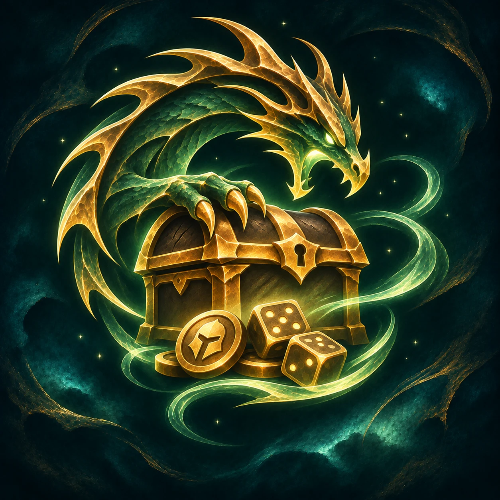
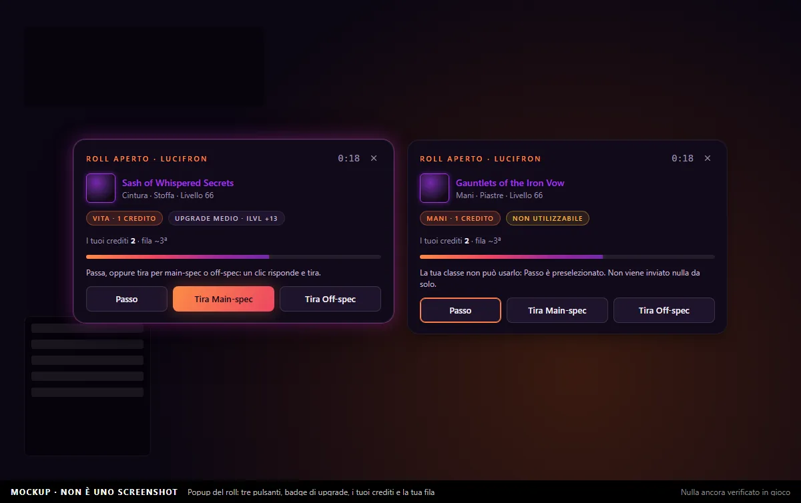
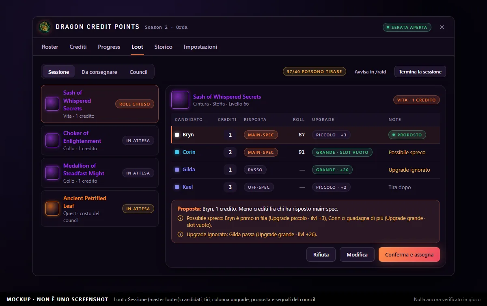
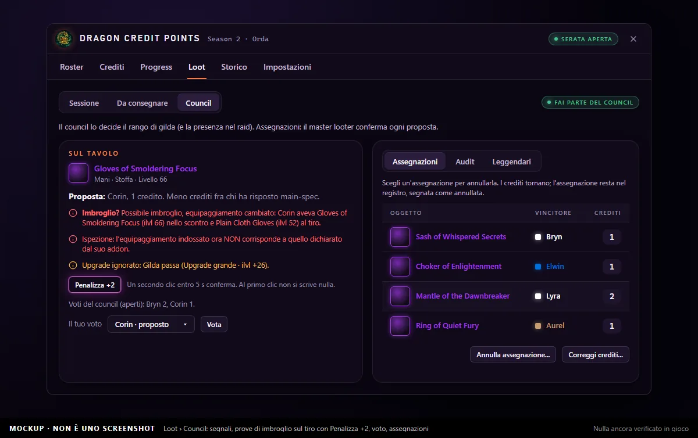
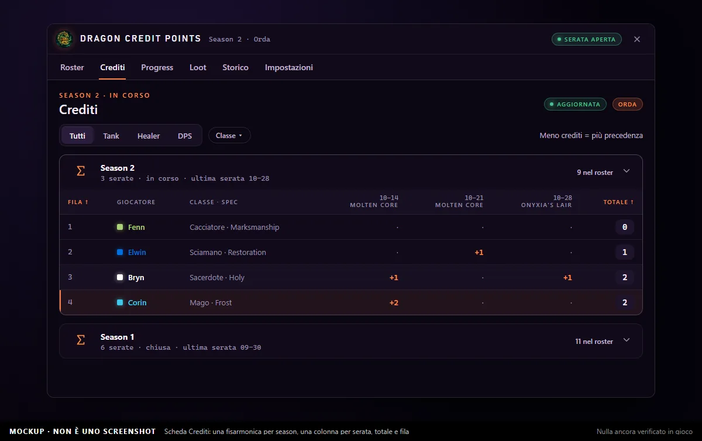
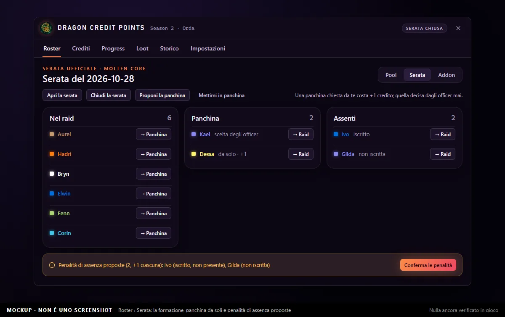
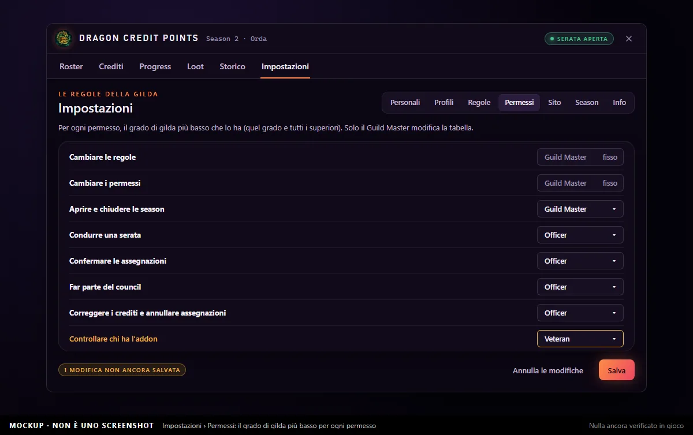
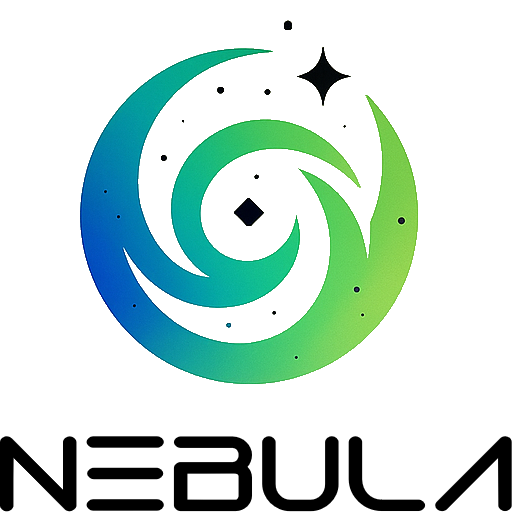

# Finland Dragon Credit Points

**Un sistema di loot a crediti per le gilde di World of Warcraft: Forever.** Finland Dragon Credit Points (FDCP, comando `/fdcp`) gestisce le serate di loot della gilda direttamente nel gioco: il master looter apre un roll per ogni drop, ogni raider risponde main-spec o off-spec da un popup e rolla, e l'addon calcola il vincitore secondo le regole della gilda — meno crediti vince, poi il roll più alto, poi un reroll fra i pari — e scrive a chi va il pezzo, quanti crediti costa e perché. Il master looter conferma, rifiuta o modifica la proposta; il council può intervenire con una motivazione; tutto finisce in un registro di crediti, serate e assegnazioni consultabile da ogni membro.

> **Stato: versione 1.0.3.** Aggiunge il controllo della preparazione del raid: il master looter vede chi non ha incantamenti o consumabili e può avvisare il raid ([Preparazione del raid](docs/wiki/Raid-Readiness-it.md)). La versione 1.0.2 ha aggiunto un'API in sola lettura per gli altri addon ([API per altri addon](docs/wiki/API-for-Addons-it.md)). Tutte le milestone sono costruite e provate offline (1700 test); le verifiche in gioco sono nella [checklist di rilascio](docs/checklists/release.md) e nel client vero non è ancora stato confermato nulla, quindi segnala quello che vedi ([issue](https://github.com/Finland6738/finland-dragon-credit-points/issues)). Si installa dalla [release su GitHub](https://github.com/Finland6738/finland-dragon-credit-points/releases) (vedi [Installazione](docs/wiki/Installation-it.md)); cosa contiene è nel [changelog](CHANGELOG.md).

[English](README.md) · [Roadmap](ROADMAP.md) · [Analisi](docs/ANALISI.md) · [Decisioni](docs/adr/README.md) · [Manuale](docs/wiki/Home-it.md) · [Changelog](CHANGELOG.md)

## Funzioni previste

| Area | Cosa offre |
|---|---|
| **Sessioni di loot** | Drop letti dal corpo, categoria e costo annunciati prima del roll, un popup sul client di ogni raider, `/roll` dal server, tier (prima main-spec, off-spec solo se nessuno lo vuole), reroll automatici fra i pari |
| **Motore delle regole** | Costi per categoria e qualità, eccezioni per oggetto, nuovi arrivati ai crediti più bassi del roster, +1 credito per una serata ufficiale saltata, progetti leggendari, BoE alla banca di gilda; il preset "Patto" della gilda più altri; tutto configurabile dal Guild Master |
| **Registro** | I crediti si calcolano da un registro di eventi firmati: storico, log e audit gratis, e gli officer si sincronizzano senza sovrascriversi |
| **Roster e serate** | Pool della season con main-spec e off-spec dichiarate, main e alt, lineup, rotazione equa della panchina, presenze per boss (solo officer) |
| **Addon obbligatorio** | Chi nel raid non ha l'addon, e un avviso in `/raid` con i nomi in un clic |
| **Prontezza del raid** *(fatta offline, M8-2 e M8-3)* | **Roster › Preparazione** (officer e master looter): il master looter chiede, il client di ogni raider dice i suoi incantamenti mancanti (per slot) e i suoi consumabili (cibo con buff, cibo, acqua, pozioni, flask o elisir, munizioni e cibo per il pet del cacciatore) e una tabella mostra chi è OK, scarso, mancante o ignoto. **Avvisa il raid** scrive un riassunto breve in `/raid` e sussurra a ogni raider cosa gli manca, mai durante un boss, in coda dietro il lockdown della chat, con un'attesa e una conferma. I requisiti e i testi sono regole della gilda (Impostazioni › Regole › Preparazione del raid); non si salva nulla ([ADR 0010](docs/adr/0010-self-reported-transient-readiness.md), wiki [Preparazione del raid](docs/wiki/Raid-Readiness-it.md)) |
| **Badge di upgrade** | Il client di ogni raider confronta il drop con il pezzo indossato durante lo scontro col boss (upgrade piccolo, medio o grande, con la differenza di item level); il council vede "upgrade grande, ha passato" o "possibile spreco" — un indizio, mai una decisione automatica |
| **Council** | Interventi con motivazione obbligatoria, voto facoltativo, annullamenti come eventi di compensazione |
| **Progress** | Prima uccisione di ogni boss per fazione della gilda, come nella scheda Progress del sito della community |
| **API per altri addon** | Un'API in sola lettura e versionata (`FinlandDragonCreditPointsAPI`) per addon come Azeroth Accord: season, pool, crediti e posto in coda, raid e panchina della serata aperta, riassunto delle regole, avvisi di cambiamento; mai le presenze ([wiki](docs/wiki/API-for-Addons-it.md), [ADR 0009](docs/adr/0009-public-read-only-api.md)) |
| **Esportazione** | La tabella dei crediti per Discord, CSV, JSON, e i file `roster.json`, `loot.json` e `progress.json` del sito della community pronti da mettere nel sito ([specifica](docs/specs/site-export.md)) |
| **Interfaccia** | Lo stile del sito della community (tema scuro "Nebula", più un tema chiaro e i colori del logo), schede Roster · Crediti · Progress · Loot · Storico · Impostazioni ([stile e anteprime](docs/specs/ui-style.md)); italiano e inglese, altre lingue aggiungendo un file |

## Anteprime dell'interfaccia

> **Mockup, non screenshot del gioco.** Disegnati dal layout e dai testi dell'addon (`tools/make_mockups.py`), con nomi inventati; nulla è ancora stato verificato in gioco. Altre nel [Giro dell'interfaccia](docs/wiki/Interface-Tour-it.md).

|   |   |   |
|---|---|---|
|  **Popup del roll** |  **Sessione del master looter** |  **Council** |
|  **Crediti** |  **Serata con assenze** |  **Permessi** |

## Requisiti

- Client di World of Warcraft: Forever (Interface 16001).
- Ogni raider deve avere l'addon per rollare, e rolla dal pulsante del popup (un `/roll` scritto a mano non conta).

## Sviluppo

- Un passo della roadmap per sessione e per pull request, pubblicato da `tools/ship_step.py` quando i controlli sono verdi ([ADR 0001](docs/adr/0001-git-flow-and-automated-shipping.md)); vedi [CLAUDE.md](CLAUDE.md) e [ROADMAP.md](ROADMAP.md).
- Controlli: `python -I -X utf8 tools/check_docs.py`.
- La checklist di verifica in gioco di ogni milestone sta in [docs/checklists/](docs/checklists/): [M1](docs/checklists/M1.md), [M3](docs/checklists/M3.md), [M4](docs/checklists/M4.md), [M5](docs/checklists/M5.md), [M6](docs/checklists/M6.md) e [M8](docs/checklists/M8.md), e il percorso del proprietario verso v1.0.0 in [docs/checklists/release.md](docs/checklists/release.md) (ognuna con le voci aperte di ogni passo della sua milestone; quella di M4 è un boss intero, piano A e piano B).
- Il manuale utente è in [docs/wiki/](docs/wiki/Home-it.md) in italiano e inglese e va sulla wiki di GitHub in automatico ([ADR 0002](docs/adr/0002-github-wiki-generated-from-docs-wiki.md)).
- Le fondamenta si copiano e si adattano dal progetto gemello Azeroth Accord (stesso autore, GPL-3.0); in gioco i due addon restano indipendenti, e Accord legge FDCP solo dalla sua API pubblica in sola lettura ([ADR 0009](docs/adr/0009-public-read-only-api.md)).

## Aggiungere una lingua

Una lingua è **un file più una riga in ciascun file TOC**; nessuna modifica al codice:

1. Copia `FinlandDragonCreditPoints/Locale/enUS.lua` in `FinlandDragonCreditPoints/Locale/<codice>.lua` (per esempio `deDE.lua`; il codice è quello della lingua del gioco), cambia la prima riga in `local L = select(2, ...).NewLocale("deDE", "Deutsch")` e traduci ogni stringa. Tieni i segnaposto `%s` / `%d` nello stesso ordine. Le ultime chiavi (`NUMBER_DECIMAL`, `NUMBER_GROUP`, `DATE_SHORT`, `DATE_LONG`, `DATETIME`) stabiliscono i separatori dei decimali e delle migliaia e i formati della data della lingua.
2. Aggiungi `Locale\<codice>.lua` dopo `Locale\itIT.lua` in `FinlandDragonCreditPoints.toc` e in `FinlandDragonCreditPoints_Camelot.toc`.
3. Esegui `python -I -X utf8 tools/check_locale.py`: segnala le chiavi mancanti, quelle che non esistono in inglese, i segnaposto diversi e un file assente dal TOC. Una stringa mancante non rompe l'addon (ricade sull'inglese), ma il controllo vuole ogni chiave tradotta.

Ogni giocatore sceglie la propria lingua con `/fdcp language` (serve un `/reload`); il capogilda sceglie la lingua dei testi mandati a tutti.

## Crediti

  <picture>
    <source media="(prefers-color-scheme: dark)" srcset="assets/nebula-logo-dark.png">
    
  </picture>

Ideato e realizzato da **Finland** per la gilda italiana **NEBULA**, il cui sito della community è <https://nebula-community.github.io/giochi/wow-forever/>. L'addon è libero e open source ([GPL-3.0](LICENSE), codice su <https://github.com/Finland6738/finland-dragon-credit-points>). Se aiuta la tua gilda e ti va di sostenerlo, puoi offrire un caffè su Ko-fi, <https://ko-fi.com/finland6738>; una segnalazione o un'idea nelle [issues](https://github.com/Finland6738/finland-dragon-credit-points/issues) aiuta altrettanto. La stessa pagina è in gioco (**Impostazioni › Info**, o `/fdcp about`) e nel manuale ([Crediti e info](docs/wiki/About-it.md)).

Il logo della community NEBULA è usato con il permesso del proprietario della community e non è coperto dalla licenza del codice (vedi [docs/third-party.md](docs/third-party.md)).

## Licenza

[GNU General Public License v3.0](LICENSE). Addon amatoriale, non affiliato a Blizzard Entertainment.

### Crediti dei font

L'addon include tre famiglie di font con la [SIL Open Font License 1.1](https://openfontlicense.org/) (i testi delle licenze stanno accanto ai file in `FinlandDragonCreditPoints/Media/Fonts/`): **Outfit** (The Outfit Project Authors), **JetBrains Mono** (The JetBrains Mono Project Authors) e **Orbitron** (Matt McInerney, incluso senza modifiche perché dichiara un Reserved Font Name). Font, foglio di icone, texture e librerie sono elencati con le loro licenze in [docs/third-party.md](docs/third-party.md).
