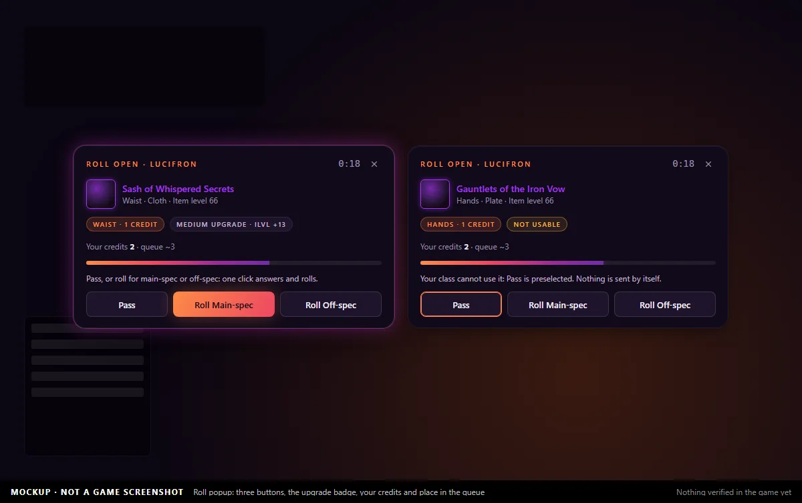
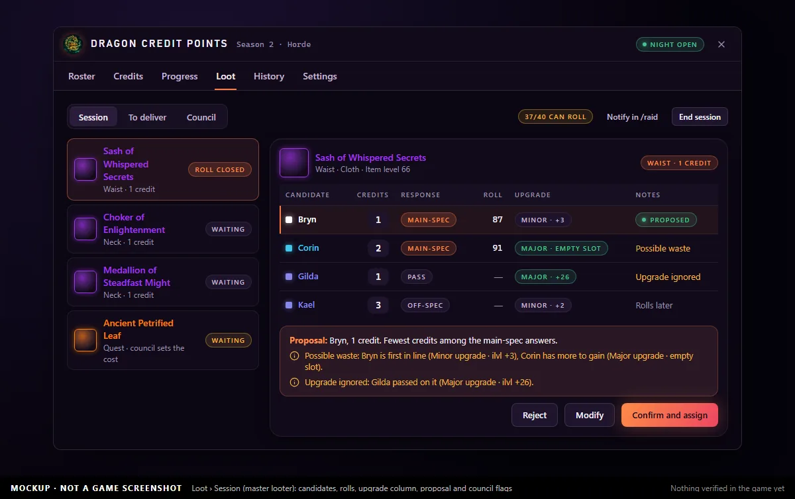
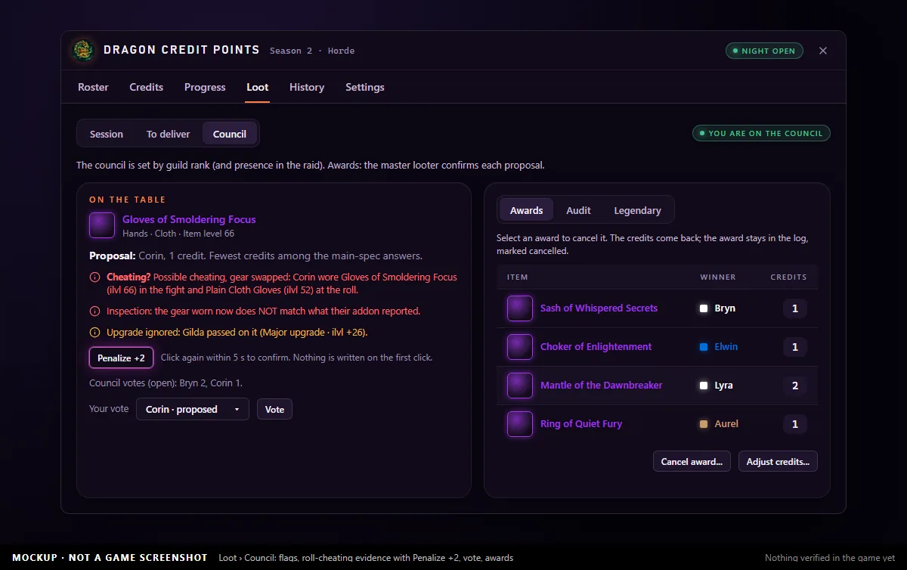
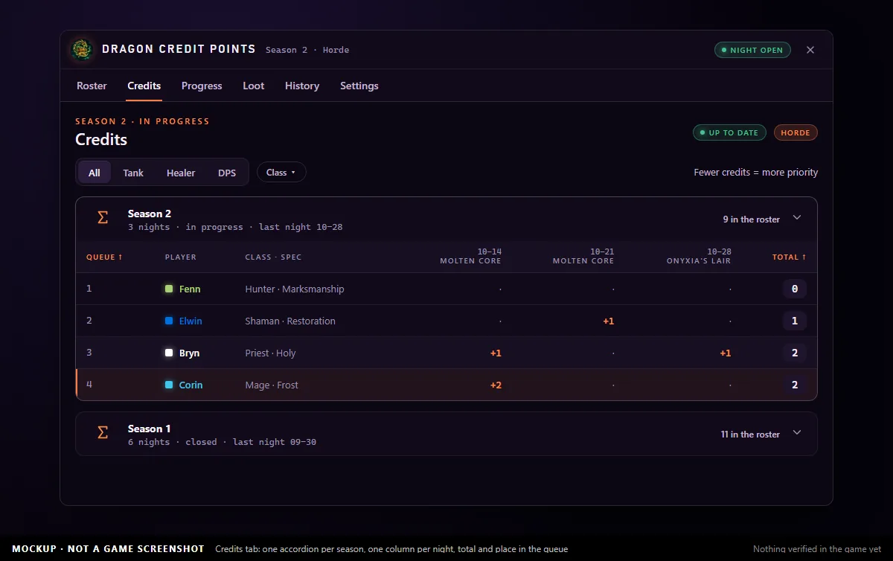
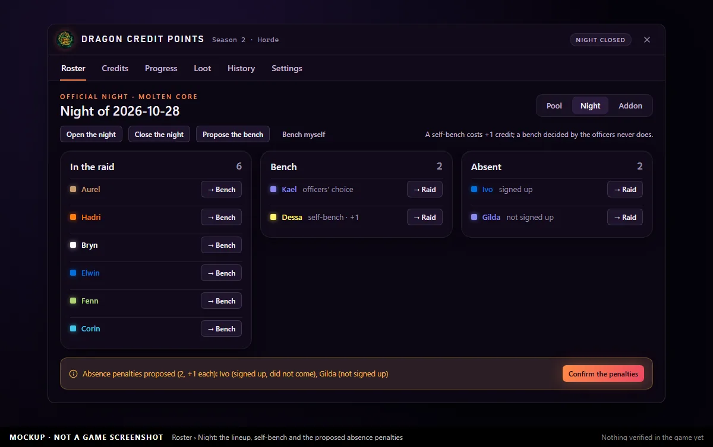
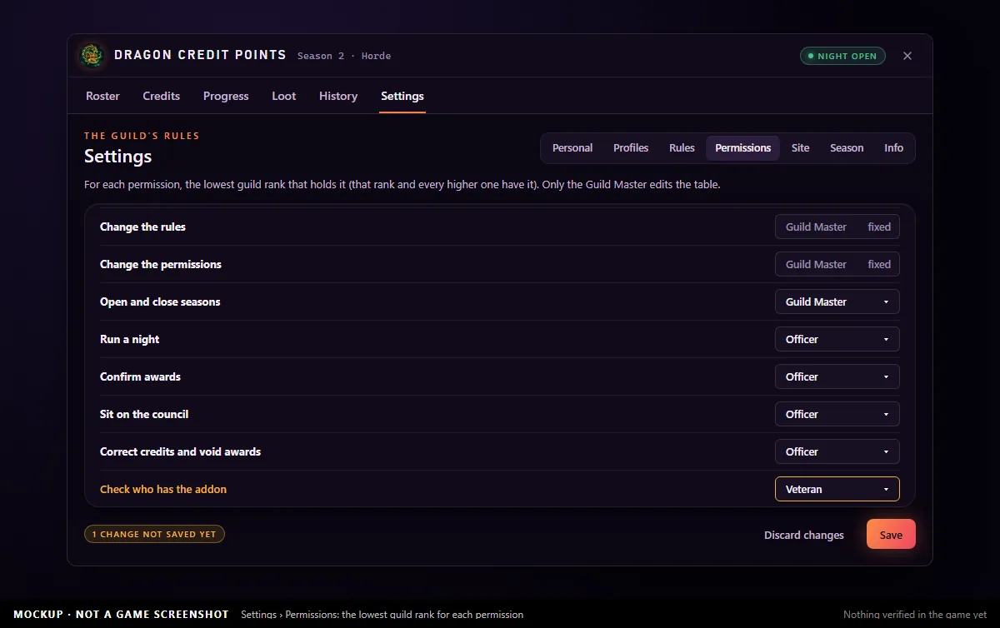
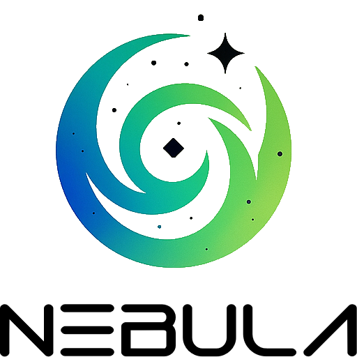

# Finland Dragon Credit Points

**A credit-based loot system for World of Warcraft: Forever guilds.** Finland Dragon Credit Points (FDCP, command `/fdcp`) runs the guild's loot nights from inside the game: the master looter opens a roll for each drop, every raider answers main-spec or off-spec from a popup and rolls, and the addon computes the winner by the guild's rules — fewest credits wins, then the highest roll, then a reroll among the tied — and writes who gets the item, how many credits it costs and why. The master looter confirms, rejects or changes the proposal; the council can step in with a reason; everything lands in a ledger of credits, nights and awards that every member can read.

> **Status: version 1.0.3.** It adds the raid readiness check: the master looter sees who lacks enchants or consumables and can notify the raid ([Raid Readiness](docs/wiki/Raid-Readiness.md)). Version 1.0.2 added a read-only API for other addons ([API for Other Addons](docs/wiki/API-for-Addons.md)). All the milestones are built and tested offline (1700 tests); the in-game checks are listed in the [release checklist](docs/checklists/release.md) and nothing has been confirmed in the real client yet, so please report what you see ([issues](https://github.com/Finland6738/finland-dragon-credit-points/issues)). Install it from the [GitHub release](https://github.com/Finland6738/finland-dragon-credit-points/releases) (see [Installation](docs/wiki/Installation.md)); what is in it is in the [changelog](CHANGELOG.md).

[Italiano](README.it.md) · [Roadmap](ROADMAP.md) · [Analysis (Italian)](docs/ANALISI.md) · [Decisions](docs/adr/README.md) · [User manual](docs/wiki/Home.md) · [Changelog](CHANGELOG.md)

## Planned features

| Area | What you get |
|---|---|
| **Loot sessions** | Drops read from the corpse, category and cost announced before the roll, a popup on every raider's client, server-side `/roll`s, tiers (main-spec first, off-spec only if nobody needs it), automatic rerolls among ties |
| **Rules engine** | Costs per category and quality, per-item overrides, late joiners at the fewest credits of the roster, +1 credit for a missed official night, legendary projects, BoE to the guild bank; the guild's "Patto" preset plus others; everything configurable by the Guild Master |
| **Ledger** | Credits are computed from a ledger of signed events: history, log and audit for free, and officers sync without overwriting each other |
| **Roster and nights** | Season pool with declared main-spec and off-spec, mains and alts, lineup, fair bench rotation, attendance per boss (officers only) |
| **Mandatory addon** | Who in the raid lacks the addon, and a one-click notice in `/raid` with their names |
| **Raid readiness** *(done offline, M8-2 and M8-3)* | **Roster › Readiness** (officers and the master looter): the master looter asks, each raider's own client reports its missing enchants (by slot) and its consumables (buff food, food, water, potions, flasks or elixirs, hunter ammunition and pet food), and one table shows who is OK, low, missing or unknown. **Notify the raid** writes a short summary in `/raid` and whispers each raider exactly what is lacking, never during a boss, queued behind the chat lockdown, with a cooldown and a confirmation. The requirements and the wording are guild rules (Settings › Rules › Raid readiness); nothing is stored ([ADR 0010](docs/adr/0010-self-reported-transient-readiness.md), wiki [Raid Readiness](docs/wiki/Raid-Readiness.md)) |
| **Upgrade badge** | Each raider's client compares the drop with the piece worn during the boss fight (minor, medium or major upgrade, with the item-level difference); the council sees "major upgrade, passed" or "possible waste" — a hint, never an automatic decision |
| **Council** | Interventions with a mandatory reason, an optional vote, voided awards as compensating events |
| **Progress** | First kill of every boss per guild faction, as on the community site's Progress tab |
| **API for other addons** | A read-only, versioned API (`FinlandDragonCreditPointsAPI`) for addons such as Azeroth Accord: season, pool, credits and queue place, the open night's raid and bench, a rules summary, change notifications; never attendance ([wiki](docs/wiki/API-for-Addons.md), [ADR 0009](docs/adr/0009-public-read-only-api.md)) |
| **Export** | The credits table for Discord, CSV, JSON, and the community site's `roster.json`, `loot.json` and `progress.json` ready to drop in ([spec](docs/specs/site-export.md)) |
| **Interface** | The look of the guild community site (dark "Nebula" theme, plus a light theme and the logo's colours), tabs Roster · Credits · Progress · Loot · History · Settings ([style and previews](docs/specs/ui-style.md)); English and Italian, more languages by adding one file |

## Interface previews

> **Mockups, not in-game screenshots.** Drawn from the addon's own layout and texts (`tools/make_mockups.py`), with invented names; nothing has been verified in the game yet. More in the [Interface Tour](docs/wiki/Interface-Tour.md).

|   |   |   |
|---|---|---|
|  **Roll popup** |  **Master looter session** |  **Council** |
|  **Credits** |  **Night with absences** |  **Permissions** |

## Requirements

- World of Warcraft: Forever client (Interface 16001).
- Every raider needs the addon to roll, and rolls from the popup's button (a typed `/roll` does not count).

## Development

- One roadmap step per session and per pull request, shipped by `tools/ship_step.py` when the checks are green ([ADR 0001](docs/adr/0001-git-flow-and-automated-shipping.md)); see [CLAUDE.md](CLAUDE.md) and [ROADMAP.md](ROADMAP.md).
- Checks: `python -I -X utf8 tools/check_docs.py`.
- The in-game checklist of each milestone is in [docs/checklists/](docs/checklists/): [M1](docs/checklists/M1.md), [M3](docs/checklists/M3.md), [M4](docs/checklists/M4.md), [M5](docs/checklists/M5.md), [M6](docs/checklists/M6.md) and [M8](docs/checklists/M8.md), and the owner's path to v1.0.0 in [docs/checklists/release.md](docs/checklists/release.md) (each one with the open items of every step of its milestone; M4's is a whole boss, plan A and plan B).
- The user manual lives in [docs/wiki/](docs/wiki/Home.md) in English and Italian and is published to the GitHub wiki automatically ([ADR 0002](docs/adr/0002-github-wiki-generated-from-docs-wiki.md)).
- Foundations are copied and adapted from the sister project Azeroth Accord (same owner, GPL-3.0); the two addons stay independent in game, and Accord reads FDCP only through its public read-only API ([ADR 0009](docs/adr/0009-public-read-only-api.md)).

## Adding a language

A language is **one file plus one line in each TOC file**; no code changes:

1. Copy `FinlandDragonCreditPoints/Locale/enUS.lua` to `FinlandDragonCreditPoints/Locale/<code>.lua` (for example `deDE.lua`; the code is the game's locale code), change the first line to `local L = select(2, ...).NewLocale("deDE", "Deutsch")` and translate every string. Keep the `%s` / `%d` placeholders in the same order. The last keys (`NUMBER_DECIMAL`, `NUMBER_GROUP`, `DATE_SHORT`, `DATE_LONG`, `DATETIME`) set the decimal and thousands separators and the date patterns of the language.
2. Add `Locale\<code>.lua` after `Locale\itIT.lua` in both `FinlandDragonCreditPoints.toc` and `FinlandDragonCreditPoints_Camelot.toc`.
3. Run `python -I -X utf8 tools/check_locale.py`: it lists missing keys, keys that do not exist in English, different placeholders and a file missing from the TOC. A missing string never breaks the addon (it falls back to English), but the check wants every key translated.

Players can pick their own language with `/fdcp language` (it needs a `/reload`); the guild leader picks the language of the texts sent to everyone.

## Credits

  <picture>
    <source media="(prefers-color-scheme: dark)" srcset="assets/nebula-logo-dark.png">
    
  </picture>

Conceived and made by **Finland** for the Italian guild **NEBULA**, whose community site is at <https://nebula-community.github.io/giochi/wow-forever/>. The addon is free and open source ([GPL-3.0](LICENSE), source at <https://github.com/Finland6738/finland-dragon-credit-points>). If it helps your guild and you would like to support it, you can buy a coffee on Ko-fi, <https://ko-fi.com/finland6738>; a bug report or an idea in the [issues](https://github.com/Finland6738/finland-dragon-credit-points/issues) helps just as much. The same page is in the game (**Settings › Info**, or `/fdcp about`) and in the manual ([About](docs/wiki/About.md)).

The NEBULA community logo is used with the community owner's permission and is not covered by the code's licence (see [docs/third-party.md](docs/third-party.md)).

## Licence

[GNU General Public License v3.0](LICENSE). Fan-made addon, not affiliated with Blizzard Entertainment.

### Font credits

The addon bundles three font families under the [SIL Open Font License 1.1](https://openfontlicense.org/) (the licence texts are next to the files in `FinlandDragonCreditPoints/Media/Fonts/`): **Outfit** (The Outfit Project Authors), **JetBrains Mono** (The JetBrains Mono Project Authors) and **Orbitron** (Matt McInerney, shipped unmodified because it declares a Reserved Font Name). Every font, the icon sheet, the textures and the libraries are listed with their licences in [docs/third-party.md](docs/third-party.md).
