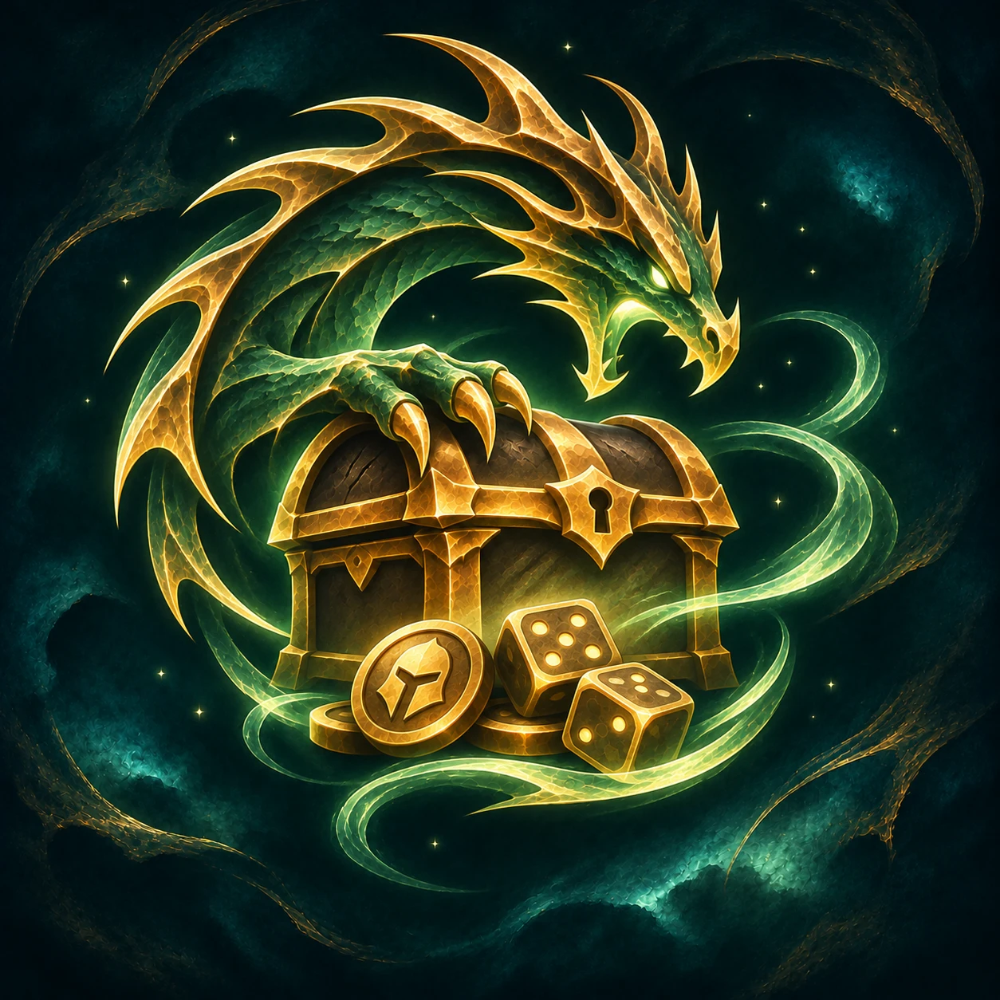

# Finland Dragon Credit Points

**A credit-based loot system for World of Warcraft: Forever guilds.** Finland Dragon Credit Points (FDCP, command `/fdcp`) runs the guild's loot nights from inside the game: the master looter opens a roll for each drop, every raider answers main-spec or off-spec from a popup and rolls, and the addon computes the winner by the guild's rules — fewest credits wins, then the highest roll, then a reroll among the tied — and writes who gets the item, how many credits it costs and why. The master looter confirms, rejects or changes the proposal; the council can step in with a reason; everything lands in a ledger of credits, nights and awards that every member can read.

> **Status: in development, no download yet.** The analysis is done ([docs/ANALISI.md](docs/ANALISI.md), Italian) and the development workflow is in place; the addon is built one roadmap step at a time, starting with a probe for the in-game checks (M0) and the foundations (M1). Nothing has been run in the game yet.

[Italiano](README.it.md) · [Roadmap](ROADMAP.md) · [Analysis (Italian)](docs/ANALISI.md) · [Decisions](docs/adr/README.md) · [User manual](docs/wiki/Home.md) · [Changelog](CHANGELOG.md)

## Planned features

| Area | What you get |
|---|---|
| **Loot sessions** | Drops read from the corpse, category and cost announced before the roll, a popup on every raider's client, server-side `/roll`s, tiers (main-spec first, off-spec only if nobody needs it), automatic rerolls among ties |
| **Rules engine** | Costs per category and quality, per-item overrides, late joiners at the roster average, legendary projects, BoE to the guild bank; the guild's "Patto" preset plus others; everything configurable by the Guild Master |
| **Ledger** | Credits are computed from a ledger of signed events: history, log and audit for free, and officers sync without overwriting each other |
| **Roster and nights** | Season pool with declared main-spec and off-spec, mains and alts, lineup, fair bench rotation, attendance per boss (officers only) |
| **Mandatory addon** | Who in the raid lacks the addon, and a one-click notice in `/raid` with their names |
| **Upgrade hints** | Each raider's client compares the drop with the equipped item; the council sees "big upgrade, passed" or "possible waste" — a hint, never an automatic decision |
| **Council** | Interventions with a mandatory reason, an optional vote, voided awards as compensating events |
| **Export** | The credits table for Discord, CSV, JSON and the community site's `loot.json` |
| **Interface** | Material Design 3 in the colours of the logo; English and Italian, more languages by adding one file |

## Requirements

- World of Warcraft: Forever client (Interface 16001).
- Every raider needs the addon to roll.

## Development

- One roadmap step per session and per pull request, shipped by `tools/ship_step.py` when the checks are green ([ADR 0001](docs/adr/0001-git-flow-and-automated-shipping.md)); see [CLAUDE.md](CLAUDE.md) and [ROADMAP.md](ROADMAP.md).
- Checks: `python -I -X utf8 tools/check_docs.py`.
- The user manual lives in [docs/wiki/](docs/wiki/Home.md) in English and Italian and is published to the GitHub wiki automatically ([ADR 0002](docs/adr/0002-github-wiki-generated-from-docs-wiki.md)).
- Foundations are copied and adapted from the sister project Azeroth Accord (same owner, GPL-3.0); the two addons stay independent in game.

## Licence

[GNU General Public License v3.0](LICENSE). Fan-made addon, not affiliated with Blizzard Entertainment.
