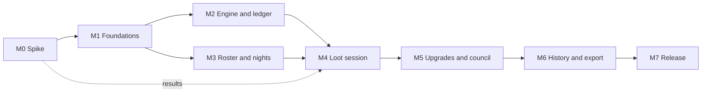

# Development roadmap

One file per milestone; each file lists the **development steps** of that milestone. A step is one session, one branch and one pull request, shipped automatically with `tools/ship_step.py` when its checks are green ([ADR 0001](../adr/0001-git-flow-and-automated-shipping.md)). The short overview and the rules are in [ROADMAP.md](../../ROADMAP.md); the behaviour every step implements is in the [analysis](../ANALISI.md) (Italian).

| Milestone | File | Goal | Steps | Needs the real client |
|---|---|---|---|---|
| **M0** | [M0-spike.md](M0-spike.md) | Workflow, then a probe addon that answers the open technical questions in game | 8 | the probe run (owner) |
| **M1** | [M1-foundations.md](M1-foundations.md) | Addon skeleton, tests, Compat, config, locales, transport, site study, theme, empty window | 9 | final check |
| **M2** | [M2-engine-ledger.md](M2-engine-ledger.md) | Pure rules engine and event ledger, "Patto" preset, the three regulation examples as tests | 7 | no |
| **M3** | [M3-roster-nights.md](M3-roster-nights.md) | Pool, mains and alts, nights, lineup, bench, attendance, first kills, addon check and `/raid` notice, Roster, Credits and Progress tabs | 11 | final check |
| **M4** | [M4-loot-session.md](M4-loot-session.md) | A whole boss run by the addon: collection, popup, rolls, proposal, delivery | 9 | final check |
| **M5** | [M5-upgrades-council.md](M5-upgrades-council.md) | Upgrade hints, council flags and interventions, vote, legendaries, BoE and bank | 8 | final check |
| **M6** | [M6-history-export.md](M6-history-export.md) | History views, log and audit, exports, officer sync, read-only credits for members | 8 | final check |
| **M7** | [M7-release.md](M7-release.md) | Site-style polish, settings, profiles, diagnostics, packaging, manual, v1.0.0 | 8 | beta and release checklist |

## Order and dependencies



M2 and M3 may run in either order after M1 (`docs/ANALISI.md` §12); the files are numbered in the order sessions take them (M2 first, because M3 writes ledger events). M4 depends on M0, M2 and M3.

## The spike and plan B

The spike (M0) needs the real game client, which a session cannot run. Its steps produce a probe addon and the in-game procedure (`docs/spike/README.md`); their result is **"probe ready, results pending owner run"**. Until the owner reports the results, **later steps proceed with plan A plus the plan-B fallbacks of [§11](../ANALISI.md#11-rischi)**:

| If the spike shows… | Plan B already built in |
|---|---|
| master loot missing or limited in Forever raids | priority and ledger work the same; delivery by trade after group loot (M4-7) |
| roll messages (`CHAT_MSG_SYSTEM`) secret inside the instance | sessions only outside encounters; rolls read after the lockdown ends (M4-3) |
| `RAID` addon messages refused in the instance | the send queue waits; sessions only after `ENCOUNTER_END` (M1-6, M4-1) |
| contextual raid stats not read correctly | the verdict stays a hint, never a decision; item level as fallback (M5-1) |

Step M0-7 (*owner*) folds the results into the analysis and the plan once the owner has run the probe; sessions skip it until then.

## How a step is written

```
### M<N>-<k> — Title
- Branch:      step/m<N>-<k>-<short-name>
- Depends on:  previous steps
- Analysis:    the sections of docs/ANALISI.md it implements
- Scope:       what it creates or changes
- Done when:   acceptance criteria (checkboxes; "(in game)" ones stay unticked until the owner confirms)
- Tests:       offline tests that must exist and pass
- Docs:        what to update in the same pull request (wiki in both languages for user-visible changes)
- Real client: what only the game can confirm (listed in the PR and the CHANGELOG as "not verified in game")
- Suggested model/effort: `opus` | `sonnet` | `haiku` / low | medium | high
```

**Suggested model/effort**: `opus` for the domain rules engine, the ledger, trust and permissions, and the network protocol; `sonnet` for UI widgets and windows, adapters, tooling and docs; `haiku` only for trivial, mechanical steps. The hint is advice for whoever starts the session, not a rule.

## Definition of done (every step)

- [ ] The acceptance criteria of the step are met (offline ones ticked; "in game" ones listed as not verified).
- [ ] `python -I -X utf8 tools/check_docs.py` and, from M1-2 on, `python -X utf8 Tests/run_tests.py` pass locally and in CI.
- [ ] `CHANGELOG.md` ("Unreleased"), the affected analysis sections and ADRs, both READMEs when features or status change, and `docs/wiki/` in both languages for anything a user can see are updated in the same pull request.
- [ ] The pull request and the changelog entry list what was **not** verified in the real client.
- [ ] No personal data; every new API is checked against the Forever dump and guarded by Compat.
- [ ] The step's checkboxes in its milestone file are ticked in the same pull request.
