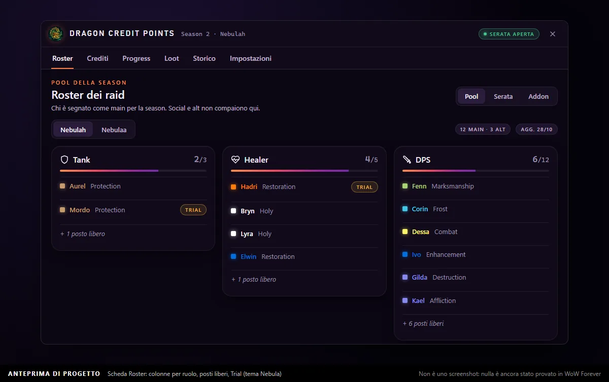
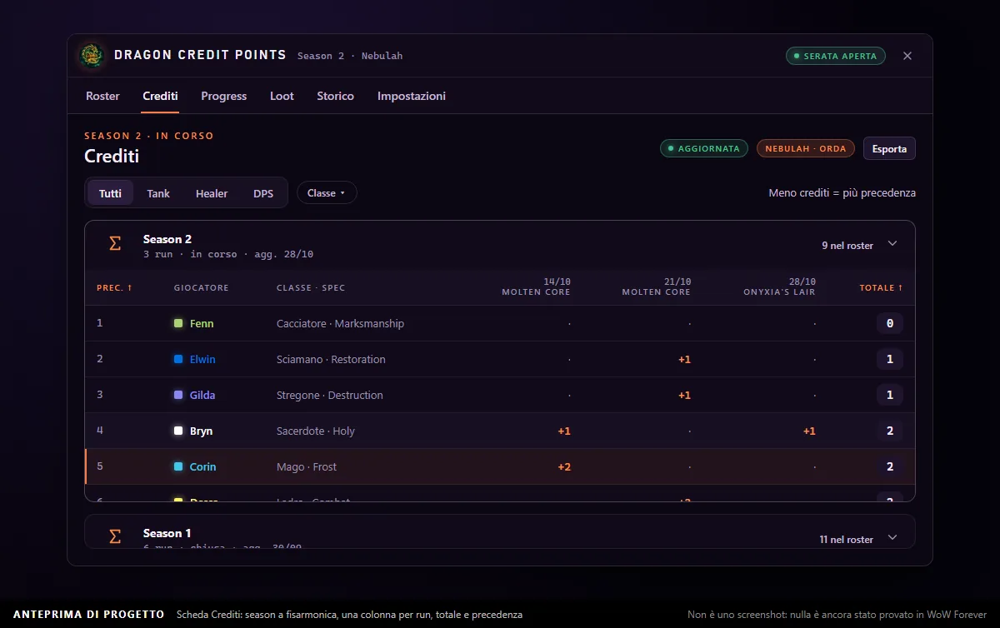
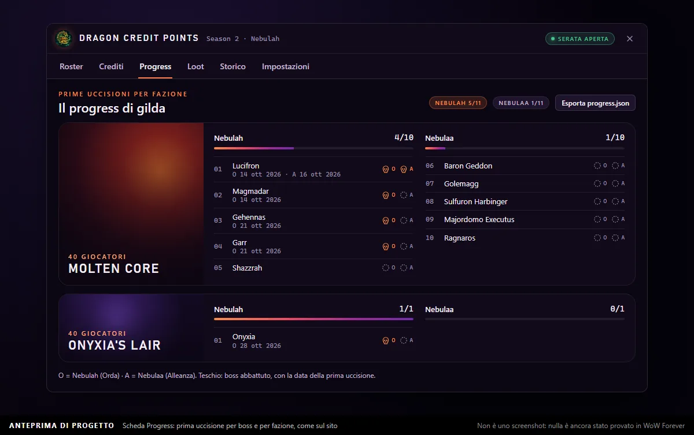
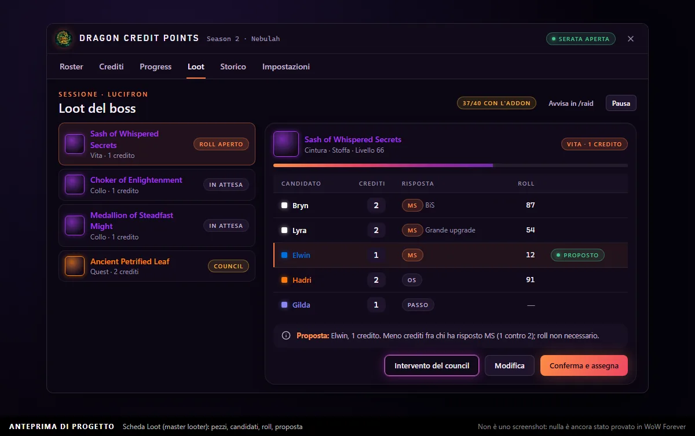
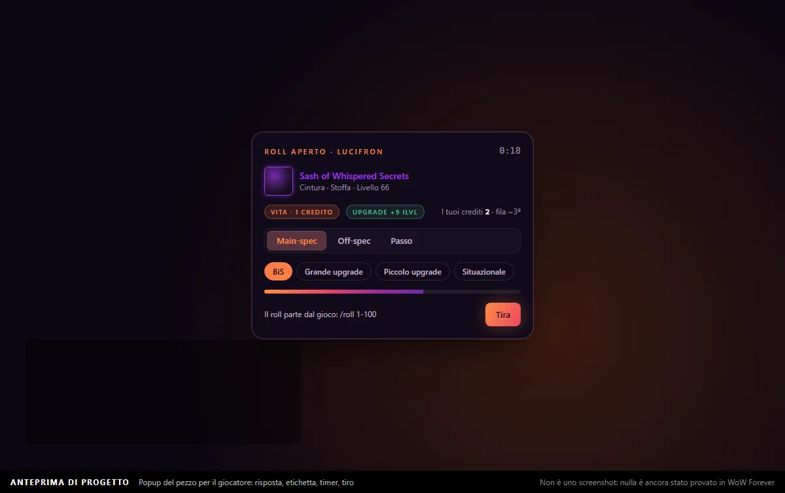
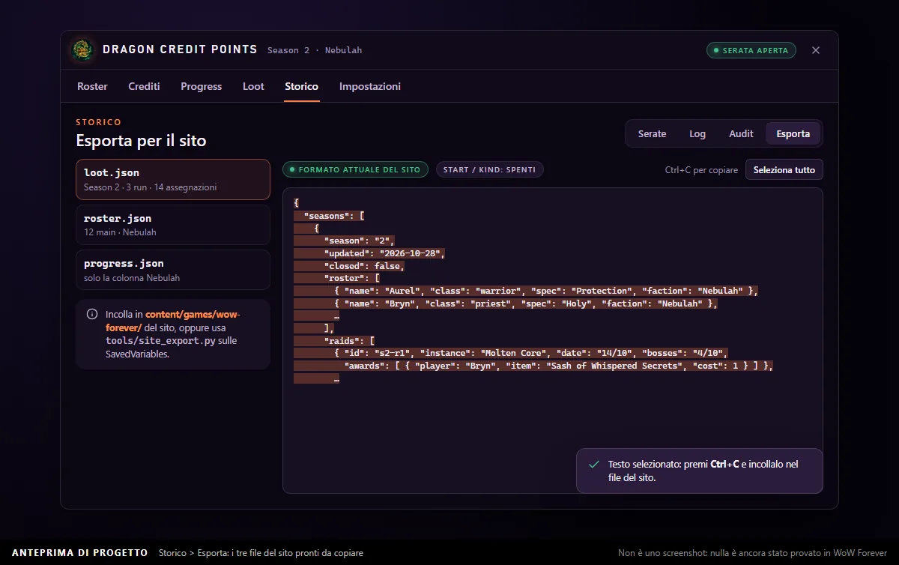
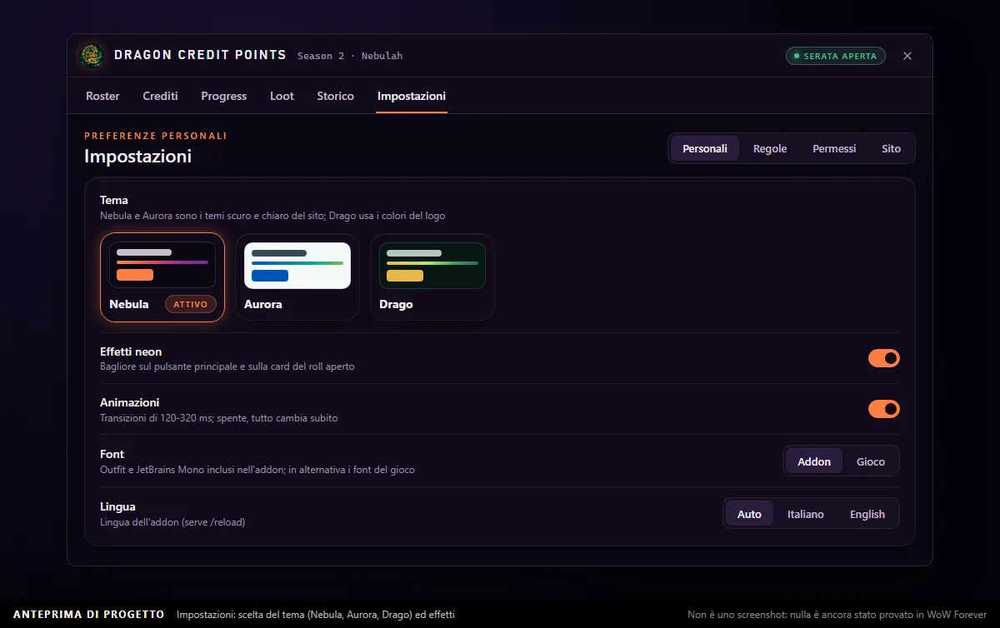
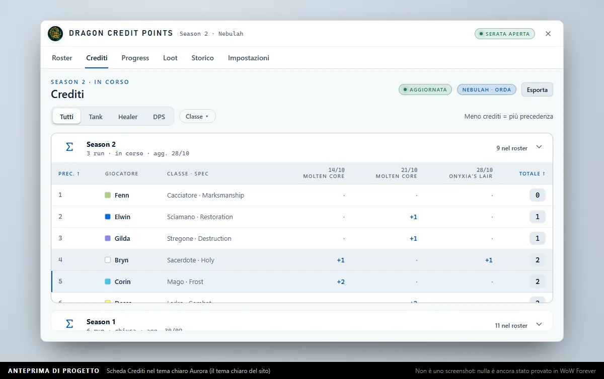
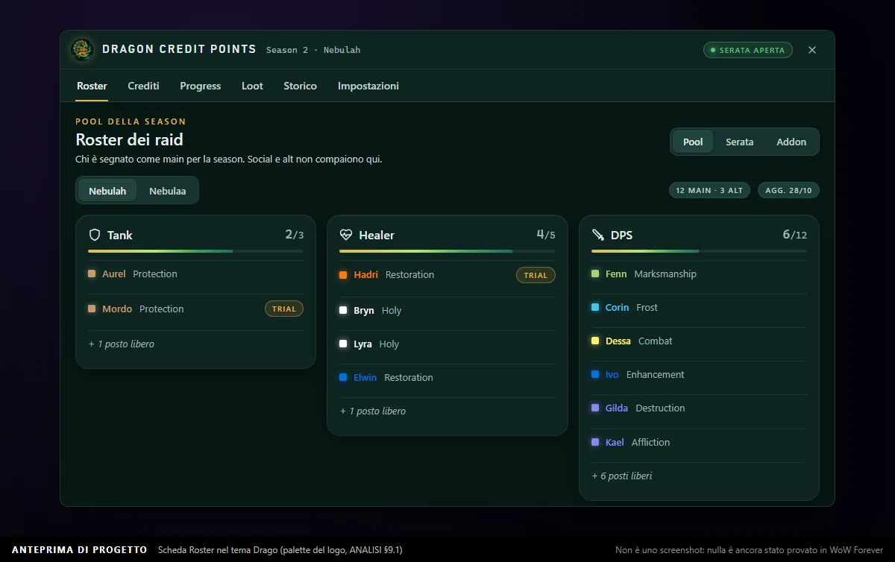
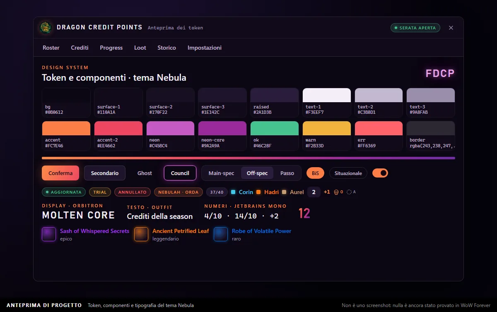

# Stile dell'interfaccia: il sito della community dentro il client

> Specifica del passo **M1-6b** (studio del sito). Vale per M1-7 (tema e finestra vuota), per ogni passo che
> costruisce una finestra (M3-6, M3-7, M3-8, M3-8b, M4-5, M4-6, M5-2, M5-8, M6-1…M6-4, M7-2) e per la rifinitura M7-1.
> Fonte: il sito della community, pagina WoW Forever
> ([nebula-community.github.io/giochi/wow-forever/#loot](https://nebula-community.github.io/giochi/wow-forever/#loot)),
> decisione in [ADR 0004](../adr/0004-interface-style-of-the-community-site.md); sorgente nel repository fratello `../nebula-community/nebula-community` (`src/styles/`, `src/ds/`, `src/kit/Wow.jsx`),
> letto e mai modificato. Formato dei dati esportati: [site-export.md](site-export.md).

## 1. Il gruppo di esperti e la sintesi

Tre ruoli hanno studiato il sito in parallelo, poi le conclusioni sono state riconciliate qui:

| Ruolo | Domanda | Risultato in questa specifica |
|---|---|---|
| Designer web/frontend senior | Qual è il linguaggio visivo del sito: token, componenti, layout di Loot, Roster e Progress? | §2 token, §3 componenti, §6 layout |
| Ingegnere UI di addon WoW (motore 12.0) | Cosa si riproduce nel client, come, a che costo? | §3 colonna "In gioco", §5 verdetti, §7 texture e prestazioni |
| Ingegnere dati/integrazione | Che cosa legge il sito, campo per campo? | [site-export.md](site-export.md) |

**Sintesi.** Il sito è un tema scuro "nebulosa" (fondo viola-nero, accento ambra-corallo, neon magenta usato con
parsimonia), con superfici a gradini, bordi a tre livelli di trasparenza, angoli morbidi, numeri in monospazio,
intestazioni maiuscole spaziate, schede a sottolineatura e barre sottili a gradiente. **Quasi tutto si costruisce in
gioco** con texture bianche tinte a runtime, 9-slice, maschere e `AnimationGroup`. Non si possono fare: la sfocatura
dello sfondo (vetro), la spaziatura fra le lettere, i gradienti con più di due colori senza una texture già pronta, le
curve di animazione a molla. Il carattere del logo del sito (Atomed) **non** si può distribuire; si usa un sostituto
con licenza libera (§4).

**Il sito e il logo.** L'analisi (§9.1) aveva una palette presa dal logo della gilda (verde-nero e oro). Il sito ne ha
un'altra (viola, ambra e magenta). Le due stanno sugli **stessi token**, quindi passare dall'una all'altra non tocca
il codice, solo una tabella di colori. Scelta: il tema predefinito è **Nebula**, i colori scuri del sito, perché la
richiesta è che l'addon somigli al sito. **Aurora** (il tema chiaro del sito) e **Drago** (la palette del logo, ex
§9.1) sono temi selezionabili nelle Impostazioni. Il logo della gilda resta nella barra della finestra e nel pulsante
della minimappa in tutti e tre i temi. La scelta è reversibile: cambia il valore predefinito di un'impostazione.

## 2. Token

I nomi dei token sono quelli che `UI/Theme.lua` userà (M1-7); i valori del tema Nebula e Aurora vengono da
`src/styles/tokens/colors.css` del sito. La stessa tabella alimenta le anteprime (`tools/mockup_lib.py`).

### 2.1 Colori

| Token | Nebula (predefinito, scuro) | Aurora (chiaro) | Drago (logo) | Uso |
|---|---|---|---|---|
| `bg` | `#0B0612` | `#F5F8FA` | `#071715` | fondo della finestra |
| `surface-1` | `#110A1A` | `#FFFFFF` | `#0E2422` | card, barra del titolo, schede |
| `surface-2` | `#170F22` | `#EAF0F4` | `#16332F` | intestazioni di tabella, campi, riga al passaggio del mouse |
| `surface-3` | `#1E142C` | `#E1E9EF` | `#1B3D38` | chip, pastiglia del totale, pulsante secondario |
| `raised` | `#2A1D3B` | `#FFFFFF` | `#22443F` | segmento selezionato, toast |
| `border-subtle` | `rgba(243,238,247,.08)` | `rgba(11,27,43,.07)` | `rgba(230,239,233,.08)` | divisori di riga, bordo card |
| `border` | `rgba(243,238,247,.14)` | `rgba(11,27,43,.13)` | `rgba(230,239,233,.14)` | bordo finestra, campi |
| `border-strong` | `rgba(243,238,247,.26)` | `rgba(11,27,43,.24)` | `rgba(230,239,233,.26)` | card aperta o al passaggio del mouse |
| `text-1` / `text-2` / `text-3` | `#F3EEF7` / `#C3B8D1` / `#9A8FAB` | `#0B1B2B` / `#3C4E60` / `#526476` | `#E6EFE9` / `#C2D3CD` / `#9FB5AE` | testo principale, secondario, attenuato |
| `on-accent` | `#1A0710` | `#FFFFFF` | `#2A1E00` | testo sul pulsante principale |
| `accent` | `#FC7E46` | `#0054B6` | `#E9B949` | selezione, indicatore della scheda, pulsante principale |
| `accent-hover` | `#FDA877` | `#003F8A` | `#F2CD6E` | passaggio del mouse sull'accento |
| `accent-text` | `#FC8C46` | `#0054B6` | `#E9B949` | numeri `+N`, sopratitoli, colonna ordinata |
| `accent-2` | `#EE4662` | `#00766C` | `#3E9E5F` | secondo colore del gradiente del pulsante |
| `neon` / `neon-core` | `#C45BC4` / `#9A2A9A` | `#008F84` / `#009A9A` (M7-1: il `#00A89A` del sito scurito, 3:1 sul fondo chiaro) | `#B8E86A` / `#6FA83A` | un solo elemento neon per vista (council, roll aperto) |
| `ok` / `warn` / `err` | `#46C28F` / `#F2B33D` / `#FF6369` | `#1B7A50` / `#8F5B00` / `#C0262D` | `#5BC17F` / `#F2B33D` / `#FF6B5E` | stati, Trial, annullamenti |
| `grad` | `#FC8C46 → #EE4662 → #9A2A9A → #702AA8` | `#0054B6 → #007EA8 → #00A89A → #70C446` | `#E9B949 → #B8E86A → #3E9E5F → #1F6F5A` | barre sottili, timer |

I colori di classe sono quelli del gioco, come sul sito: guerriero `#C69B6D`, paladino `#F48CBA`, cacciatore
`#AAD372`, ladro `#FFF468`, sacerdote `#FFFFFF`, sciamano `#0070DD`, mago `#3FC7EB`, stregone `#8788EE`, druido
`#FF7C0A` (in gioco si leggono da `C_ClassColor`, non si scrivono a mano). I colori di qualità degli oggetti restano
quelli del gioco. Le fazioni non hanno colore, come sul sito: si distinguono con il nome e con la lettera **O**
(Nebulah, Orda) o **A** (Nebulaa, Alleanza).

### 2.2 Forme, ombre, movimento, spaziatura

| Gruppo | Valori del sito | In gioco |
|---|---|---|
| Raggi | 4 · 8 · 12 · 18 · 28 · pillola | texture 9-slice bianche per 8, 12 e 18 (la finestra usa 12, le card 18, i pulsanti 8); pillola = cerchio tagliato a metà |
| Ombre (scuro) | luce interna di 1 px in alto più un'ombra morbida in basso: "sullo scuro la profondità viene dalla luce" | una riga di 1 px `highlight` in cima alla card più una texture d'ombra sfocata 128 px in 9-slice |
| Ombre (chiaro) | ombre leggere blu-grigie | la stessa texture d'ombra, tinta e più trasparente |
| Bagliori | neon `0 0 18px` più `0 0 48px` magenta; ambra `0 0 24px` sul pulsante principale; testo neon solo nei titoli grandi | texture di bagliore pre-sfocata in fusione additiva (`ADD`) nel tema scuro, ombra normale nel chiaro |
| Durate | 120 · 200 · 320 · 560 ms | 120 ms per stati e pulsanti, 200 ms per schede e chip, 320 ms per pannelli e fisarmonica |
| Curve | ease-out `(.22,1,.36,1)`, molla `(.34,1.4,.64,1)` | solo le curve del gioco (`IN`, `OUT`, `IN_OUT`): `OUT` per tutto, nessuna molla |
| Spaziatura | scala 4 · 8 · 12 · 16 · 20 · 24 · 32 | stessa scala in punti dell'interfaccia; interno finestra 20, distanza fra card 14-16, righe di tabella 8 in verticale |
| Densità | righe di tabella di circa 45 px, testo 15 px | righe di 36-40 px, testo 13 px: la finestra in gioco è più piccola di una pagina |

### 2.3 Tipografia

| Ruolo | Sito | In gioco (FDCP) |
|---|---|---|
| Display (nome dell'addon, nomi delle istanze, numeri grandi) | Atomed, maiuscolo, spaziato | **Orbitron** (OFL 1.1) maiuscolo, 20-26 pt; senza spaziatura fra le lettere (il motore non la ha) |
| Testo | Outfit 300-700 | **Outfit** (OFL 1.1), file statici Regular, Medium, SemiBold |
| Numeri, date, conteggi `4/10`, `+2` | JetBrains Mono | **JetBrains Mono** (OFL 1.1) Regular e Medium |
| Sopratitoli (eyebrow) | 12 px, 500, maiuscolo, `accent-text` | Outfit Medium 11 pt, maiuscolo, `accent-text` |
| Intestazioni di tabella | 11 px, 600, maiuscolo, `text-3` | Outfit SemiBold 10 pt, maiuscolo, `text-3` |
| Ripiego | `system-ui` | i font del gioco (`STANDARD_TEXT_FONT`; Friz Quadrata per i titoli) se un file non si carica |

## 3. Componenti e come si costruiscono in gioco

Tutte le texture sono **bianche** e si tingono con il token (`SetVertexColor`); così un tema è solo una tabella di
colori e nessun file è legato a un tema. Ogni regione tinta si registra in `Theme` (registro a chiavi deboli) e il
cambio di tema la ricolora senza `/reload`. Le API citate sono state controllate nel dump di Forever
(`../WoW-Addons/docs/api.json`); quelle di Blizzard scritte in Lua/XML (ScrollBox, template) non sono nel dump e si
provano in gioco con un ripiego.
Dal passo M1-7 esistono `UI/Assets.lua` (la tabella unica di texture e font), `UI/Theme.lua` (token, registro, font,
`Px()`, forme 9-slice), `UI/Widgets.lua` (Button, Card, Badge, Tabs, Segmented, TitleBar, Dialog) e `UI/MainWindow.lua`;
le texture le genera `tools/make_media.py`.

| Componente (sito) | Anatomia sul sito | In gioco |
|---|---|---|
| **Finestra** | fondo `bg`, bordo `border`, raggio 12, ombra grande | `Frame` con texture 9-slice `rr_fill_12` (fill) + `rr_ring_12` (bordo 1 px) + ombra sfocata; mobile, posizione ricordata per personaggio, Esc chiude |
| **Barra del titolo** | — (il sito ha un'intestazione con il logo) | 52 pt, `surface-1`, logo della gilda tondo con piccolo bagliore ambra, "DRAGON CREDIT POINTS" in Orbitron, sottotitolo mono (season · fazione), chip di stato, chiudi |
| **Schede (underline)** | altezza 44, testo 14/500, scheda attiva `text-1` con barra di 2 px `accent` in basso | pulsanti propri (non `PanelTemplates`), indicatore = texture di 2 pt che scorre in 200 ms (`Translation`) o compare in dissolvenza |
| **Selettore a pillole** (fazione, sotto-schede) | contenitore `surface-2`, segmento attivo `raised` con ombra | 9-slice pillola; segmento attivo con texture `raised` e riga di luce |
| **Card** | `surface-1`, bordo `border-subtle`, raggio 18, ombra 2; al passaggio bordo `border-strong` | fill + ring + ombra (massimo 4 regioni per card); niente inclinazione 3D né bagliore che segue il mouse |
| **Fisarmonica della season** | riga 68 px: icona Σ, titolo, sottotitolo mono, conteggio, freccia che ruota | riga 58 pt; la freccia ruota con `Rotation` 320 ms; il corpo si apre senza animazione dell'altezza (si mostra e si fa scorrere) |
| **Tabella crediti** | intestazioni maiuscole su `surface-2`, colonne ordinabili, prima e ultima colonna fisse, `+N` mono in `accent-text`, totale in pastiglia `surface-3` | intestazione fuori dalla lista; righe in `ScrollBox` con `DataProvider` (ripiego `FauxScrollFrame`); ordinamento nel Domain; colonne fisse = due liste sincronizzate; righe riciclate da un pool |
| **Nome di classe** | nome nel colore della classe con quadratino di 10 px che brilla | FontString colorata + texture quadrata 10 pt con bagliore `ADD` piccolo; nel tema chiaro nome in `text-1` e solo il quadratino colorato |
| **Badge** | pillola 24 px, 11/600 maiuscolo, toni accent/ok/warn/err, punto luminoso | 9-slice pillola dimensionata da `GetStringWidth`; il punto è un cerchio con bagliore |
| **Chip di filtro / etichetta** | pillola 32 px con bordo; selezionata piena `accent` | 9-slice pillola, stato in vertex color |
| **Pulsanti** | principale a gradiente ambra→corallo con bagliore; secondario `surface-3`; ghost; neon con bordo magenta e bagliore | `SetGradient` a due colori sul fill; stati hover 8% e pressed 12% come texture sovrapposta; pressione = `Scale` 0,97 in 120 ms; neon = ring tinto + bagliore `ADD` |
| **Barre sottili** (roster, progress, timer) | 4 px, traccia `border-subtle`, riempimento `grad` | `StatusBar` con `SetGradient` a due colori (primo e terzo colore del gradiente) e punta luminosa `ADD` |
| **Colonne del roster** | tre card (Tank, Healer, DPS), icona del ruolo, conteggio mono `N/obiettivo`, barra, righe con classe e spec, badge Trial, "N posti liberi" in corsivo | identico; icone dei ruoli dall'atlas del gioco se esiste (`C_Texture.GetAtlasExists`), altrimenti dal foglio di icone dell'addon |
| **Card di istanza (Progress)** | copertina 300 px con gradiente scuro e nome in Atomed, corpo con barre per fazione e lista dei boss su due colonne, teschio o cerchio tratteggiato per fazione, data della prima uccisione in mono | copertina = immagine dell'istanza (`EJ_GetInstanceInfo` se il Diario delle avventure esiste su Forever) o una copertina generata (gradiente radiale nel colore dell'istanza); angoli con maschera; teschio e cerchio dal foglio di icone |
| **Tooltip** | invertito (fondo `text-1`, testo `bg`), 13 px | frame proprio dell'addon; `GameTooltip` del gioco solo per gli oggetti (confronto e link) e mai riskinnato |
| **Dialog** | raggio 28, velo sfocato, entrata che sale | velo scuro senza sfocatura, card raggio 18, entrata `Alpha` + `Translation` 320 ms, strato `DIALOG` |
| **Toast / snackbar** | 380 px, `raised`, icona colorata | uguale, in basso a destra della finestra, dissolvenza dopo 4 s |
| **Switch, campi, slider** | switch 44×26, campi `surface-2` | `CheckButton`, `EditBox`, `Slider` su 9-slice; la selezione a tendina è una lista propria (niente `UIDropDownMenu`, causa taint) |
| **Scheletri di caricamento** | luccichio `surface-2`/`surface-3` | rettangoli `surface-2` con `Alpha` ciclica; servono poco (i dati sono locali) |
| **Icone** | Lucide (ISC) come maschere | foglio di icone bianche TGA 256×256 (Lucide ISC o Material Symbols Apache-2.0) con `SetSpriteSheetCell`; `SetSVG` solo dopo una prova in gioco |

## 4. Font: decisione e licenze

- **Atomed**, il carattere del logo del sito, ha nei metadati "Jadatype · 2023 · All Rights Reserved" e il
  repository del sito non contiene una licenza. **Non si distribuisce** in un addon GPL-3.0. Al suo posto, per i
  titoli: **Orbitron** (SIL OFL 1.1), geometrico e largo, il più vicino ad Atomed fra i caratteri liberi. Se Orbitron
  non copre bene gli accenti italiani (da verificare in M1-7), i titoli usano Outfit SemiBold maiuscolo.
- **Outfit** e **JetBrains Mono**, gli stessi del sito, sono SIL OFL 1.1. L'OFL permette di includere i font in
  un software con qualunque licenza, GPL-3.0 compresa, purché il font non sia venduto da solo, il file `OFL.txt` lo
  accompagni e una versione modificata non usi un eventuale "Reserved Font Name". Quindi:
  - file **TTF statici**: le versioni variabili non si usano;
  - sottoinsieme latino (Latin-1, Latin Extended-A, punteggiatura, frecce, `·`) per stare fra 20 e 60 KB per file;
  - prima di creare il sottoinsieme si legge il `Reserved Font Name` di ogni `OFL.txt`: se c'è, si spedisce il file
    intero e non modificato;
  - `FinlandDragonCreditPoints/Media/Fonts/` con un `OFL.txt` per famiglia e la riga di credito nel README.
- **Verifica fatta in M1-7**: Outfit e JetBrains Mono non dichiarano un Reserved Font Name; Orbitron sì
  (`Reserved Font Name: "Orbitron"`), quindi spedisce **intero e non modificato**, nella versione Bold dell'autore
  originale (`theleagueof/orbitron`, 52 KB), con il suo `OFL.txt`. Copre le lettere accentate italiane (àèéìòùÀÈÉÌÒÙ)
  ma non il punto mediano `·` né le frecce: in Orbitron si scrive solo il titolo in maiuscolo. I tre file di Outfit
  (Regular, Medium, SemiBold) e i due di JetBrains Mono (Regular, Medium) sono istanze statiche tagliate dai font
  variabili di Google Fonts con `tools/make_fonts.py` e ridotte al sottoinsieme latino (40-58 KB ciascuno); coprono
  tutti gli accenti. Cartella: `FinlandDragonCreditPoints/Media/Fonts/`, un `*-OFL.txt` per famiglia.
- I file arrivano in **M1-7**, con la verifica di licenza e glifi. Un font nuovo viene letto solo al riavvio del
  client, non dopo `/reload`: lo dice il manuale.
- **Ripiego** sempre attivo: `SetFont` restituisce un esito; se fallisce si usa il font del gioco
  (`STANDARD_TEXT_FONT`). L'impostazione "Font: Addon / Gioco" permette di usare i font del gioco per scelta.

## 5. Verdetto di fattibilità per elemento

| Elemento del sito | Verdetto | Come in gioco | Alternativa se non si può |
|---|---|---|---|
| Colori, superfici a gradini, bordi a tre livelli | **identico** | token + texture bianche tinte | — |
| Angoli arrotondati (8/12/18) | **identico** | 9-slice `SetTextureSliceMargins` | — |
| Bordo neon fermo | **identico** | anello 9-slice tinto + bagliore | — |
| Bagliore esterno (neon, ambra) | **approssimato** | texture pre-sfocata in fusione `ADD`, raggio fisso | — |
| Testo neon (titoli) | **approssimato** | ombra colorata del font + bagliore dietro il titolo; un solo titolo per vista | il nome dell'addon come texture pronta |
| Gradienti a 3-4 colori | **approssimato** | `SetGradient` a due colori; quattro colori solo come striscia TGA pronta | due colori del gradiente |
| Sfocatura dello sfondo (vetro, velo dei dialog) | **non fattibile** | — | superficie quasi opaca; velo scuro senza sfocatura |
| Grana, nebulosa, raggi dell'intestazione | **approssimato** (non usato nelle schede) | texture di rumore ripetuta con alpha < 0,1 | sfondo piatto `bg`, come le schede del sito |
| Schede con indicatore | **identico** | pulsanti propri + texture dell'indicatore | — |
| Selettore a pillole | **identico** | 9-slice | — |
| Card con inclinazione 3D e bagliore che segue il mouse | **non fattibile** (e inutile) | — | bordo `border-strong` al passaggio |
| Fisarmonica con freccia che ruota | **identico** | `Rotation` | — |
| Apertura animata in altezza | **approssimato** | si mostra subito, con dissolvenza | — |
| Tabella con colonne fisse e ordinabili | **identico** | ScrollBox + DataProvider, pool | `FauxScrollFrame` se il template manca |
| Barre sottili a gradiente | **identico** (due colori) | `StatusBar` + `SetGradient` | — |
| Nome di classe con quadratino luminoso | **identico** | FontString + texture + bagliore | — |
| Copertine delle istanze | **approssimato** | immagine del Diario delle avventure o copertina generata | copertine disegnate per l'addon (mai arte di Blizzard copiata nel repository) |
| Teschio / cerchio tratteggiato per fazione | **identico** | foglio di icone | — |
| Tooltip invertito | **approssimato** | frame proprio | — |
| Dialog | **approssimato** | velo senza sfocatura, raggio 18 invece di 28 | — |
| Tema chiaro e scuro dal vivo | **identico** | registro dei token, `Theme.Apply` senza `/reload` | — |
| Font del sito | **identico** per Outfit e JetBrains Mono, **sostituito** per Atomed | TTF inclusi | font del gioco |
| Spaziatura fra le lettere delle intestazioni | **non fattibile** | — | font un punto più grande, maiuscolo |
| Transizioni 120-320 ms | **identico** | `AnimationGroup` `Alpha`, `Scale`, `Translation` | — |
| Curve a molla | **non fattibile** | — | `OUT` |
| Linee di 1 px nette | **identico** | `SetSnapToPixelGrid(false)` + `SetTexelSnappingBias(0)` + un aiuto `Px()` dalla scala effettiva | — |
| Movimento ridotto | **identico** | impostazione "Animazioni: no" | — |
| Riordino responsivo (colonne → una) | **non serve** | la finestra ha una larghezza minima (900 pt) e si ridimensiona solo oltre | — |

In breve: **somiglierà al sito** in colori, superfici, bordi, schede, tabelle, chip, badge, barre, colonne del roster
e card del progress. **Non somiglierà del tutto** nel vetro sfocato, nelle animazioni a molla, nell'inclinazione
delle card, nella spaziatura delle lettere e nel carattere Atomed; per le copertine delle istanze dipende da cosa
offre il client.

## 6. Finestra e schede

Una sola finestra principale (900-1040 × 640 pt, ridimensionabile, scala propria), con **barra del titolo**,
**schede orizzontali come quelle del sito** (sostituiscono la navigation rail dell'analisi) e il contenuto. Le schede
che un rango non può usare non compaiono (§3.9 dell'analisi).

| Scheda | Contenuto | Sotto-schede (selettore a pillole) | Chi la vede | Passo |
|---|---|---|---|---|
| **Roster** | tre colonne per ruolo come sul sito, posti liberi, Trial; selettore di fazione | Pool · Serata (lineup, panchina, presenze) · Addon (chi ha l'addon, avviso in `/raid`) | tutti (Serata e Addon solo con i permessi) | M3-6, M3-7 |
| **Crediti** | la tabella del sito: season a fisarmonica, una colonna per run con `+N`, totale, precedenza; filtri per ruolo e classe; la propria riga evidenziata | — | tutti | M3-8 |
| **Progress** | una card per istanza come sul sito: copertina, barra per fazione, boss su due colonne con teschio e data della prima uccisione per fazione | — | tutti | M3-8b |
| **Loot** | sessione del master looter: pezzi a sinistra, candidati con crediti, risposta e roll a destra, proposta, conferma, intervento del council; per gli altri la stessa vista in sola lettura | Sessione · Council | ML e council (gli altri in sola lettura) | M4-5, M5-8 |
| **Storico** | serate, log del loot, audit, esportazioni (Discord, CSV, JSON e i tre file del sito) | Serate · Log · Audit · Esporta | tutti (Audit ed Esporta con i permessi) | M6-1…M6-4 |
| **Impostazioni** | preferenze personali (tema, effetti, font, lingua, popup), regole in sola lettura, permessi (GM), profilo del sito (nome della fazione) | Personali · Regole · Permessi · Sito · Season | tutti (modifiche solo GM) | M7-2 |

Fuori dalla finestra: il **popup del pezzo** per il giocatore (card impilabili, con risposta, etichetta, timer e
tiro; M4-6), il **pulsante della minimappa** e la voce nel compartment con il logo. Quando una sessione di loot è
aperta, la finestra si apre sulla scheda Loot.

## 7. Texture e prestazioni

| File (`FinlandDragonCreditPoints/Media/`) | Dimensione | Memoria | Note |
|---|---|---|---|
| `rr_fill_8/12/18`, `rr_ring_8/12/18` | 64×64 | 6 × 16 KB | bianchi, 9-slice |
| `shadow`, `glow` (piccolo e grande) | 128×128 | 4 × 64 KB | pre-sfocati |
| `pill`, `circle`, `blob_radial` | 32-128 | < 100 KB | badge, switch, copertine generate |
| foglio di icone | 256×256 | 256 KB | bianco, celle di 16 px |
| logo | 256×256 e 64×64 | 0,28 MB | da `assets/logo-source.webp` |
| copertine delle istanze (se servono) | 256×128 | ~0,3 MB in BLP DXT1 | solo quelle del pacchetto di raid attivo |

Totale previsto sotto gli 8 MB di memoria video con la finestra aperta e sotto i 3 MB di file nel repository. Le
texture si generano con uno script in `tools/` (M1-7), in TGA, dimensioni potenza di due. Ogni card ha al massimo
quattro regioni; una lista di 25 righe visibili sta sotto le 150 texture; righe e card vengono da pool (nessuna
regione creata durante un aggiornamento, nessun `OnUpdate` fisso). Tutta la UI è fatta di frame normali, non protetti:
niente template sicuri, niente riskin di frame di Blizzard, niente `UIDropDownMenu`, nessun dato segreto mostrato.

Da provare in gioco (nessuno è verificato): template ScrollBox, `SetSVG`, `SetSpriteSheetCell`, fusione `ADD`, qualità
del 9-slice a scala frazionaria, propagazione del colore degli oggetti font, nomi degli atlas di classe e ruolo,
`EJ_GetInstanceInfo` per le copertine. M1-7 aggiunge le prove a `/fdcp debug`.

## 8. Anteprime

Generate da `tools/make_mockups.py` (`python -X utf8 tools/make_mockups.py`; servono Chrome o Edge in modalità
headless e Pillow) con i token di `tools/mockup_lib.py`. **Non sono screenshot**: i font sono approssimati con
quelli del computer che le genera, i nomi sono inventati e nulla è stato provato nel client.

| Anteprima | Cosa mostra |
|---|---|
|  | **Roster**: colonne per ruolo, posti liberi, Trial, selettore di fazione |
|  | **Crediti**: season a fisarmonica, run come colonne, totale e precedenza; la propria riga evidenziata |
|  | **Progress**: prima uccisione per boss e per fazione, come sul sito |
|  | **Loot** (master looter): pezzi, candidati, roll, proposta, council |
|  | **Popup del pezzo** per il giocatore |
|  | **Storico › Esporta**: i file del sito pronti da copiare |
|  | **Impostazioni**: tema Nebula, Aurora o Drago, effetti, font |
|  | Crediti nel tema chiaro **Aurora** |
|  | Roster nel tema **Drago** (palette del logo) |
|  | Token, componenti e tipografia del tema Nebula |

## 9. Stato dopo M7-1 (rifinitura)

Ogni elemento "identico" o "approssimato" del §5 è costruito nel codice; resta da vedere in gioco (nulla è verificato):

| Elemento | Dove |
|---|---|
| Bagliori in `ADD` (nei temi chiari fusione normale a metà intensità), nascosti da "Effetti neon: no" | `Theme.Glow`, `Theme.GlowShow` (`UI/Theme.lua`); pulsante principale (ambra), pulsante neon, logo e titolo, card del popup in testa (l'unico neon della vista), quadratino della classe |
| Testo neon del titolo | `Theme.TextGlow` (ombra colorata del font) più `bar.titleGlow` (bagliore dietro il titolo), solo nei temi scuri |
| Ombre e linea di luce | `Theme.Panel{ shadow, highlight }`: finestra, card, dialog, snackbar; la linea di 1 px `highlight` sul bordo alto |
| Stati hover 8 % / pressed 12 % e pressione 0,97 | `Widgets.Button` (strato bianco con dissolvenza di 120 ms), `Motion.Press` (`Scale` 120 ms `OUT`, tiene la dimensione finché il mouse è premuto) |
| Movimento 120 / 200 / 320 ms con `OUT` | `UI/Motion.lua`; indicatore delle schede 200 ms, dialog 320 ms (`Rise`), freccia della fisarmonica 320 ms (`Rotate`), corpo della season che compare in dissolvenza |
| "Animazioni: no" | `Theme.AnimationsOn()` letto da ogni chiamata di `Motion`: tutto finisce subito, nessun gruppo parte |
| Tre temi rivisti per il contrasto | `Tests/test_theme.lua`; unica correzione: il neon di Aurora (`#008F84`) |
| Chip, switch, slider, selezione senza `UIDropDownMenu`, snackbar, scheletri | `Widgets.Chip` (M1-7), `UI/Widgets/Controls.lua` |
| Copertine generate | colore del gradiente del tema per posizione nella lista (`ProgressWindow.COVER_TOKENS`); l'immagine del Diario resta quando il client la offre |
| Nome di classe | colore della classe nei temi scuri, `text-1` in Aurora con il solo quadratino colorato (`Theme.ClassText`, `Widgets.ClassMark`) |
| Foglio di icone | 40 icone in `tools/make_media.py` e `Assets.icons` |
| Colori solo nel tema | `tools/check_addon.py` (`check_ui_colours`) |
| Licenze di font e icone | [`../third-party.md`](../third-party.md) |
