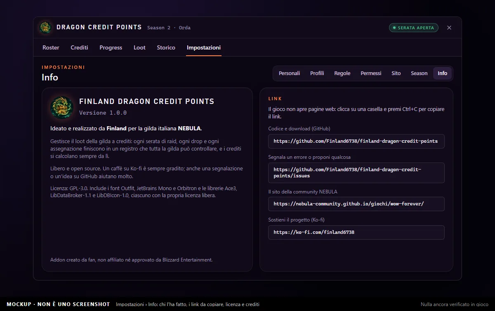

# Crediti e info

> **Costruita, non ancora vista in gioco.** La pagina funziona nei test offline; come appare nel gioco vero è ancora da confermare. [English](About)

*Mockup, non uno screenshot del gioco.*

**Finland Dragon Credit Points** è stato ideato e realizzato da **Finland** per la gilda italiana **NEBULA**. Gestisce il loot della gilda a crediti: ogni serata di raid, ogni drop e ogni assegnazione finiscono in un registro che tutta la gilda può controllare, e i crediti si calcolano sempre da lì.

NEBULA è una gilda e community italiana su WoW Forever; il suo sito, <https://nebula-community.github.io/giochi/wow-forever/>, ha il roster, il loot e i progressi su cui questo addon esporta ([[Esportazione per il sito|Site-Export-it]]).

## In gioco

Apri **Impostazioni › Info**, oppure scrivi `/fdcp about` (`/fdcp about chat` scrive le stesse informazioni in chat). Il gioco non può aprire una pagina web, quindi ogni link sta in una casella: **cliccaci e premi Ctrl+C** per copiarlo, poi incollalo nel browser. La casella non si può modificare.

| Casella | Cos'è |
|---|---|
| Codice e download | Il repository GitHub, <https://github.com/Finland6738/finland-dragon-credit-points> |
| Segnala un errore o proponi qualcosa | Le issues del repository |
| Il sito della community NEBULA | <https://nebula-community.github.io/giochi/wow-forever/> |
| Sostieni il progetto | La pagina Ko-fi, <https://ko-fi.com/finland6738> |

## Sostegno

L'addon è gratuito. Se aiuta la tua gilda e ti va di sostenerlo, un caffè su Ko-fi è sempre gradito; anche una segnalazione o un'idea su GitHub aiutano molto.

## Licenza e materiale di terzi

L'addon è sotto la **GNU General Public License v3.0**: puoi usarlo, studiarlo, modificarlo e condividerlo alle stesse condizioni. Include i font **Outfit**, **JetBrains Mono** e **Orbitron** (SIL Open Font License 1.1) e le librerie **Ace3**, **LibDataBroker-1.1** e **LibDBIcon-1.0**, ciascuna con la propria licenza libera; l'elenco completo è in `docs/third-party.md` del repository. Il logo della gilda è usato con il permesso del proprietario e non è coperto dalla licenza del codice.

Addon creato da fan, non affiliato né approvato da Blizzard Entertainment.
