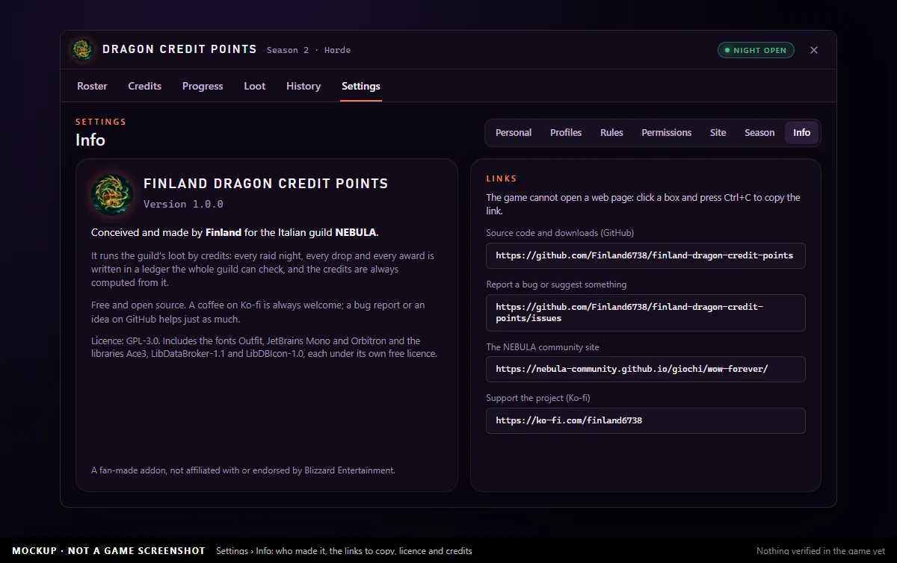
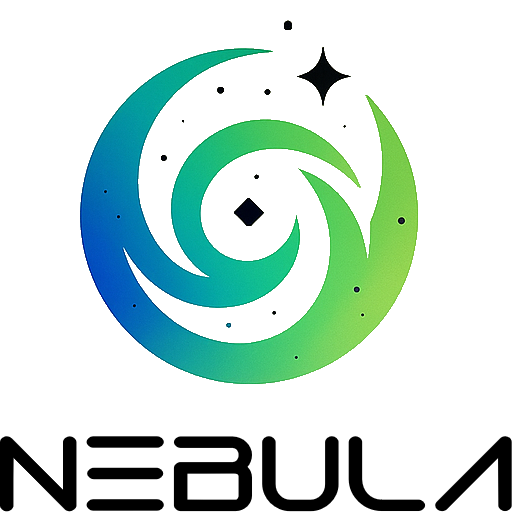

# About

> **Built, not yet seen in the game.** The page works in the offline tests; how it looks in the real game is still to be confirmed. [Italiano](About-it)

*Mockup, not an in-game screenshot.*

**Finland Dragon Credit Points** was conceived and made by **Finland** for the Italian guild **NEBULA**. It runs the guild's loot by credits: every raid night, every drop and every award is written in a ledger the whole guild can check, and the credits are always computed from it.

  <picture>
    <source media="(prefers-color-scheme: dark)" srcset="../../assets/nebula-logo-dark.png">
    
  </picture>

NEBULA is an Italian guild and community on WoW Forever; its site, <https://nebula-community.github.io/giochi/wow-forever/>, has the roster, the loot and the progress that this addon exports to ([[Site Export|Site-Export]]).

## In the game

Open **Settings › Info**, or type `/fdcp about` (`/fdcp about chat` writes the same information in the chat). The game cannot open a web page, so each link is in a box: **click it and press Ctrl+C** to copy it, then paste it in your browser. The box cannot be edited.

| Box | What it is |
|---|---|
| Source code and downloads | The GitHub repository, <https://github.com/Finland6738/finland-dragon-credit-points> |
| Report a bug or suggest something | The repository's issues |
| The NEBULA community site | <https://nebula-community.github.io/giochi/wow-forever/> |
| Support the project | The Ko-fi page, <https://ko-fi.com/finland6738> |

## Support

The addon is free. If it helps your guild and you would like to support it, a coffee on Ko-fi is always welcome; a bug report or an idea on GitHub helps just as much.

## Licence and third-party material

The addon is under the **GNU General Public License v3.0**: you may use, study, change and share it under the same terms. It includes the fonts **Outfit**, **JetBrains Mono** and **Orbitron** (SIL Open Font License 1.1) and the libraries **Ace3**, **LibDataBroker-1.1** and **LibDBIcon-1.0**, each under its own free licence; the complete list is in the repository's `docs/third-party.md`. The guild's logo is used with the owner's permission, and so is the NEBULA community logo (shown on this page and on the Info page, dark or light to match the theme); neither is covered by the code's licence.

This is a fan-made addon, not affiliated with or endorsed by Blizzard Entertainment.
