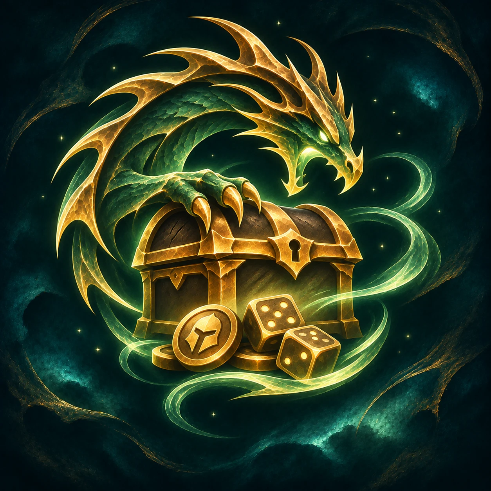

# Finland Dragon Credit Points

**Il sistema di loot a crediti della gilda per World of Warcraft: Forever.** Finland Dragon Credit Points (FDCP, comando `/fdcp`) aiuta il master looter a gestire ogni roll: legge i drop, mostra a ogni raider un popup per rispondere main-spec o off-spec e rollare, sceglie il vincitore secondo le regole della gilda (meno crediti vince, poi il roll più alto, poi un reroll fra i pari) e tiene un registro di crediti, serate e assegnazioni consultabile da tutti.

> **Stato: completo offline, non ancora visto in gioco.** Ogni funzione è costruita e provata offline; le verifiche in gioco del proprietario vengono prima della prima versione (v1.0.0), quindi non c'è ancora un download e questo manuale può cambiare dopo di esse. [English](Home)

## Da dove iniziare

| Voglio… | Leggi |
|---|---|
| Iniziare come raider (versione breve) | [[Guida rapida: raider|Quick-Start-Raider-it]] |
| Iniziare come ufficiale o Guild Master (versione breve) | [[Guida rapida: ufficiali|Quick-Start-Officer-it]] |
| Installare l'addon | [[Installazione|Installation-it]] |
| Conoscere i comandi | [[Comandi|Commands-it]] |
| Sapere come funzionano crediti, costi, roll e parità | [[Regole del loot|Loot-Rules-it]] |
| Vedere come sarà la finestra | [[Giro dell'interfaccia|Interface-Tour-it]] |
| Aggiornare il sito della community dall'addon | [[Esportazione per il sito|Site-Export-it]] |
| Vedere chi nel raid non ha l'addon e avvisarlo | [[Controllo dell'addon|Addon-Check-it]] |
| Gestire il pool e condurre una serata di raid | [[Roster e Serate|Roster-and-Nights-it]] |
| Aprire e chiudere una season (Guild Master), vedere quella corrente | [[Season|Seasons-it]] |
| Leggere la tabella dei crediti e il tuo posto in fila | [[Tabella crediti|Credits-it]] |
| Condurre una sessione di loot da master looter | [[Guida del master looter|Master-Looter-Guide-it]] |
| Rispondere e rollare per un pezzo da raider | [[Rollare per il loot|Rolling-for-Loot-it]] |
| Capire il badge di upgrade del popup | [[Suggerimenti di upgrade|Upgrade-Hints-it]] |
| Votare, annullare un'assegnazione, correggere i crediti o seguire un progetto leggendario come council | [[Council|Council-it]] |
| Leggere le serate, lo storico di un membro o di un oggetto | [[Storico|History-it]] |
| Cambiare le mie preferenze o (Guild Master) le regole e i permessi | [[Impostazioni|Settings-it]] |
| Trovare una risposta veloce | [[FAQ|FAQ-it]] |
| Sapere cosa conserva e manda l'addon | [[Privacy e dati|Privacy-and-Data-it]] |
| Segnalare un bug (la finestra del rapporto bug) | [[Segnalare un bug|Reporting-Bugs-it]] |
| Sapere chi ha fatto l'addon, la licenza e i link | [[Crediti e info|About-it]] |
| Incollare la tabella crediti su Discord, o averla in CSV o JSON | [[Esporta|Export-it]] |

Altre pagine arrivano con le funzioni.

## Per gli sviluppatori

Piano, analisi e decisioni sono nel [repository](https://github.com/Finland6738/finland-dragon-credit-points): `ROADMAP.md`, `docs/ANALISI.md` e `docs/adr/`.
