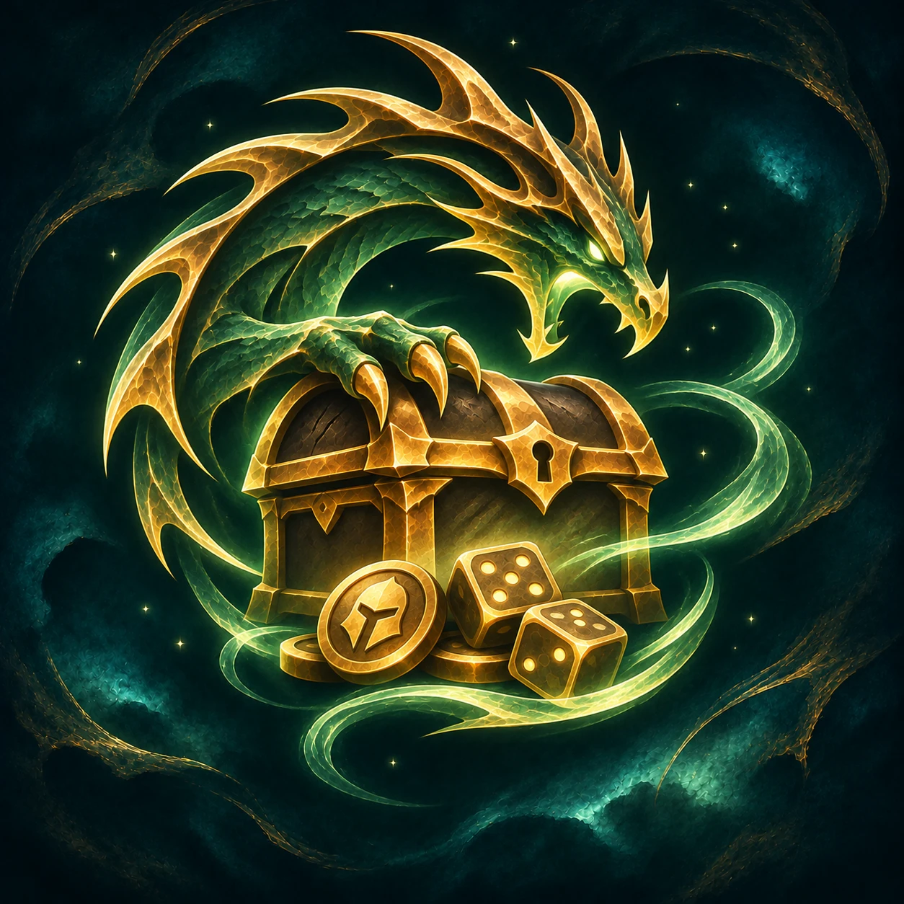

# Finland Dragon Credit Points

**The guild's credit-based loot system for World of Warcraft: Forever.** Finland Dragon Credit Points (FDCP, command `/fdcp`) helps the master looter run each roll: it reads the drops, shows every raider a popup to answer main-spec or off-spec and roll, picks the winner by the guild's rules (fewest credits wins, then the highest roll, then a reroll among the tied), and keeps a ledger of credits, nights and awards that everyone can read.

> **Status: in development, no download yet.** The addon is being planned and built one step at a time; the pages of this manual are filled in as each feature arrives. [Italiano](Home-it)

## Start here

| I want to… | Read |
|---|---|
| Install the addon | [[Installation|Installation]] |
| Know the commands | [[Commands|Commands]] |
| Know how credits, costs, rolls and ties work | [[Loot Rules|Loot-Rules]] |
| See what the window will look like | [[Interface Tour|Interface-Tour]] |
| Update the community site from the addon | [[Site Export|Site-Export]] |
| See who in the raid lacks the addon and notify them | [[Addon Check|Addon-Check]] |
| Manage the pool and run a raid night | [[Roster and Nights|Roster-and-Nights]] |

More pages (the credits table, the master looter's guide, the council, settings) are added as the features are built.

## For developers

The plan, the analysis and the decisions live in the [repository](https://github.com/Finland6738/finland-dragon-credit-points): `ROADMAP.md`, `docs/ANALISI.md` (Italian) and `docs/adr/`.
