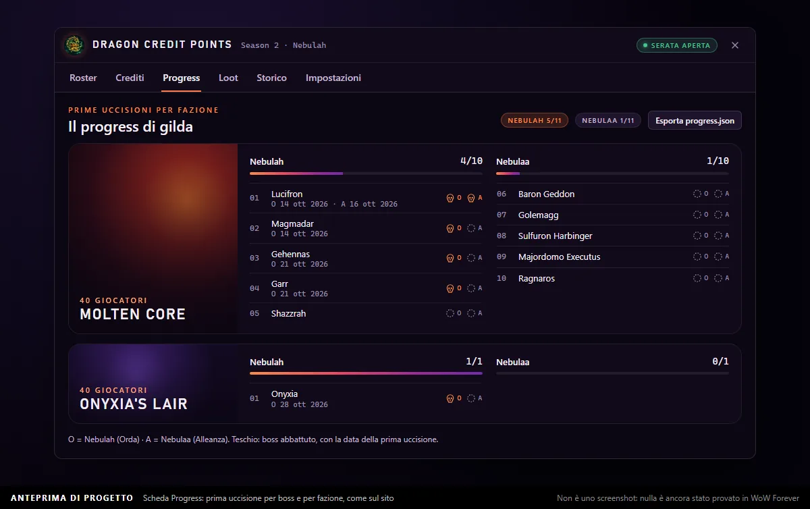

# Giro dell'interfaccia

> **Anteprime di progetto, non screenshot.** La finestra non è ancora costruita. Queste immagini mostrano come è progettata, nello stile della pagina WoW Forever del sito della community. Sono disegnate dalla specifica con nomi inventati e nulla è stato provato in gioco. [English](Interface-Tour)

## Cosa esiste ora

La finestra è costruita: la aprono `/fdcp`, il pulsante della minimappa (il logo della gilda) o la voce nell'AddOn Compartment. Ha la barra del titolo, le sei schede qui sotto, i **temi** (Nebula, Aurora, Drago: `/fdcp theme`) e le schede si riempiono con le versioni: Roster, Crediti, Progress e **Loot › Sessione** (la finestra del master looter, vedi la [[Guida del master looter|Master-Looter-Guide-it]]) e **Loot › Council** (vedi [[Council|Council-it]]) funzionano già; Storico e Impostazioni sono ancora pagine vuote. Si trascina dalla barra del titolo, si ridimensiona dall'angolo in basso a destra (non sotto 900 × 560) e ricorda dove stava per ogni personaggio; **Esc** la chiude. I font sono Outfit, JetBrains Mono e Orbitron, inclusi nell'addon (font liberi, SIL Open Font License); se uno non si carica si usa il font del gioco. Le immagini qui sotto sono ancora anteprime di progetto: la finestra vera non è stata ancora vista in gioco.

## Una finestra, sei schede

`/fdcp` (o il pulsante della minimappa) apre una sola finestra. La barra del titolo mostra il logo della gilda, la season, la tua fazione e se c'è una serata aperta. Sotto ci sono le schede, come sul sito della community. Vedi solo le schede che il tuo rango di gilda può usare.

| Scheda | Che cosa trovi |
|---|---|
| **Roster** | Il roster dei raid come sul sito: una colonna per tank, healer e DPS, con i posti liberi e chi è in prova. Gli officer vedono anche la lineup della serata, la panchina e chi nel raid ha l'addon. |
| **Crediti** | La tabella dei crediti della season come sul sito: una colonna per serata, il tuo totale e il tuo posto nella fila del loot. Meno crediti vuol dire più precedenza. |
| **Progress** | Ogni boss di ogni raid, con la data della prima uccisione della tua gilda e dell'altra, come sul sito. |
| **Loot** | La sessione di loot del master looter: i pezzi, chi ha risposto, i roll e il vincitore proposto. Gli altri la vedono in sola lettura. Sotto-schede: **Sessione**, **Da consegnare** e **Council** (le segnalazioni, il voto, l'annullamento di un'assegnazione, la correzione dei crediti, l'audit e i progetti leggendari: [[Council|Council-it]]). |
| **Storico** | Le serate passate, il log del loot, l'audit delle correzioni e le esportazioni (Discord, CSV, JSON e i file del sito della community). |
| **Impostazioni** | Le tue preferenze (tema, effetti, font, lingua), le regole della gilda (in sola lettura se non sei il GM) e le impostazioni del sito. |

Quando c'è un pezzo a cui rispondere compare un **popup** a parte, con una card per ogni pezzo: vedi [[Rollare per il loot|Rolling-for-Loot-it]].

## La scheda Progress

Una card per raid, come sul sito: la copertina (l'immagine del raid dal Diario delle avventure del gioco quando il client ce l'ha, una generata altrimenti), la dimensione e il nome e, per ogni gilda, una barra con `uccisioni/totale`. Sotto, i boss su due colonne: il numero, il nome e, per ogni gilda, un teschio con la data della prima uccisione oppure un cerchio tratteggiato se il boss non è ancora caduto. La prima gilda è la tua. La colonna dell'altra gilda mostra solo le date che un officer ha inserito per lei: le due gilde non si scambiano mai dati. Con la rotellina del mouse si scorre quando le card non stanno nella finestra.

Le tue prime uccisioni si registrano da sole: durante una serata ufficiale o, fuori da una serata, in un gruppo di gilda. Gli officer (i ranghi con il permesso `progress.edit`, di norma il Guild Master e gli officer) possono anche **inserire o correggere una data**: clicca la riga del boss, scegli la gilda, scrivi la data come `AAAA-MM-GG` (non nel futuro) e premi **Salva**. **Rimuovi la data inserita** toglie un valore messo a mano; un'uccisione registrata dall'addon non si toglie così. Per gli altri la scheda è di sola lettura. Ogni modifica è una riga dell'audit.

## Anteprime

## Temi

Il tema predefinito è **Nebula**, l'aspetto scuro del sito della community. Lo cambi nelle Impostazioni, senza `/reload`:

- **Aurora** è il tema chiaro del sito.
- **Drago** usa i colori del logo della gilda.

I colori delle classi e della qualità degli oggetti sono sempre quelli del gioco.

## Che cosa sarà diverso dal sito

Il gioco non ha gli stili del web, quindi alcune cose sono approssimate:

- niente vetro sfocato dietro i dialog;
- i bagliori sono immagini sfumate;
- i gradienti hanno due colori;
- le animazioni sono semplici;
- nei titoli non c'è spaziatura fra le lettere.

Il carattere del logo del sito non si può ridistribuire, quindi i titoli usano un carattere libero dalla forma simile. I caratteri del testo e dei numeri sono gli stessi del sito.

Vedi anche: [[Esportazione per il sito|Site-Export-it]] · [[Comandi|Commands-it]]
