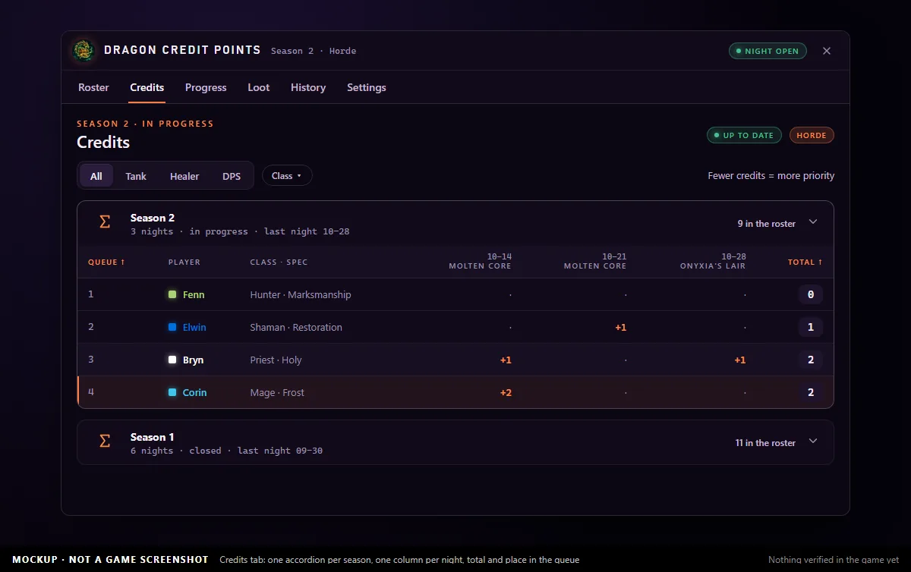
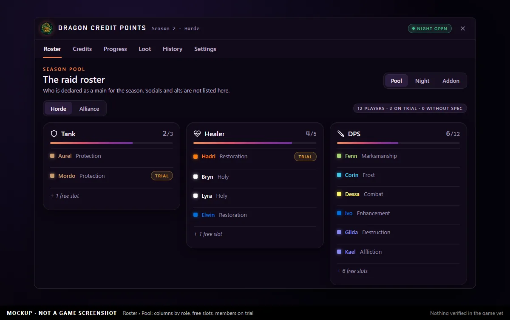
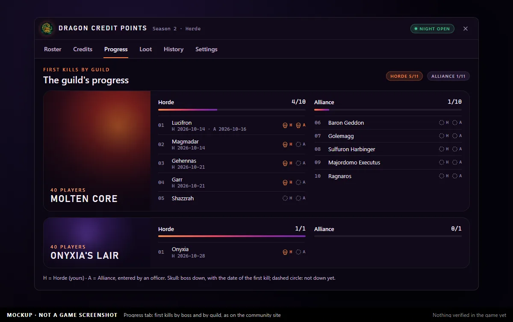
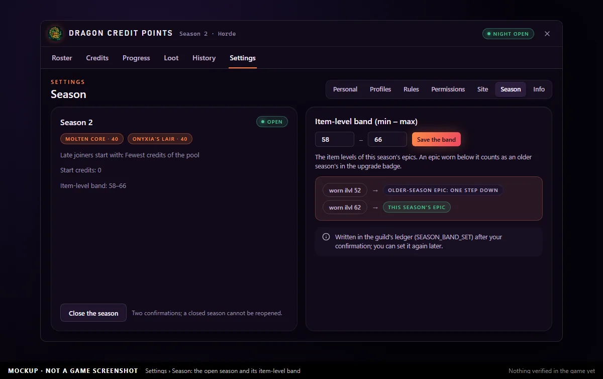
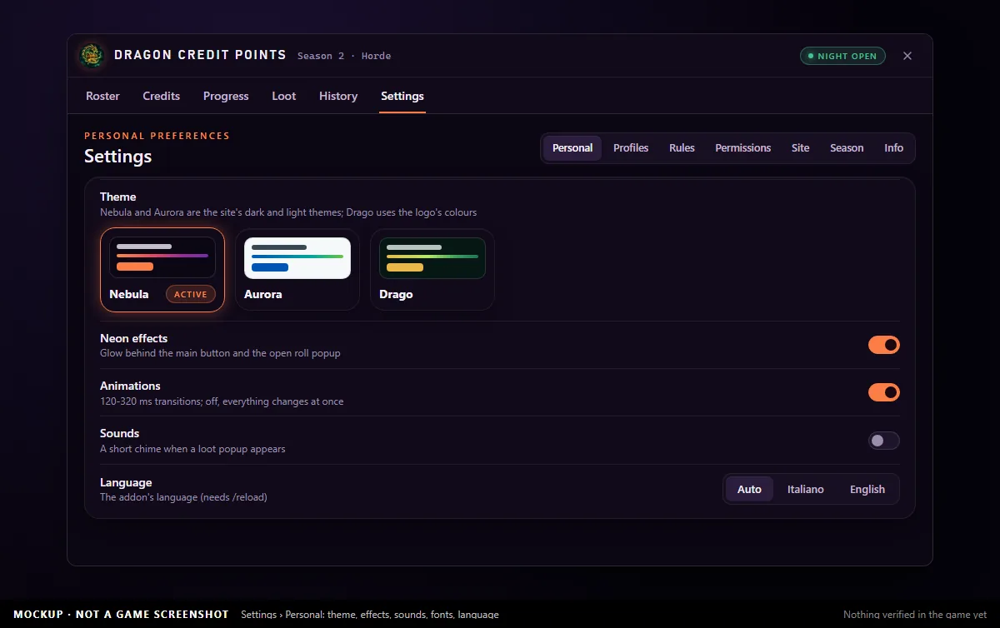

# Interface Tour

> **Mockups, not screenshots.** The images on this page are drawn by `tools/make_mockups.py` from the addon's own layout and texts, with invented names, in the style of the guild community site's WoW Forever page. Nothing has been verified in the game yet, so the real window may differ in small details. The images are in English here; the Italian page has the Italian ones. [Italiano](Interface-Tour-it)

## What exists now

The window itself is built: `/fdcp`, the minimap button (the guild logo) or the AddOn Compartment entry opens it. It has the title bar, the six tabs below, **themes** (Nebula, Aurora, Drago: `/fdcp theme`), and the tabs fill in as the versions arrive: Roster, Credits, Progress and **Loot › Session** (the master looter's window, see the [[Master Looter Guide|Master-Looter-Guide]]) and **Loot › Council** (see [[Council|Council]]) already work; **History › Nights** (see [[History|History]]) already work; **Settings** (see [[Settings|Settings]]) has your preferences, the guild's rules and permissions (read-only unless you are the Guild Master), the site key and the **Season** (see [[Seasons|Seasons]]). You can drag it by the title bar, resize it from the corner grip (not below 900 × 560), and it remembers where it was for each character; **Esc** closes it. The fonts are Outfit, JetBrains Mono and Orbitron, shipped with the addon (free fonts, SIL Open Font License); if one cannot load, the game's own font is used. The images below are mockups: the real window has not been seen in the game yet.

## One window, six tabs

`/fdcp` (or the minimap button) opens one window. Its title bar shows the guild logo, the season and your faction, and whether a raid night is open. Below it are tabs like the ones on the community site. You only see the tabs your guild rank can use.

| Tab | What you find there |
|---|---|
| **Roster** | The raid roster as on the site: one column each for tanks, healers and DPS, with free slots and trial members. Officers also see the night's lineup and bench, and who in the raid has the addon. |
| **Credits** | The season's credits table as on the site: one column per raid night, your total and your place in the loot queue. Fewer credits means more priority. |
| **Progress** | Every boss of every raid, with the date of your guild's first kill and the other guild's, as on the site: see [The Progress tab](#the-progress-tab). |
| **Loot** | The master looter's loot session: the items, who answered, the rolls and the proposed winner. Everyone else sees it read-only. Sub-tabs: **Session**, **To deliver** and **Council** (the flags, the vote, cancelling an award, correcting credits, the audit and the legendary projects: [[Council|Council]]). |
| **History** | Past nights by week with who got what, a member's and an item's history ([[History|History]]), the loot log, the audit of corrections and the exports (Discord, CSV, JSON and the community site files). |
| **Settings** | Your preferences (theme, effects, fonts, language), the guild rules (read-only unless you are the Guild Master) and the site settings. |

When a raider has a drop to answer, a separate **popup** appears, with one card per item: see [[Rolling for Loot|Rolling-for-Loot]].

## The Progress tab

One card per raid, as on the community site: the cover (the picture of the raid from the game's Encounter Journal when the client has it, a generated one otherwise), the size and the name, and for each guild a bar with `kills/total`. Below, the bosses in two columns: the number, the name, and for each guild a skull with the date of the first kill, or a dashed circle when the boss is not down yet. The first guild is yours. The other guild's column shows only the dates an officer entered for it: the two guilds never exchange data. Scroll with the mouse wheel when the cards do not fit.

Your first kills are recorded by themselves: during an official night, or in a guild group outside one. Officers (the ranks allowed `progress.edit`, by default the Guild Master and the officers) can also **enter or correct a date**: click the boss row, pick the guild, write the date as `YYYY-MM-DD` (not in the future) and press **Save**. **Remove entered date** deletes a value entered by hand; a kill the addon recorded is never removed this way. Everyone else sees the tab read-only. Every change is a line of the audit.

## Mockups

Ten of the windows, as planned. Each is explained on its own page of this manual.

### The roll popup

*Mockup, not an in-game screenshot.*

### The master looter's session

*Mockup, not an in-game screenshot.*

### The council

*Mockup, not an in-game screenshot.*

### Credits

*Mockup, not an in-game screenshot.*

### Roster

*Mockup, not an in-game screenshot.*

### A night

*Mockup, not an in-game screenshot.*

### Progress

*Mockup, not an in-game screenshot.*

### Permissions

*Mockup, not an in-game screenshot.*

### Season

*Mockup, not an in-game screenshot.*

### Info

*Mockup, not an in-game screenshot.*

## Themes

The default theme is **Nebula**, the dark look of the community site. You can switch in Settings, without `/reload`:

- **Aurora** is the site's light theme.
- **Drago** uses the colours of the guild logo.

Class colours and item quality colours are always the game's own. On the light theme Aurora a player's name is written in the normal text colour and only the small square next to it carries the class colour, so a white priest stays readable.

## Effects and animations

Two preferences change how the window looks, both on by default and both set at once, without `/reload`:

- **Neon effects** (`/fdcp effects on|off`): the soft glows (the amber one behind the main button, the magenta one on the one highlighted item popup, the one under the title and the logo) and the shadows under windows and cards. Off, the window is flat.
- **Animations** (`/fdcp animations on|off`): the short transitions (120 ms for a button pressed or hovered, 200 ms for tabs, 320 ms for a card or dialog entering and the season arrow turning). Off, everything changes at once, as for anyone who prefers reduced motion.

The same two switches are in **Settings › Personal** (see [[Settings|Settings]]).

*Mockup, not an in-game screenshot.*

## What will differ from the site

The game has no web styling, so a few things are approximated:

- no blurred glass behind dialogs;
- glows drawn as soft images added to the picture;
- gradients with two colours;
- simple animations, always ending the same way (no springy curves);
- no letter spacing in headings.

The site's logo font cannot be redistributed, so headings use a free font with a similar shape. The text and number fonts are the same as on the site.

Related: [[Site Export|Site-Export]] · [[Commands|Commands]]
