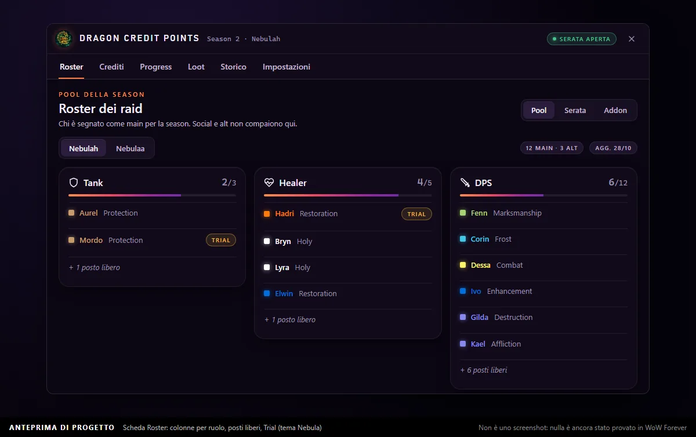
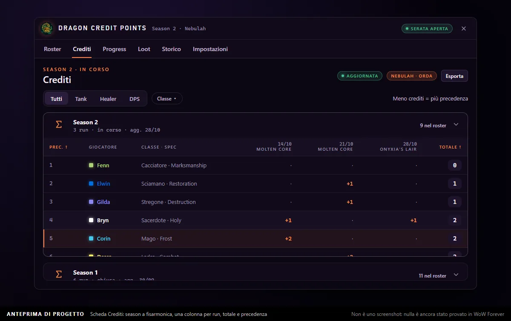
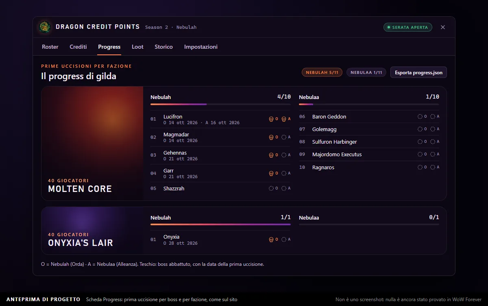
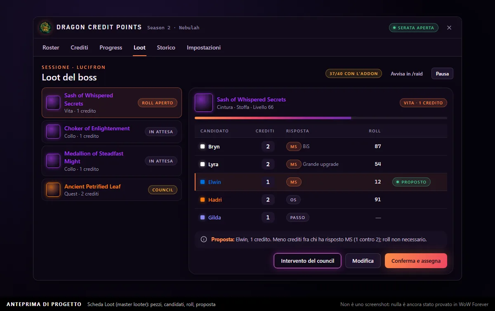
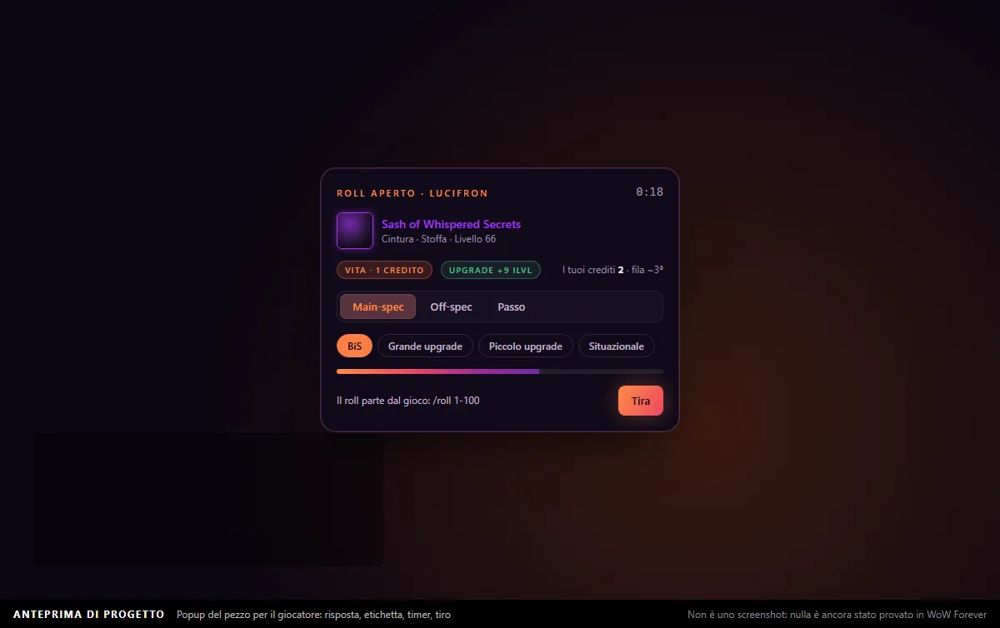
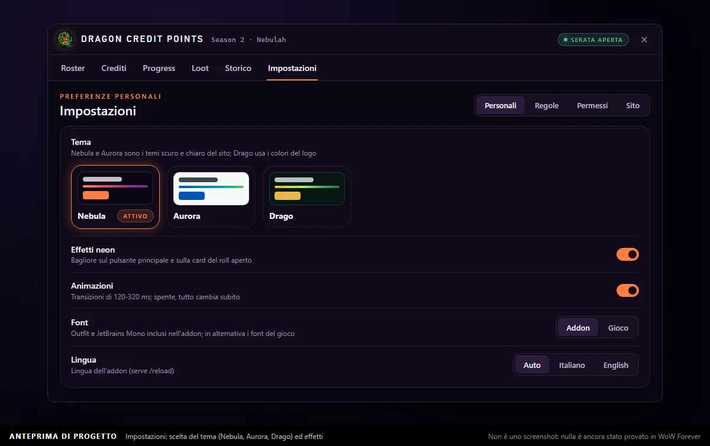

# Interface Tour

> **Design previews, not screenshots.** The window is not built yet: these images show how it is planned, in the style of the guild community site's WoW Forever page. They are drawn from the design specification with invented names, and nothing has run in the game. The previews are in Italian, the guild's language. [Italiano](Interface-Tour-it)

## One window, six tabs

`/fdcp` (or the minimap button) opens one window. Its title bar shows the guild logo, the season and your faction, and whether a raid night is open. Below it are tabs like the ones on the community site. You only see the tabs your guild rank can use.

| Tab | What you find there |
|---|---|
| **Roster** | The raid roster as on the site: one column each for tanks, healers and DPS, with free slots and trial members. Officers also see the night's lineup and bench, and who in the raid has the addon. |
| **Credits** | The season's credits table as on the site: one column per raid night, your total and your place in the loot queue. Fewer credits means more priority. |
| **Progress** | Every boss of every raid, with the date of your guild's first kill and the other guild's, as on the site. |
| **Loot** | The master looter's loot session: the items, who answered, the rolls and the proposed winner. Everyone else sees it read-only. |
| **History** | Past nights, the loot log, the audit of corrections and the exports (Discord, CSV, JSON and the community site files). |
| **Settings** | Your preferences (theme, effects, fonts, language), the guild rules (read-only unless you are the Guild Master) and the site settings. |

When a raider has a drop to answer, a separate **popup** appears, with one card per item.

## Previews

## Themes

The default theme is **Nebula**, the dark look of the community site. You can switch in Settings, without `/reload`:

- **Aurora** is the site's light theme.
- **Drago** uses the colours of the guild logo.

Class colours and item quality colours are always the game's own.

## What will differ from the site

The game has no web styling, so a few things are approximated:

- no blurred glass behind dialogs;
- glows drawn as soft images;
- gradients with two colours;
- simple animations;
- no letter spacing in headings.

The site's logo font cannot be redistributed, so headings use a free font with a similar shape. The text and number fonts are the same as on the site.

Related: [[Site Export|Site-Export]] · [[Commands|Commands]]
