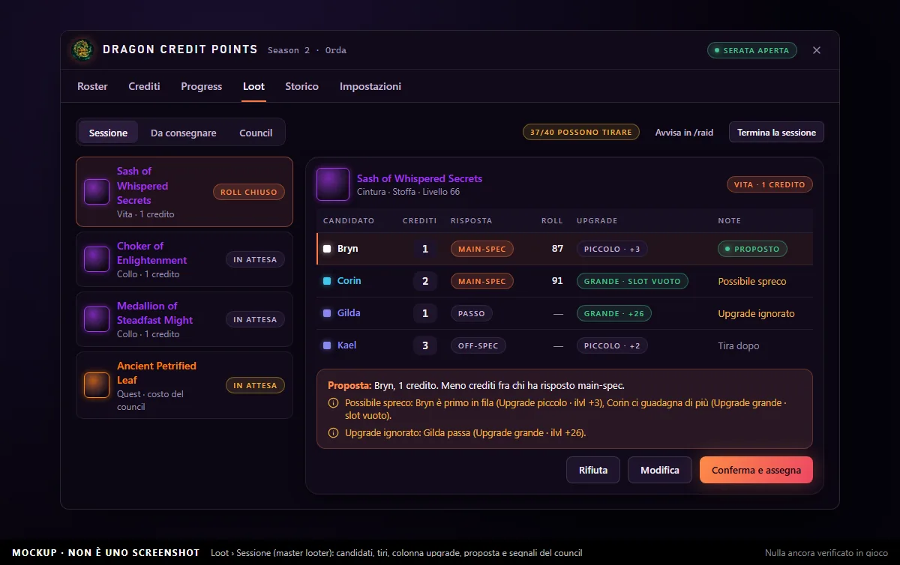

# Guida del master looter

> **Costruito, non ancora visto in gioco.** La finestra della sessione funziona nei test offline con un raid simulato; come appare e come si usa in un raid vero, e la consegna del pezzo, sono ancora da confermare in gioco. [English](Master-Looter-Guide)

*Mockup, non uno screenshot del gioco.*

Questa pagina è per il **master looter**: chi apre il corpo del boss e guida il roll. L'addon fa i conti e scrive la proposta; **tu confermi, rifiuti o modifichi**. Non calcoli mai i crediti a mano e non scrivi mai il motivo di un'assegnazione normale: lo fa l'addon. Scrivi un motivo solo quando ti discosti dalla regola.

## Prima del raid

- Imposta il metodo di bottino su **Master Looter** (l'addon lavora solo dal client del master looter) e la soglia sulla qualità per cui la gilda rolla.
- Tutti nel raid devono avere l'addon attivo: solo chi ce l'ha può rispondere e rollare. Vedi [[Controllo dell'addon|Addon-Check-it]]. La scheda Loot ti avvisa, per esempio **3 membri del raid non possono rollare**, con il pulsante **Avvisa in /raid** (per chi può usare il controllo dell'addon) che scrive l'avviso per te.
- Apri la serata ([[Roster e Serate|Roster-and-Nights-it]]) così uccisioni e assegnazioni appartengono a lei.

## Un boss, passo per passo

1. **Uccidi il boss.** Quando il boss muore l'addon apre una sessione sul tuo client. Durante il combattimento non si apre nulla: la sessione aspetta la fine del combattimento, di una restrizione dell'addon o del lockdown della chat.
2. **Apri il corpo.** Quando apri la finestra del bottino la finestra principale si apre su **Loot › Sessione**. I pezzi pari o sopra la soglia sono elencati a sinistra, ciascuno con categoria e costo (per esempio *Gioiello · 1 credito*), proposti dall'addon dalla tabella della gilda. Se i drop sono stati letti durante un lockdown, la finestra dice che sono in attesa e li legge appena finisce.
3. **Controlla la lista.** Seleziona un pezzo per vederlo a destra. Se una categoria o un costo è sbagliato, premi **Correggi** (vedi sotto). **Togli** toglie dalla lista un pezzo che non vuoi in sessione.
4. **Premi Avvia la sessione.** Categorie e costi vanno al raid, scritti anche in `/raid` ([vedi sotto](#annunci-in-raid)). Con le impostazioni solite della gilda (avanzamento automatico) il primo roll si apre da solo; altrimenti premi **Apri il roll** sul pezzo che vuoi.
5. **Il roll.** Ogni raider con l'addon riceve un popup, risponde con uno dei tre pulsanti, *Passo*, *Tira Main-spec* o *Tira Off-spec* (un pulsante di tiro risponde e tira con un clic): vedi [[Rollare per il loot|Rolling-for-Loot-it]]. La parte destra della tua finestra si riempie man mano che arrivano risposte e roll: per ogni candidato i crediti, la risposta, il roll e una nota. Una barra sottile e un orologio contano il tempo del round. Il round si chiude da solo al timer o quando tutti hanno risposto e rollato; puoi chiuderlo prima con **Chiudi il round**. Se nessuno ha chiesto il pezzo in main-spec, il round off-spec si apre da solo; se due giocatori sono pari per crediti e roll, si apre un reroll fra loro.
6. **La proposta.** Quando il round si chiude l'addon scrive **a chi, quanto e perché**, per esempio *Proposta: Bryn, 1 credito. Stessi crediti degli altri, roll più alto.* Il giocatore proposto è segnato nella lista. Sotto la frase, in ambra, ciò che va guardato (roll scartati, un costo che deve fissare il council, una parità che le regole non sciolgono, una proposta dopo un rifiuto, e le [segnalazioni del council](#segnalazioni-del-council)).
7. **Decidi tu:**
   - **Conferma e assegna** scrive l'assegnazione nel registro con il motivo dell'addon e addebita i crediti. Non c'è altro da scrivere.
   - **Rifiuta** non addebita nulla e rimette il pezzo in gioco (vedi sotto).
   - **Modifica** cambia il vincitore o il costo e vuole un motivo (vedi sotto).
8. **Il pezzo dopo.** Con l'avanzamento automatico il roll successivo si apre da solo dopo ogni assegnazione, quindi un boss con cinque pezzi sono cinque conferme. C'è sempre **un solo pezzo in corso**: il roll successivo si apre dopo l'assegnazione del precedente, così i crediti del suo vincitore sono già addebitati. Per questo non esiste il pulsante *Conferma tutto*: non c'è mai una seconda proposta in attesa.
9. **Chiudi la sessione** con **Chiudi sessione** quando l'ultimo pezzo è fatto (è disponibile finché nessun pezzo è in corso). I pezzi mai rollati restano elencati come in attesa. Anche la morte del boss successivo chiude la sessione precedente se nessun pezzo è in corso.

Se la finestra è chiusa, `/fdcp` la apre sulla scheda Loot mentre una sessione è in corso.

> **Consegna del pezzo.** **Conferma e assegna** consegna anche il pezzo, nello stesso clic: vedi [Consegna del pezzo](#consegna-del-pezzo) più sotto.

## Consegna del pezzo

**Conferma e assegna** fa due cose nello stesso clic: scrive l'assegnazione e addebita i crediti, e chiede al gioco di consegnare il pezzo al vincitore con il **master loot**. Il tuo clic è quello che il gioco può richiedere.

**Piano A: master loot.** L'addon cerca il pezzo nella finestra del bottino aperta (dal pezzo, non dalla posizione: la lista chiude i buchi man mano che i pezzi escono) e il vincitore nell'elenco del master loot, e lo consegna. Il pezzo aspetta poi in **Loot › Da consegnare** come *Consegnato: aspetto il messaggio del bottino* finché il messaggio di bottino del vincitore in chat (*Bryn riceve il bottino*) viene letto: allora è **Consegnato** ed esce dalla lista. Se il pezzo lo vinci tu, il tuo *Ricevi il bottino* è la ricevuta.

**Piano B: per scambio.** Quando il master loot non può farlo, l'assegnazione resta nel registro (i crediti sono addebitati comunque) e il pezzo va nell'elenco **Da consegnare** con il motivo:

| L'elenco dice | Cosa è successo |
|---|---|
| Qui il master loot non è in uso | Non sei il master looter, o il gruppo usa un altro metodo di loot: il caso tipico del piano B. |
| La finestra del bottino è chiusa | Hai chiuso il corpo prima di confermare. Riaprilo: l'addon riprova da solo. |
| Il pezzo non è più nella finestra del bottino | Qualcuno lo ha lootato, o era già stato consegnato. |
| Il vincitore non è nell'elenco del master loot | Troppo lontano, o non nel raid. Digli di avvicinarsi e premi **Consegna ora**, oppure scambia. |
| Il gioco ha rifiutato la consegna | Il gioco non ha accettato la chiamata. Premi **Consegna ora** (il tuo clic), oppure scambia. |

Consegna il pezzo con un **normale scambio**: l'addon non avvia, non riempie e non accetta mai uno scambio al posto tuo, guarda solo quelli che fai. Quando uno scambio che dà il pezzo al suo vincitore va a buon fine (o ricevi in uno scambio un pezzo che hai vinto tu), il pezzo è segnato **Consegnato**. Quando un messaggio di bottino mostra chi ha il pezzo, l'elenco lo dice (*Lo ha Corin*). Un pezzo che il vincitore aveva già lootato prima della tua conferma è consegnato subito.

**La scheda Da consegnare** elenca ogni pezzo assegnato che non è ancora arrivato al vincitore: il pezzo, il vincitore e a che punto è. Seleziona una riga e usa:

- **Consegna ora (master loot)**: riprova con il master loot, dal tuo clic. Usalo dopo aver riaperto il corpo o quando il gioco ha rifiutato. È nascosto mentre il pezzo aspetta il suo messaggio di bottino.
- **Segna come consegnato**: la tua parola che il pezzo è arrivato al vincitore (uno scambio che l'addon non ha potuto leggere, un messaggio di bottino nascosto dal gioco). Viene scritto come consegnato a mano.

L'intestazione della scheda Sessione conta i pezzi ancora da consegnare.

**Rollare tutto a fine serata.** Puoi rollare prima tutti i pezzi e consegnarli dopo: i pezzi restano nell'elenco, **Chiudi sessione** li tiene, e quando muore il boss successivo passano nell'elenco della sessione nuova, così non si perde nulla fra un boss e l'altro, nemmeno dopo un `/reload`. Quando riapri un corpo, i pezzi che lo aspettavano sono riprovati da soli (non quelli che il gioco ha rifiutato: aspettano il tuo clic).

> **Non ancora verificato in gioco:** che un addon possa chiamare `GiveMasterLoot` da un clic, che la finestra del bottino e l'elenco del master loot si leggano come descritto, cosa portano gli eventi dello scambio e se i messaggi di bottino sono leggibili dentro un'istanza. Se un passaggio non funziona, il pezzo aspetta nell'elenco e lo consegni con uno scambio.

## Annunci in /raid

Tutto quello che l'addon scrive in `/raid` è scritto nella **lingua della gilda** scelta dal Guild Master nelle impostazioni, qualunque sia la lingua del tuo gioco, così tutto il raid legge le stesse parole. Il testo e l'interruttore acceso/spento sono del Guild Master (sezione `announce` delle regole).

## Che cosa scrive l'addon in /raid

- **Quando premi Avvia la sessione**, una riga per pezzo: il link del pezzo, la sua **categoria** e il suo **costo**, per esempio *[Anello di Brace]: Gioiello, 1 credito.* La categoria si annuncia **prima** dell'apertura del primo roll. Un pezzo il cui costo lo decide il council lo dice (*costo deciso dal council*).
- **Se correggi un pezzo dopo la partenza**, una riga dice *Correzione: [pezzo] ora è Arma, 2 crediti.*
- **Quando confermi un'assegnazione**, una riga con il pezzo, il vincitore, il costo e il **perché**, composto dall'addon dai codici di motivo, per esempio *[Anello di Brace]: Bryn, 1 credito. Stessi crediti degli altri, roll più alto.* Un pezzo che va alla banca di gilda o da disincantare lo dice al posto del vincitore.
- Ogni riga comincia con **[FDCP]**, è lunga al massimo 255 caratteri (un testo più lungo si divide, un link di oggetto non si taglia mai) ed è scritta nella lingua della gilda. Fuori da un gruppo raid non si scrive niente: i popup e la tua finestra portano le stesse notizie.

**Quando scrive.** Mai durante uno scontro con un boss: le righe aspettano in una coda e escono appena lo scontro è finito e la chat del gioco le accetta (anche un lockdown della chat le fa aspettare), poche al secondo, in ordine. Se il gioco rifiuta una riga cinque volte di fila la coda si svuota. Il popup dei raider e la finestra mostrano tutto che le righe escano o no.

**Cambiare il testo (Guild Master).** Il Guild Master può spegnere gli annunci, cambiare il testo del pezzo e quello del risultato e togliere la frase del perché. In un testo, `{item}`, `{category}` e `{cost}` sono sostituiti nella riga del pezzo; `{item}`, `{winner}`, `{cost}`, `{category}` e `{reason}` in quella del risultato. Un testo vuoto usa quello predefinito della lingua della gilda. La modifica è salvata nelle regole e l'audit dice chi l'ha fatta. Per ora non c'è una finestra per farlo.

> **Non ancora verificato in gioco:** che il gioco lasci scrivere l'addon in `/raid` dal tuo clic (e dall'assegnazione automatica, che non ha un clic dietro) e come la chat limiti un elenco lungo.

## Leggere la tabella dei candidati

| Colonna | Significato |
|---|---|
| **Candidato** | Il nome, nel colore della classe. |
| **Crediti** | I crediti del giocatore all'apertura del roll di questo pezzo (congelati per il pezzo, così il risultato è quello contro cui il raid ha rollato). |
| **Risposta** | Main-spec, Off-spec o Passo; un punto se non ha ancora risposto. I giocatori non aggiungono più un'etichetta né una nota: quanto il pezzo è un upgrade lo dice l'addon (colonna seguente). Un'etichetta o una nota mandate da un addon più vecchio si ignorano. |
| **Upgrade** | Il badge che l'addon del giocatore ha calcolato per la spec della sua risposta, contro l'equipaggiamento che indossava durante lo scontro col boss: *Upgrade grande · ilvl +26* (verde o slot vuoto), *Upgrade medio · ilvl +13* (blu, o viola di una season precedente), *Upgrade piccolo · ilvl +6* (viola di questa season), *Nessun upgrade*, *Non confrontabile*, *Non usabile*; un punto se il suo addon non ha mandato nulla (una versione più vecchia, o la gilda ha spento il badge). **Passa il mouse sulla riga** per vedere i badge di entrambe le spec, i pezzi che indossava e la regola. Informa il council e non cambia mai la proposta (vedi [[Suggerimenti di upgrade|Upgrade-Hints-it]]). Clicca l'intestazione per ordinare: prima gli upgrade grandi. |
| **Roll** | Il primo roll 1-100 del round in corso (un reroll lo sostituisce per i pari). |
| **Note** | *Proposto* per il vincitore; *Non ha ancora risposto* a round aperto; il motivo per cui un roll è stato scartato (un secondo roll, non 1-100, troppo presto, **l'addon non è attivo**); *Upgrade ignorato* o *Possibile spreco* quando una [segnalazione del council](#segnalazioni-del-council) nomina il giocatore. |

Ordina cliccando su un'intestazione. La lista è in ordine: prima main-spec, poi meno crediti, poi il roll più alto. In un reroll i giocatori non pari sono attenuati.

Ogni cella sta su una riga. In una finestra stretta un testo lungo (un badge di upgrade, una nota) viene accorciato alla sua colonna: passa sopra la riga per leggerlo intero nel tooltip. La proposta sotto la tabella si allunga con la sua frase e le righe sotto, e la tabella finisce sopra di essa.

Un giocatore che rolla senza l'addon **non** conta: il roll compare con *L'addon non è attivo* così lo vedi, e lui non può rispondere.

## Segnalazioni del council

Due segnalazioni aiutano te e il council a vedere i casi che il regolamento dice di sollevare **prima** dell'assegnazione. Compaiono sotto i candidati, in ambra, **appena arrivano le risposte** (non devi aspettare la chiusura del round), restano con la proposta, e il candidato che nominano lo dice nella colonna **Note**.

| Segnalazione | Quando | Esempio |
|---|---|---|
| **Upgrade ignorato** | Un raider con l'addon **passa** su un pezzo che per la sua **main-spec** (MS1) è un **upgrade grande**. | *Upgrade ignorato: Bryn passa (Upgrade grande · ilvl +26).* |
| **Possibile spreco** | Il **primo in fila** fra le risposte main-spec ha un **upgrade piccolo o nessuno**, un altro candidato main-spec ne ha uno **grande** (quando entrambi mostrano un guadagno di item level, almeno **il doppio**: il rapporto è una regola della gilda). | *Possibile spreco: Aurel è primo in fila (Upgrade piccolo · ilvl +3), Corin ci guadagna di più (Upgrade grande · slot vuoto).* |

- **Non cambiano mai il vincitore.** La proposta resta quella delle regole. Se il council è d'accordo che è un caso su cui intervenire, **Modifichi** la proposta con il motivo *Spreco palese* (un altro candidato) o *Passato per fare il furbo* (a chi ha passato, a costo pieno); l'assegnazione tiene la segnalazione nell'audit.
- **Solo la main-spec.** Entrambe leggono il badge della **MS1** del giocatore; una risposta off-spec e il badge off-spec non le fanno mai scattare. Un upgrade medio non fa scattare nessuna delle due; un pezzo che il giocatore non può usare non conta mai.
- **Prima della proposta** il "primo in fila" segue crediti e roll; scritta la proposta, è il giocatore scelto dalle regole (e se il pezzo è andato al round off-spec, alla banca o a una tua scelta, non c'è "possibile spreco").
- **Assegnazione automatica.** Quando la gilda assegna in automatico, una proposta con una segnalazione del council **non** si conferma da sola: aspetta te.
- **Chi le vede.** Tu sempre. Oltre a te, la gilda decide chi vede badge e segnalazioni: il **council** (il preset: il rango con il permesso *membro del council*, che riceve la finestra in sola lettura anche se non è officer), **tutti gli officer**, oppure **solo il master looter**. Gli altri vedono solo i codici della proposta, senza nomi. La gilda può spegnere le segnalazioni.
- **Cosa non possono sapere.** Chi non risponde mai non manda nessun badge, quindi un giocatore in silenzio è segnalato solo se il suo addon ne ha già mandato uno. Il badge lo calcola l'addon del giocatore da colore e item level (vedi [[Suggerimenti di upgrade|Upgrade-Hints-it]]).

## Possibili imbrogli sul tiro

Oltre alle due segnalazioni del council, l'addon segnala un **Possibile imbroglio** (*Imbroglio?* nella colonna Note) quando l'addon di un raider riporta uno dei quattro casi della gilda (vedi [Regole del loot](Loot-Rules-it.md#imbrogli-sul-tiro)): equipaggiamento cambiato con un item level più basso dopo lo scontro, un pezzo tolto, un passo su un upgrade medio o grande per la spec principale (un passo su un grande è la segnalazione *Upgrade ignorato* e vale come questo caso), o un pezzo di un'altra spec che nasconde l'upgrade. La riga sotto i candidati nomina il giocatore e le prove: *Possibile imbroglio, pezzo tolto: Bryn aveva Elmo di Brace (ilvl 226) nello scontro, lo slot è vuoto al tiro.*

- **Penalizza +2.** Il pulsante compare nella finestra della sessione e nella pagina Council per la prima segnalazione non ancora penalizzata. Il primo clic chiede *Confermi +2 a Bryn?*; un secondo clic entro cinque secondi scrive la penalità. Al primo clic non si scrive niente. Con le penalità automatiche del Guild Master accese, il tuo addon la scrive da solo quando si fa la proposta.
- **Non cambia mai il vincitore**, e un'assegnazione automatica ti aspetta, come per le altre segnalazioni.
- **Ispezione.** Quando il giocatore segnalato è a portata, il tuo addon lo ispeziona (uno alla volta, mai in combattimento) e aggiunge *l'equipaggiamento indossato ora corrisponde* oppure *NON corrisponde a quello dichiarato dal suo addon*. Quello dello scontro è solo la parola del suo addon: un addon modificato potrebbe mentire.
- **Tornare indietro.** La penalità è una correzione dei crediti con il motivo *Imbroglio sul tiro*: annullala dalla pagina Council come ogni correzione. Per lo stesso caso sullo stesso oggetto non viene mai riproposta.

## Il council: interventi e voto

**Chi è il council.** Di base, i ranghi di gilda con il permesso *membro del council* (gli officer) che sono **nel raid**. La gilda può invece scrivere nelle sue regole una **lista esplicita di personaggi**: allora la lista sostituisce il rango (sempre solo chi è nel raid, salvo che la gilda spenga la regola della presenza). Scrivi `/fdcp council` per sapere se ne fai parte. La pagina **Loot › Council** fa lo stesso dalla finestra, con pulsanti e finestre di dialogo: vedi [[Council|Council-it]].

**Cosa può fare il council, sempre con un motivo.** Le decisioni del council le esegui tu dalla tua finestra, e ognuna finisce nel log con il motivo e il tuo nome:

| Cosa | Come | Motivo |
|---|---|---|
| Correggere categoria o costo | **Correggi**, prima che si apra il roll del pezzo. Una volta aperto l'addon rifiuta (*La categoria non si cambia dopo l'apertura del roll.*). | *La categoria o il costo erano sbagliati*, *Il council ha dato un prezzo all'oggetto* |
| Spreco palese: un altro candidato | **Modifica**, scegli il candidato. Paga il costo della sua risposta. | *Spreco palese* |
| Passato per fare il furbo | **Modifica**, scegli chi non ha rollato. Paga il **costo pieno**. | *Passato per fare il furbo* |
| Annullare un'assegnazione | `/fdcp council awards`, poi `/fdcp council void <n> <motivo>`. I crediti tornano; l'assegnazione resta nel log, segnata come annullata. | *mistake*, *duplicate_award*, *obvious_waste*, *passed_to_game*, *council_vote*, *legendary*, *other* |
| Correggere a mano i crediti di un membro | `/fdcp council adjust <giocatore> <crediti> <motivo>` (positivo aggiunge crediti, come un costo; negativo li toglie; al massimo 1000). | *mistake*, *penalty*, *bonus*, *council_vote*, *other* |

Senza motivo non si scrive nulla. Annullare e correggere i crediti richiedono il permesso della *serata* mentre una serata della season è aperta (tu, master looter, scrivi le correzioni del council) e il permesso di *correzione dei crediti* fuori dalla serata (il Guild Master nel preset). Gli addon degli altri ricontrollano lo stesso permesso quando l'evento arriva. `/fdcp council audit` elenca gli ultimi interventi della season: assegnazioni modificate (con il vincitore delle regole), correzioni prima del roll, voti, annullamenti e correzioni dei crediti.

**Il voto.** Quando la modalità di assegnazione della gilda è **council**, o la gilda accende il **voto del council**, ogni membro del council vota dal proprio gioco con `/fdcp council vote <giocatore>` appena c'è la proposta (ognuno vota solo per sé; il voto di chi non è nel council viene ignorato, e un membro può cambiare il voto finché non è chiuso). Vedi i voti nella striscia sotto la proposta, per esempio *Voti del council (aperto): Corin 2, Bryn 1.*, e il pulsante principale diventa **Chiudi il voto**:

- in modalità **council** non puoi confermare prima di chiudere il voto. Decide la maggioranza stretta; se nomina un altro, la proposta cambia con il motivo *Deciso dal voto del council*. Parità o nessun voto: decidi tu con **Modifica**;
- con il voto nelle altre modalità i voti ti informano soltanto: puoi confermare subito, chiudere il voto per applicare la maggioranza, o modificare. In modalità **automatica** un voto per un altro giocatore ferma l'assegnazione automatica e aspetta te (*Un voto del council non è d'accordo: decide il master looter.*);
- i voti finiscono nell'assegnazione nel log.

## Modifica

Premi **Modifica** su una proposta. Si apre una scheda con:

- **Nuovo vincitore**: prima i candidati (con risposta e crediti), poi il resto del raid, poi **Alla banca di gilda** e **Da disincantare**. Un nuovo vincitore paga il costo della propria risposta, o il costo pieno se non ha risposto.
- **Costo in crediti**: cambialo se il vincitore deve pagare altro.
- **Motivo (obbligatorio)**: uno dell'elenco, mai testo libero:

| Motivo | Quando |
|---|---|
| Spreco palese | Dato a un altro candidato invece del primo in fila. |
| Passa per fare il furbo | Dato a chi non ha rollato, a costo pieno. |
| Il council ha stabilito il costo | Un costo deciso dal council. |
| La categoria o il costo era sbagliato | Una correzione a posteriori. |
| Un pezzo di una catena leggendaria | I pezzi leggendari. |
| Un errore del master looter o dell'addon | Uno sbaglio. |
| Un altro motivo | Qualunque altro (diccelo al raid). |

Mentre scegli, la scheda mostra la proposta che ne risulterebbe e **come si discosta dalla regola**: *Fuori fila: Bryn era primo, invece Corin.* e *Costo: 2 crediti invece di 1 credito come da regola.* **Salva** viene rifiutato, con il motivo a parole, finché non scegli un motivo o se non è cambiato nulla. Una proposta modificata resta una proposta: premi comunque **Conferma e assegna**. L'assegnazione è segnata nell'audit come intervento, con vincitore e costo della regola, il codice del tuo motivo e il tuo nome.

## Rifiuta

**Rifiuta** apre le scelte su cosa succede al pezzo. Nessuno viene addebitato:

| Scelta | Effetto |
|---|---|
| Rimetti il pezzo in gioco: riaprilo dopo | Torna in attesa, segnato *Sospeso*; apri il suo roll quando vuoi (selezionalo e premi **Apri il roll**). L'avanzamento automatico non lo riapre. |
| Riapri subito il roll | Si apre subito un roll nuovo. |
| Passa al tier successivo | I tier fino a quello della proposta vengono saltati (per esempio finito il main-spec, si va all'off-spec). |
| Mandalo alla banca di gilda / Disincantalo | Una nuova proposta per il personaggio banca o il disincantatore. |

La proposta successiva porta la nota *È una nuova proposta dopo un rifiuto.*

## Correggi (prima del roll)

**Correggi** è disponibile finché il pezzo non ha una proposta: scegli la **categoria** giusta, oppure scrivi il **costo base** (il moltiplicatore di ogni risposta si applica ancora), e dai un motivo. È bloccato dopo l'apertura del roll del pezzo quando le regole della gilda bloccano la categoria all'apertura.

## Pausa, timer e lockdown

- **Pausa** ferma i timer e i passi automatici e conserva il tempo rimasto; **Riprendi** continua. I tuoi pulsanti funzionano anche in pausa.
- La sessione non apre né chiude nulla durante un combattimento col boss o un lockdown della chat: aspetta e prosegue dopo. Un roll che il gioco ha nascosto durante il lockdown viene letto quando finisce, e il round non si chiude prima.
- **Roll solo dal pulsante** (regola *I roll contano solo dal pulsante Roll del popup*, accesa di norma; *Secondi tra il clic su Roll e il roll*, 10 di norma): il clic di un raider su **Tira** lo dice al tuo addon subito prima del roll del gioco. Un roll senza quel clic è un `/roll` scritto a mano: il tuo addon aspetta il clic qualche secondo (di più durante un lockdown, che non conta), poi lo mette da parte come *Scritto a mano: conta solo il pulsante Roll del popup*. Il raider può ancora cliccare dopo. Un secondo clic o un secondo roll è un doppione. Chi ha un addon più vecchio della regola rolla come prima. Spegni la regola nelle regole della sessione se la tua gilda vuole che i roll scritti contino.
- Se fai `/reload` o ti disconnetti, la sessione torna come l'hai lasciata, anche a metà di un reroll: scrivi `/fdcp` per rivedere la finestra. Al raid viene chiesto di nuovo chi ha l'addon; mentre tornano le risposte ognuno tiene lo stato che la sessione conosceva, così nessuno resta fuori dal roll successivo. La finestra del bottino si chiude con un `/reload`: un pezzo che confermi prima di riaprire il corpo aspetta in **Da consegnare** e viene consegnato appena apri il corpo.

## Dopo il raid: le assenze

Quando **chiudi la serata** ([[Roster e Serate|Roster-and-Nights-it]]), la scheda Serata elenca le **penalità di assenza** che l'addon propone: +1 credito a ogni membro del roster che non si è iscritto, si è iscritto e non è venuto, o si è messo in panchina da solo. Chi hai messo in panchina tu non è mai nella lista. Controllala e premi **Conferma le penalità**; prima non si scrive nulla (a meno che il Guild Master non l'abbia resa automatica). Una penalità scritta per errore si annulla dal council come ogni correzione. Le regole sono in [[Regole del loot|Loot-Rules-it]], Assenze.

## Gli altri officer

Gli officer che non sono il master looter vedono la stessa finestra **in sola lettura**: i pezzi, il round, la proposta e i suoi motivi, ma nessun pulsante e né crediti né roll (restano al master looter). Dove la gilda lascia vedere i verdetti (al council, di base) vedono anche chi ha risposto cosa, la colonna Upgrade e le [segnalazioni del council](#segnalazioni-del-council). Chi non ha il permesso vede invece il proprio popup.

## Se la gilda usa altre modalità

La gilda può impostare l'assegnazione **automatica** (l'addon conferma da solo una proposta pulita dopo una breve finestra, mai dopo un tuo intervento e mai con una [segnalazione del council](#segnalazioni-del-council) attiva; la striscia dice *L'addon conferma da solo fra N s* e puoi ancora Rifiutare o Modificare in quel tempo) oppure **council** (il council vota su ogni proposta e tu chiudi il voto prima di confermare: vedi [Il council: interventi e voto](#il-council-interventi-e-voto)). Quale modalità vale è una regola della gilda: vedi [[Regole del loot|Loot-Rules-it]].
