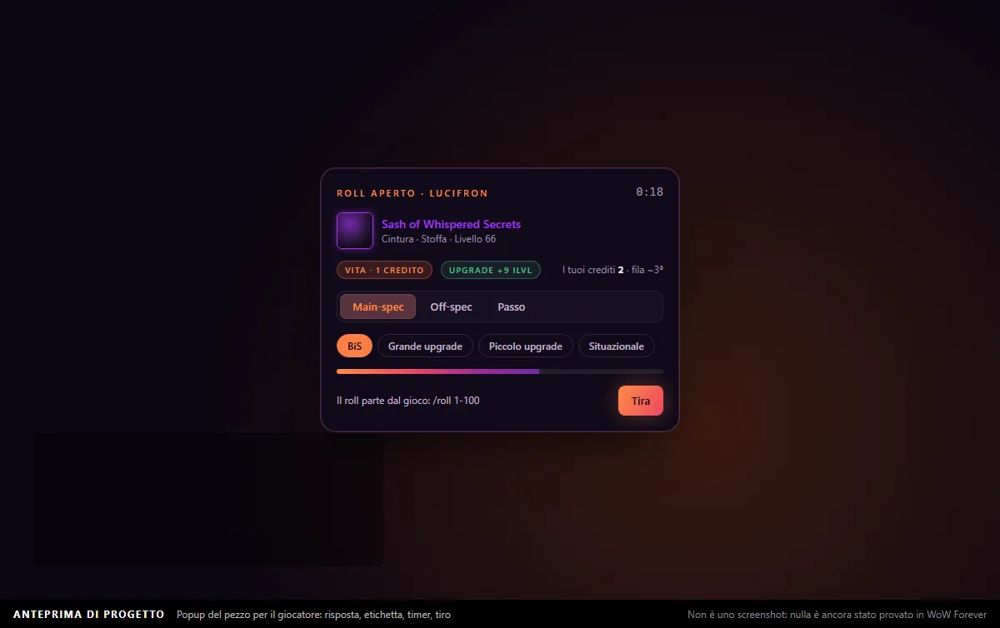

# Rollare per il loot

> **Costruito, non ancora visto in gioco.** Il popup funziona nei test offline con un raid simulato; come appare in un raid vero, il tooltip del pezzo con il confronto, il roll dai pulsanti e il badge di upgrade sui pezzi veri del raid sono ancora da confermare in gioco. [English](Rolling-for-Loot)

Questa pagina è per **ogni raider**. Quando il master looter apre il roll di un pezzo, l'addon ti mostra una finestra piccola, il **popup del pezzo**. Scegli con **tre pulsanti**, e il popup sparisce quando il round si chiude. Non devi mai scrivere `/roll` a mano.

Ti serve l'addon attivo: solo i raider con l'addon possono rispondere e rollare, e un `/roll` scritto da chi non ce l'ha viene messo da parte (vedi [[Controllo dell'addon|Addon-Check-it]]).

## Il popup

Dall'alto in basso:

- **La riga del titolo.** *ROLL APERTO · nome del boss* (oppure *REROLL*, o *ROLL LIBERO*, vedi sotto), e a destra il **timer** in minuti e secondi. Diventa ambra negli ultimi cinque secondi e dice *In pausa* mentre il master looter mette in pausa. La crocetta nasconde la card per questo round.
- **Il pezzo.** Icona e nome nel colore della sua qualità, e sotto lo slot, il tipo (stoffa, piastre, spada a una mano...) e l'item level. **Passa sopra l'icona o il nome** per vedere il tooltip del gioco, con il confronto con quello che indossi.
- **Il chip del costo**, per esempio *ARMA · 2 CREDITI*: la categoria che la tabella della gilda ha dato al pezzo e quanto paghi se lo vinci con la risposta scelta (prima di rispondere, il costo pieno). *COUNCIL* vuol dire che il costo lo decide il council. Accanto, quando questo client conosce la tabella dei crediti della gilda, **i tuoi crediti e il tuo posto stimato in fila**: *I tuoi crediti 2 · fila ~3ª*. Il posto è "1 + i membri del raid con meno crediti"; è una stima, perché una parità la decide il roll.
- **Il badge di upgrade**, per esempio *Upgrade medio · ilvl +13*: lo calcola il tuo addon, vedi [È un upgrade?](#è-un-upgrade) sotto.
- **La barra del timer**, che si svuota col passare del tempo, e **la riga di aiuto**.
- **Tre pulsanti: Passo, Tira Main-spec, Tira Off-spec.** È tutto quello che scegli.

Il popup è una finestra a sé: **trascinalo da una card qualsiasi** per spostarlo, e trascina la maniglia sottile sul bordo destro per allargarlo. Posizione e larghezza sono ricordate per ogni personaggio.

## I tre pulsanti

- **Tira Main-spec** manda la risposta *main-spec* **e tira con lo stesso clic**: l'addon dice al master looter "questo giocatore ha cliccato", poi chiede al gioco `/roll 1-100`. Il roll è del gioco e nessuno può sceglierlo. Il pulsante poi dice *Tirato* e tutti i pulsanti si bloccano: tiri **una volta** per round, e dopo il roll la risposta non cambia più.
- **Tira Off-spec** manda la risposta *off-spec*. L'off-spec tira solo se nessuno chiede il pezzo per la propria main-spec, quindi nel primo round il clic **manda solo la risposta** e la riga di aiuto dice *Tiri solo se nessuno chiede il pezzo prima di te: premi lo stesso pulsante quando tocca a te*. Se si apre il round off-spec, compare un nuovo popup e **Tira Off-spec** tira.
- **Passo** manda un passo e non tira. Finché non hai tirato puoi ancora cambiare idea e premere un pulsante di tiro.

Se non rispondi affatto, le regole lo contano come un passo. **Non ci sono più etichetta e nota**: quanto il pezzo ti migliora lo dice l'addon al master looter.

## È un upgrade?

Il badge sotto il chip del costo ti dice come il pezzo si confronta con quello che **indossavi durante lo scontro col boss** in quello slot. Lo calcola il tuo addon; nessuno deve chiedertelo in chat, e **non cambia mai chi vince**.

| Vedi | Vuol dire |
|---|---|
| **Upgrade grande** (verde) | Lì indossi un pezzo **verde o inferiore**, o **niente** (*Upgrade grande · slot vuoto*). |
| **Upgrade medio** | Lì indossi un pezzo **blu**, o un **viola di una season precedente**. |
| **Upgrade piccolo** | Lì indossi un **viola di questa season**. |
| **Nessun upgrade** | Il pezzo è peggiore di quello che indossi (item level più basso), o dello stesso livello senza niente di meglio. |
| **Non confrontabile** | L'addon non può confrontarlo: un token, una mano sinistra mentre indossi un'arma a due mani, o un pezzo che il gioco non ha ancora caricato. |
| **Non usabile** (ambra) | La tua classe non può usarlo: tipo di armatura o di arma, doppia arma, un pezzo per altre classi o per un'altra specializzazione. |

Il badge mostra sempre anche la **differenza di item level**: *Upgrade medio · ilvl +13*. Passa sopra il badge per vedere le tue due spec, i pezzi con cui è stato confrontato, se ha usato l'equipaggiamento dello scontro, e la regola. Anelli e trinket si confrontano col peggiore dei tuoi due; un'arma a due mani con mano destra più mano sinistra. La regola completa è in [[Suggerimenti di upgrade|Upgrade-Hints-it]].

**Un pezzo che non puoi usare.** Quando l'addon è sicuro che nessuna tua spec può usarlo, **Passo è preselezionato** e la riga di aiuto lo dice. **Non parte nulla da solo**: non rispondere vale comunque come passo. Se non sei d'accordo premi un pulsante di tiro; premendo Passo il passo parte. Il Guild Master può spegnere la preselezione.

**Cosa riceve il master looter.** Ogni risposta che mandi, passo compreso, porta il badge e i pezzi che indossavi al master looter (la colonna *Upgrade* della sua tabella). Oltre al master looter lo vede solo il council (la gilda può scegliere tutti gli officer, o il solo master looter). Un **passo su un upgrade grande per la tua main spec** viene segnalato (*Upgrade ignorato*), e così un pezzo main-spec che andrebbe a chi ha un upgrade piccolo mentre tu ne hai uno grande (*Possibile spreco*): vedi la [[Guida del master looter|Master-Looter-Guide-it]], "Segnalazioni del council".

## Come va un roll

1. **Scegli.** Premi **Tira Main-spec**, **Tira Off-spec** o **Passo**. Una risposta main-spec tira subito.
2. **Aspetta.** Il round si chiude da solo allo scadere del timer, o quando tutti hanno risposto e tirato. Il popup si chiude con lui, e la finestra del master looter mostra la proposta.

### Si tira solo con i pulsanti

Di norma la gilda conta **solo i roll fatti con i pulsanti di tiro del popup**, una volta per pezzo. Un `/roll` scritto a mano **non conta**, anche con l'addon: il master looter lo vede messo da parte come *Scritto a mano: conta solo il pulsante Roll del popup*, e il tuo addon te lo dice in chat: *Usa i pulsanti di tiro del popup del loot: i roll scritti a mano non contano.* Un roll scritto a mano non ti fa perdere il turno: premi poi il pulsante di tiro e quel roll conta. Un secondo roll dopo quello contato è un doppione e non conta. Anche gli spareggi fra pari si fanno col pulsante.

Perché: il gioco non distingue un `/roll` scritto dal roll del pulsante, quindi il pulsante manda un piccolo messaggio "ho cliccato" subito prima del roll. Non porta nessun numero: il roll resta del gioco. Dopo un boss il messaggio può aspettare qualche secondo dietro il blocco della chat del gioco; l'addon del master looter lo aspetta. Il Guild Master può spegnere la regola (*I roll contano solo dal pulsante Roll del popup*, nelle regole della sessione), e allora un `/roll 1-100` scritto conta come prima.

### Chi tira e quando

- Le risposte **Main-spec** tirano nel primo round. Se nessuno risponde main-spec, il **round off-spec** si apre da solo: se hai risposto Off-spec compare un nuovo popup e **Tira Off-spec** tira; se hai risposto Main-spec o Passo non vedi nulla.
- Se due giocatori sono **pari** di crediti e tirano, si apre uno **spareggio** solo fra loro: il popup dice *REROLL*, lo vedono solo i pari, e tira il pulsante della tua risposta.
- Se nessuno voleva il pezzo e la gilda usa il **roll libero**, il popup dice *ROLL LIBERO* e chiunque può tirare con uno dei due pulsanti di tiro.

La riga di aiuto sotto la barra ti dice cosa fare ora: *Passa, oppure tira per main-spec o off-spec: un clic risponde e tira*; *Il roll parte dal gioco: /roll 1-100*; *Tiri solo se nessuno chiede il pezzo prima di te*; *Siete pari: tira ancora*; *Tirato. Il master looter ha il tuo roll*.

## Se qualcosa va storto

- *Non è stato possibile inviare la tua risposta.* L'addon non è riuscito a consegnare la risposta al canale del raid e non ha tirato nulla; premi di nuovo il pulsante.
- *Il gioco non ha lasciato tirare all'addon: scrivi subito /roll 1-100.* La risposta è partita, ma il client ha rifiutato il roll dal pulsante; premi di nuovo il pulsante o scrivi tu il comando subito: il tuo clic ha già avvisato il master looter, quindi un roll scritto entro pochi secondi (la finestra della gilda, 10 secondi di norma) conta lo stesso.
- **Hai ricaricato l'interfaccia o fatto login durante un roll.** L'addon del master looter ti rimanda il popup con la tua risposta com'era. L'equipaggiamento dello scontro col boss resta anche dopo il ricaricamento.
- **Sei entrato nel raid dopo l'apertura del roll.** Vedi il popup, ma il raid di un pezzo è fissato quando si apre il suo roll: la tua risposta non conta per quel pezzo, solo dal successivo.

## Cosa vede il master looter

La tua risposta e il tuo badge di upgrade, accanto ai tuoi crediti, nella tabella dei candidati della [[Guida del master looter|Master-Looter-Guide-it]]. Viaggiano sul canale addon del raid come ogni messaggio della sessione di loot; gli addon degli altri giocatori non li mostrano. Nessuno può rispondere a nome tuo: l'addon del master looter prende il giocatore dal mittente del messaggio, mai da quello che il messaggio dice.
