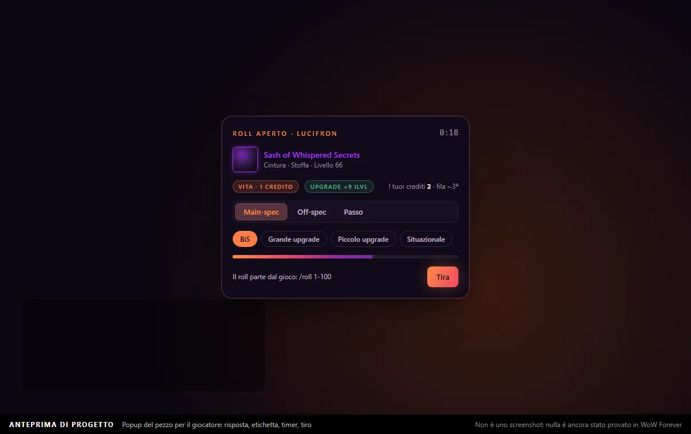

# Rolling for Loot

> **Built, not yet seen in the game.** The popup works in the offline tests with a simulated raid; how it looks in a real raid, the item tooltip with the comparison and the roll from the button are still to be confirmed. [Italiano](Rolling-for-Loot-it)

This page is for **every raider**. When the master looter opens the roll of an item, the addon shows you a small window, the **item popup**. You answer in it, you roll from it, and it goes away when the round closes. You never have to type `/roll` yourself.

You need the addon active: only raiders with the addon can answer and roll, and a `/roll` typed by a player without it is set aside (see [[Addon Check|Addon-Check]]).

## The popup

From top to bottom:

- **The title line.** *ROLL OPEN · boss name* (or *REROLL*, or *FREE ROLL*, see below), and on the right the **timer** in minutes and seconds. It turns amber in the last five seconds and says *Paused* while the master looter pauses. The small cross hides the card for this round.
- **The item.** Its icon and name in the colour of its quality, and under it the slot, the kind (cloth, plate, one-handed sword...) and the item level. **Hover the icon or the name** to see the game's own tooltip for the item, with the comparison with what you wear.
- **The cost chip**, for example *WEAPON · 2 CREDITS*: the category the guild's table gave the item and what you pay if you win it with the answer you have chosen (before you answer, the full cost). *COUNCIL* means the cost is set by the council. Next to it, when this client knows the guild's credits table, **your credits and your estimated place in the queue**: *Your credits 2 · queue ~3*. The place is "1 + the raid members with fewer credits"; it is an estimate, because a tie is decided by the roll.
- **Your answer:** **Main-spec**, **Off-spec** or **Pass**. Click one and it is sent at once. You can change your mind until you roll.
- **A label, optional**, for a main-spec answer: **BiS**, **Big upgrade**, **Small upgrade** or **Situational**. Click one to set it, click it again to clear it. It only informs the master looter and the council; it never changes who wins. If you click a label before answering, it answers main-spec for you. Off-spec and Pass carry no label.
- **A note, optional.** Up to 80 characters (a few words fewer if you use accents). It is sent when you leave the box, press Enter, or press **Roll**.
- **The timer bar**, which empties as the time runs out.
- **The line of help** and the **Roll** button.

The popup is a window of its own: **drag it by any card** to move it, and drag the thin handle on its right edge to make it wider. The place and the width are remembered for each character.

## How a roll goes

1. **Answer.** Pick Main-spec, Off-spec or Pass (and a label or a note if you want).
2. **Roll.** Press **Roll**: the addon asks the game for `/roll 1-100`, exactly as if you had typed it. The roll is the game's and nobody can choose it. The button then says *Rolled*, and your answer is locked: after you roll you can no longer change it. You roll **once** per round; a second roll is not counted.
3. **Wait.** The round closes by itself on its timer, or when everyone has answered and rolled. The popup closes with it, and the master looter's window shows the proposal.

**Pass** needs no roll. If you do not answer at all, the rules treat it as a pass.

### Who rolls when

- **Main-spec** answers roll in the first round. If nobody answers main-spec, the **off-spec round** opens by itself: if you answered Off-spec, a new popup appears with just **Roll**; if you answered Main-spec or Pass you see nothing.
- If two players are **tied** on credits and roll, a **reroll** opens among them only: the popup says *REROLL* and only the tied see it.
- If nobody wanted the item and the guild uses a **free roll**, the popup says *FREE ROLL* and anyone may roll.

The line of help under the bar tells you what to do now: *Choose your response, then roll*; *The game makes the roll: /roll 1-100*; *You roll only if nobody asks for the item before you* (you answered a lower tier); *You are tied: roll again*; *Rolled. The master looter has your roll*.

## If something goes wrong

- *Your answer could not be sent.* The addon could not hand your answer to the raid channel; click your answer again.
- *The game did not let the addon roll: type /roll 1-100.* The client refused the roll from the button; type the command yourself, it counts the same.
- **You reloaded the interface or logged in during a roll.** The master looter's addon sends your popup back with your answer, label and note as they were.
- **You joined the raid after the roll opened.** You see the popup, but the raid of an item is fixed when its roll opens: your answer is not counted for that item, only from the next one.

## What the master looter sees

Your answer, label and note, next to your credits, in the candidates table of the [[Master Looter Guide|Master-Looter-Guide]]. They travel on the raid's addon channel like every message of the loot session; other players' addons do not show them. Nobody can answer in your name: the master looter's addon takes the player from the sender of the message, never from what the message says.

The popup does not yet say whether the item is an upgrade for you: that hint arrives in a later version.
