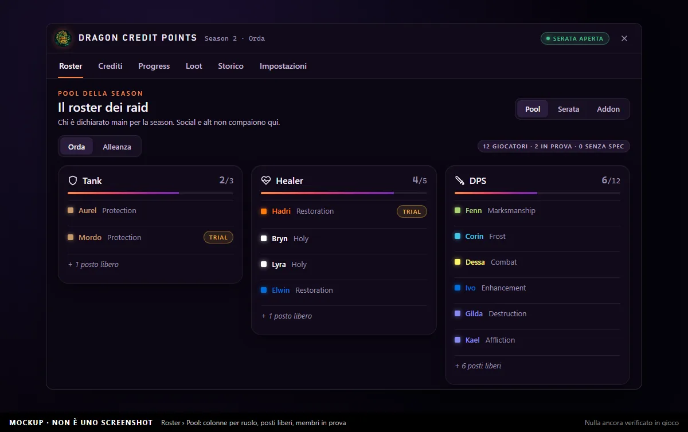
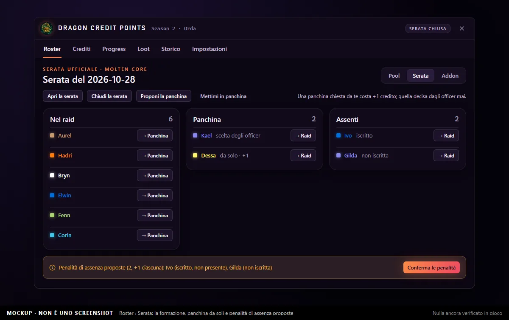

# Roster e Serate

> **Costruito, non ancora visto in gioco.** Le finestre funzionano nei test offline con un client simulato; come appaiono e come si usano nel gioco vero è ancora da confermare. [English](Roster-and-Nights)

La scheda **Roster** ha tre sotto-schede: **Pool**, **Serata** e **Addon** ([[Controllo dell'addon|Addon-Check-it]]). L'aspetto segue la pagina roster del sito della community.

## Pool

*Mockup, non uno screenshot del gioco.*

I raider della season, come sul sito: una card per **Tank**, **Healer** e **DPS**.

- Il titolo dice la fazione della tua gilda (**Orda** o **Alleanza**). Nel gioco le due fazioni sono due gilde diverse (Nebulah e Nebulaa), ognuna con i propri dati, quindi non c'è un selettore di fazione: vedi il pool della tua gilda.
- Ogni card mostra il conteggio contro l'obiettivo, per esempio **1/2**, una barra sottile a gradiente e "N posti liberi" finché il ruolo non è pieno. Gli obiettivi vengono dalla dimensione del raid del pacchetto della season e dal minimo di tank e healer della gilda; gli altri posti sono per i danni.
- Ogni riga ha un quadratino nel colore della classe, il nome (con `+2` se il giocatore ha due alt), la spec principale dichiarata e il marchio **PROVA** per i membri in prova. Una card lunga si scorre con la rotellina.
- Sotto il titolo una riga conta i giocatori, quelli in prova e quelli che non hanno dichiarato la spec.

### Entrare nel roster (ogni giocatore)

I pulsanti in alto a destra dipendono da dove sei nella season aperta:

- **Entra nel roster** quando non sei nel pool. Si apre un piccolo modulo: la classe viene dal gioco; scegli la **spec principale (MS1)** (obbligatoria) e, se vuoi, la **seconda spec (MS2)**, la **spec che vorresti (OS)**, i **giorni in cui puoi raidare** e una **nota breve**. **Invia** manda la richiesta agli officer della gilda.
- **Collega come alt** quando questo personaggio è un alt: scegli il tuo main dalla lista e **Invia**. Un alt non ha crediti propri: usa quelli del main.
- **Dichiara le spec** quando un officer ti ha aggiunto senza dichiarazione (per esempio con **Aggiungi il raid**): lo stesso modulo, e un officer la approva.

Sotto i pulsanti una riga segue la tua richiesta: *in attesa di invio* (per esempio durante il blocco della chat), *inviata, in attesa di un officer*, *ricevuta da un officer, in attesa*, *approvata* o *rifiutata*. Se nessun officer era online, l'addon rimanda la richiesta una volta dopo il tuo prossimo accesso. Puoi mandare una nuova richiesta dopo 30 secondi; sostituisce quella in attesa.

Una volta approvata, la dichiarazione resta fissa per la season: per cambiarla poi, chiedi a un officer.

### Officer

Chi ha il permesso *gestire il roster* (gli officer, di default) vede anche:

- **Metti in prova / Rendi raider** su ogni riga: cambia lo stato del membro. Il cambio è scritto nel registro e annotato come ogni altro.
- **Richieste da approvare**: le dichiarazioni per entrare nel pool e i collegamenti di alt che i giocatori chiedono. **Approva** scrive il membro (con i crediti da nuovo arrivato delle regole della gilda) o il collegamento; **Rifiuta** scarta la richiesta. Il giocatore vede la decisione e la richiesta sparisce anche dalle liste degli altri officer.
- **Aggiungi giocatore**: una lista dei personaggi del gruppo raid e della gilda che non sono nel pool (prima il raid, con la classe letta dal gioco). Scegline uno, compila MS1 (e MS2, OS, giorni, nota se li conosci), premi **Aggiungi al roster** e conferma: la finestra mostra i crediti con cui parte il giocatore (la regola dei ritardatari della gilda).
- **Aggiungi il raid**: aggiunge in un colpo ogni membro di gilda del tuo raid che non è ancora nel pool, dopo una conferma che li elenca. Entrano **senza dichiarazione** (solo la classe), con i crediti da nuovo arrivato; poi ognuno manda **Dichiara le spec** dalla propria finestra e tu la approvi. I giocatori fuori dalla gilda non vengono mai aggiunti.
- Sotto le richieste, la riga **Senza dichiarazione** elenca i membri che devono ancora dichiarare.

I membri vedono il pool ma nessun pulsante da officer e nessuna richiesta. Sul client di un membro, che non tiene un registro proprio, il Pool mostra i pulsanti per entrare e rimanda alla scheda **Crediti**, che mostra la tabella degli officer.

## Serata

*Mockup, non uno screenshot del gioco.*

La serata di raid ufficiale.

- **Apri la serata** (chi ha il permesso *condurre la serata*, gli officer di default): scegli l'istanza del pacchetto della season e la difficoltà, poi apri. Se sei dentro l'istanza è già selezionata. La formazione si legge subito dal gruppo raid.
- **Chiudi la serata** a raid finito.
- La **formazione** ha tre colonne: **Nel raid**, **Panchina** e **Assenti**. Il pulsante di ogni riga sposta un giocatore: un raider in panchina, uno in panchina di nuovo nel raid, un assente nel raid. Solo l'officer che ha aperto la serata o il suo master looter registra i cambi del gruppo raid; i client degli altri li lasciano stare.
- **Proponi la panchina** chiede alla rotazione chi deve restare fuori (prima chi ha meno panchine nella season, nel rispetto delle disponibilità dichiarate e del calendario e del minimo di tank e healer). Non si scrive nulla finché il master looter non preme **Applica la panchina** (a serata già aperta) o apre la serata con la proposta.
- **Mettimi in panchina** (ogni giocatore, M7-5b): stasera resti fuori di tua iniziativa. Sul client dell'officer che guida la serata si scrive subito; da chiunque altro la richiesta va all'addon di quell'officer, che la scrive come panchina volontaria. Una panchina volontaria **costa +1 credito** (vedi [[Regole del loot|Loot-Rules-it]], Assenze); una panchina decisa dagli officer mai. Per rientrare chiedi al master looter di spostarti nel raid.
- **Penalità di assenza (officer)**: dopo **Chiudi la serata** la scheda elenca le penalità proposte, per esempio *Penalità di assenza proposte (2, +1 ciascuna): Dara (iscritto, non presente), Edda (non iscritto)*, e **Conferma le penalità** le scrive con un clic (+1 credito ciascuna, motivo *Assenza da una serata ufficiale*). Prima del clic non si scrive nulla, a meno che il Guild Master non abbia acceso la scrittura automatica. Una penalità si annulla come ogni correzione.
- **Presenze (solo ufficiali)**: una tabella con, per ogni giocatore, le serate giocate, quelle solo in panchina, i boss visti sui possibili e la percentuale. Un clic su un'intestazione ordina. I membri non vedono mai questa tabella, come ha deciso la gilda.

Ogni rifiuto dice il perché nella finestra: un rango troppo basso, nessuna season aperta, un'istanza che non è un raid ufficiale della season, una serata già aperta, e così via.
