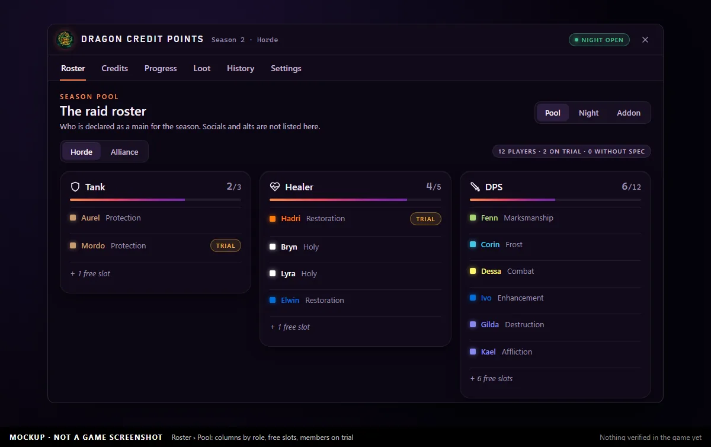
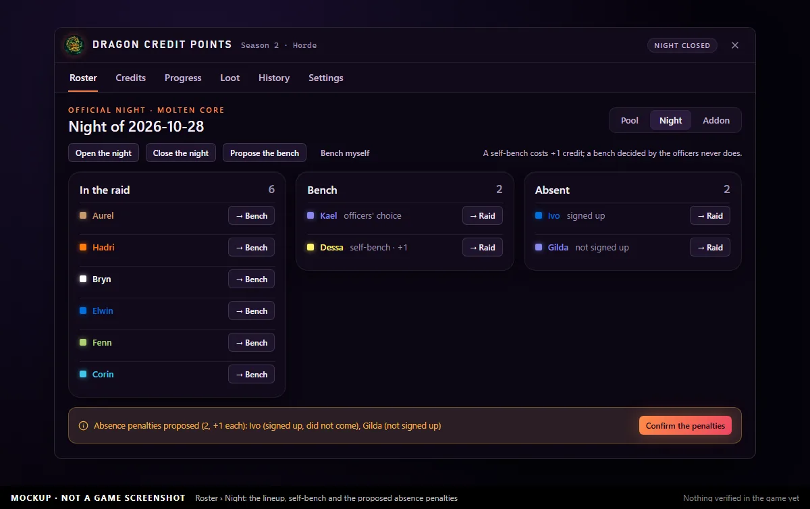

# Roster and Nights

> **Built, not yet seen in the game.** The windows work in the offline tests with a simulated client; how they look and feel in the real game is still to be confirmed. [Italiano](Roster-and-Nights-it)

The **Roster** tab has three sub-tabs: **Pool**, **Night** and **Addon** ([[Addon Check|Addon-Check]]). The look follows the community site's roster page.

## Pool

*Mockup, not an in-game screenshot.*

The raiders of the season, as on the site: one card each for **Tank**, **Healer** and **DPS**.

- The title names your guild's faction (**Horde** or **Alliance**). In the game the two factions are two different guilds (Nebulah and Nebulaa), each with its own data, so there is no faction switch: you see your own guild's pool.
- Each card shows the count against the target, for example **1/2**, a thin gradient bar, and "N free slots" while the role is not full. The targets come from the raid size of the season's pack and the guild's minimum of tanks and healers; the rest of the slots are damage dealers.
- Each row has a square in the class colour, the name (with `+2` when the player has two alts), the declared main spec and a **TRIAL** mark for members on trial. Scroll a long card with the mouse wheel.
- Under the title, a line counts the players, the ones on trial and the ones who have not declared a spec.

### Joining the roster (every player)

The buttons at the top right depend on where you stand in the open season:

- **Join the roster** when you are not in the pool. A small form opens: your class comes from the game; pick your **main spec (MS1)** (required), and if you like a **second spec (MS2)**, the **spec you would like (OS)**, the **days you can raid** and a **short note**. **Send** sends the request to the guild's officers.
- **Link as alt** when this character is an alt: pick your main from the list and **Send**. An alt has no credits of its own; it uses its main's.
- **Declare your specs** when an officer added you without a declaration (for example with **Add the raid group**): the same form, and an officer approves it.

Under the buttons a line follows your request: *waiting to be sent* (a chat lockdown, for example), *sent, waiting for an officer*, *received by an officer, pending*, *approved* or *rejected*. If no officer was online, the addon sends the request again once after your next login. You can send a new request after 30 seconds; it replaces your pending one.

Your declaration is fixed for the season once approved: to change it later, ask an officer.

### Officers

Anyone with the permission *manage the roster* (officers by default) also sees:

- **Make Trial / Make Raider** on every row: changes the member's status. The change is written in the ledger and logged like every other.
- **Requests to approve**: the declarations to join the pool and the alt links that players ask for. **Approve** writes the member (with the late-joiner credits of the guild's rules) or the alt link; **Reject** drops the request. The player sees the decision, and the request leaves the other officers' lists too.
- **Add a player**: a list of the raid group's and the guild's characters who are not in the pool (the raid first, with the class read from the game). Pick one, fill MS1 (and MS2, OS, days, note if you know them), press **Add to the roster** and confirm: the window shows the credits the player starts with (the guild's late-joiner rule).
- **Add the raid group**: adds in one go every guild member of your raid who is not in the pool yet, after a confirmation that lists them. They join **without a declaration** (only the class), with the late-joiner credits; each of them then sends **Declare your specs** from their own window, and you approve it. Players from outside the guild are never added.
- Under the requests, the line **Without a declaration** lists the members who still have to declare.

Members see the pool but no officer buttons and no requests. On a member's client, which holds no ledger of its own, the Pool shows the join buttons and points to the **Credits** tab, which shows the officers' table.

## Night

*Mockup, not an in-game screenshot.*

The official raid night.

- **Open the night** (anyone with the permission *run the night*, officers by default): pick the instance of the season's pack and the difficulty, then open. When you stand inside the instance it is already selected. The lineup is read from the raid group at once.
- **Close the night** when the raid is over.
- The **lineup** has three columns: **In the raid**, **Bench** and **Absent**. The button on each row moves a player: a raider to the bench, a benched player back into the raid, an absent one into the raid. Only the officer who opened the night or its master looter records changes from the raid group; others' clients leave them alone.
- **Propose the bench** asks the rotation who should sit out (the fewest benches in the season first, the declared and calendar availability respected, the minimum of tanks and healers kept). Nothing is written until the master looter presses **Apply the bench** (when the night is already open) or opens the night with the proposal in place.
- **Bench myself** (every player, M7-5b): you sit out tonight on your own initiative. On the client of the officer running the night it is written at once; from anyone else the request goes to that officer's addon, which writes it as a self-bench. A self-bench **costs +1 credit** (see [[Loot Rules|Loot-Rules]], Absences); a bench decided by the officers never does. To come back, ask the master looter to move you into the raid.
- **Absence penalties (officers)**: after **Close the night** the tab lists the proposed penalties, for example *Absence penalties proposed (2, +1 each): Dara (signed up, did not come), Edda (not signed up)*, and **Confirm the penalties** writes them in one click (+1 credit each, reason *Absence from an official night*). Nothing is written before the click unless the Guild Master turned on the automatic writing. A penalty can be cancelled like any correction.
- **Attendance (officers only)**: a table with, for every player, the nights played, the nights only benched, the bosses attended out of those possible and the percentage. Click a header to sort. Members never see this table, as the guild decided.

Every refusal says why in the window: a rank that is too low, no season open, an instance that is not an official raid of the season, a night already open, and so on.
