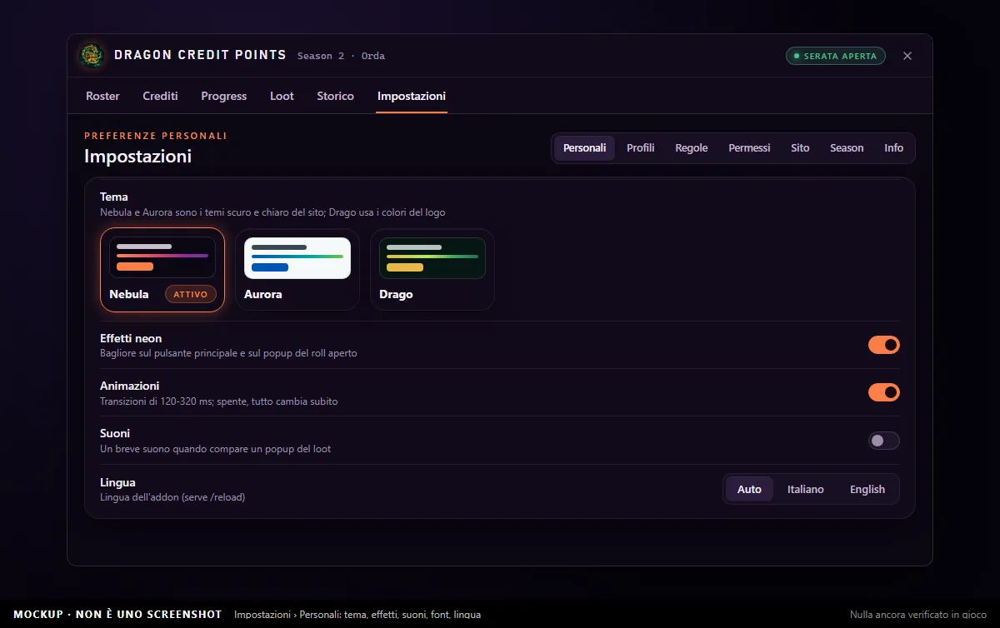
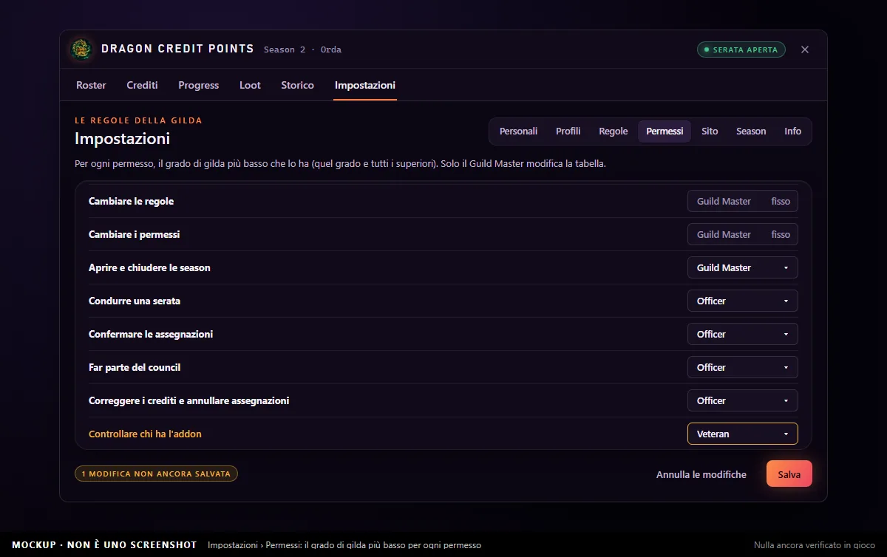

# Impostazioni

> **Costruita, non ancora vista in gioco.** La scheda funziona nei test offline con un client simulato; come appare nel gioco vero è ancora da confermare. [English](Settings)

La scheda **Impostazioni** ha sette sotto-schede: **Personali**, **Profili**, **Regole**, **Permessi**, **Sito**, **Season** e **Info** (vedi [[Crediti e info|About-it]]). Le vedono tutti. **Solo il Guild Master** (chi ha il primo rango di gilda, indice 0) può cambiare le **regole** e i **permessi** della gilda: per tutti gli altri i controlli sono spenti, il pulsante **Salva** non c'è e una nota lo dice. Le **preferenze personali** sono tue e le cambia chiunque.

L'addon ha anche una piccola voce nella finestra delle impostazioni del gioco (**Opzioni › AddOn › Finland Dragon Credit Points**): gli interruttori di effetti neon, animazioni e suoni e un pulsante che apre questa scheda.

## Personali

*Mockup, non uno screenshot del gioco.*

Solo per te: niente di qui viene condiviso con la gilda.

| Impostazione | Cosa fa |
|---|---|
| **Tema** | Nebula, Aurora o Drago, applicato subito (`/fdcp theme`). |
| **Caratteri** | Quelli dell'addon o quelli del gioco. |
| **Effetti neon** | Bagliori e ombre accesi o spenti (`/fdcp effects`). |
| **Animazioni** | Le transizioni da 120–320 ms accese o spente (`/fdcp animations`). |
| **Suoni** | Un breve suono quando compare un popup del loot. |
| **Lingua** | `automatica` (quella del gioco) o un'altra lingua; serve `/reload`. |
| **Lingua dei messaggi per tutti** | La lingua di ciò che l'addon scrive in `/raid`. |
| **Popup del loot › Rimetti al suo posto** | Riporta il popup al centro, con la larghezza di partenza. |

## Profili

I tuoi **profili** conservano le tue impostazioni (tema, caratteri, effetti, animazioni, suoni, lingue, conto alla rovescia dei roll); le regole della gilda non ci sono. Puoi averne più d'uno, per esempio uno per il raid e uno per una serata tranquilla.

| Pulsante | Cosa fa |
|---|---|
| **Usa** | Passa al profilo scelto nell'elenco (l'aspetto si ridisegna subito). |
| **Nuovo** | Crea un profilo con il nome scritto (da 1 a 32 caratteri) e passa a quello. |
| **Copia qui** | Copia le impostazioni del profilo scelto su quello in uso, dopo una conferma. |
| **Elimina** | Elimina il profilo scelto, dopo una conferma; quello in uso non si può eliminare. |
| **Ripristina** | Riporta il profilo in uso ai valori predefiniti, dopo una conferma. |

**Condividere un profilo.** *Scrivi il mio profilo* mette il profilo in uso nel riquadro come una riga che inizia con `!FDCP:PRF:`; clicca nel riquadro, premi Ctrl+A e Ctrl+C e incollala su Discord. Per usare quello di un altro, incolla la riga nel riquadro e premi **Importa**: una finestra elenca cosa cambierebbe (*Tema: nebula > aurora*) e non si scrive nulla finché non confermi. Una stringa con un valore sbagliato, di una versione più recente dell'addon o che non è un profilo viene rifiutata con un messaggio, e una chat che ha spezzato la riga non fa danni.

**Preset delle regole.** Quattro set di regole pronti: *Patto* (il regolamento della gilda), *Solo roll*, *Loot council puro* ed *EPGP semplice*; quello uguale alle regole in vigore è segnato *in vigore*. Sceglilo per vedere quante regole cambierebbe. Lo applica solo il **Guild Master**: una finestra elenca le prime modifiche e il preset si scrive come ogni altra modifica delle regole (un evento del registro che tiene il nome del preset, visibile in **Storico › Audit**; con una season aperta tiene anche la tua conferma). I valori propri della gilda, i nomi del council e la chiave del sito, non si toccano. Dopo puoi ancora modificare ogni regola nella scheda **Regole**. Le regole intere possono anche viaggiare come stringa, vedi [[Backup e season|Backup-and-Seasons-it]].

## Regole

A sinistra l'elenco delle pagine, a destra i campi della pagina su una card:

- **Serata e sessione**: se una serata deve aprirla un ufficiale, chi conferma un'assegnazione (il master looter, in automatico dopo una pausa, o il council), i passi automatici, i secondi di un giro di roll.
- **Priorità**: chi ha la precedenza (meno crediti, meno crediti per serata, roll più alto), gli spareggi, i reroll di fila, se l'addon è necessario, se la risposta off-spec è ammessa, cosa succede a un pezzo che nessuno vuole o a un BoE.
- **Costi**: il costo di ogni categoria e qualità, in una griglia (*Council* nella colonna dei leggendari vuol dire che il costo lo decide il council; scrivi la parola per rimetterlo).
- **Moltiplicatori**: il fattore sul costo di ogni risposta, della dimensione del raid e della difficoltà.
- **Membri e crediti**: solo i main, da dove partono i nuovi arrivati (meno crediti del gruppo nel preset della gilda, media, mediana, zero, fisso), l'arrotondamento, i crediti con cui parte una season e la **penalità di assenza** (crediti aggiunti per una serata saltata, 1 nel preset, 0 la spegne) con l'interruttore che la scrive alla chiusura senza la conferma di un officer (spento nel preset).
- **Loot council**: se i membri devono essere nel raid, il voto, le segnalazioni per le richieste dispendiose, chi vede i badge di upgrade e l'elenco dei nomi del council (vuoto: chi ha il rango).
- **Leggendari e panchina**: come si assegna un leggendario, il costo di un pezzo della catena e cosa guadagna la panchina.
- **Messaggi in /raid**: il testo dell'avviso per chi non ha l'addon e delle righe di pezzo e risultato (segnaposto `{names}`, `{link}`, `{addon}`).
- **Preparazione del raid**: gli incantamenti e i consumabili che il controllo di preparazione chiede: un interruttore per slot, il minimo di ogni consumabile (0 = non richiesto), a chi servono acqua, munizioni e cibo del pet, e il testo dell'avviso e dei sussurri ([[Preparazione del raid|Raid-Readiness-it]]).
- **Badge di upgrade**: se il popup mostra il badge di upgrade, e se un pezzo che il giocatore non può usare arriva con Passo preselezionato. Il badge segue una regola fissa ([[Suggerimenti di upgrade|Upgrade-Hints-it]]); la fascia di item level della season che usa si imposta in **Season** ([[Season|Seasons-it]]).

L'etichetta di una risposta main-spec con la sua regola (M7-2b), i pesi delle statistiche personali e la wishlist non ci sono più: il popup ha tre pulsanti e il badge di upgrade lo calcola l'addon. Le regole scritte prima continuano a funzionare: le impostazioni tolte si ignorano.

Tutti vedono i valori. Il Guild Master li modifica: un'etichetta diventa ambra finché il suo valore è diverso dalle regole in vigore, e la riga in basso conta le modifiche non ancora salvate. Un numero non valido è segnato subito e non arriva mai alla bozza. **Salva** controlla l'intera configurazione (se qualcosa non va apre la pagina e nomina il campo), poi scrive **una** modifica nel registro della gilda; **Annulla modifiche** riporta il modulo alle regole in vigore.

**Con una season aperta** Salva chiede prima la tua conferma esplicita: una finestra elenca le modifiche, e la modifica resta nel registro con il tuo nome e la conferma, così gli ufficiali la vedono in **Storico › Audit** (*Impostazioni*). Non viene scritto nulla finché non premi **Conferma e salva**.

Una modifica è un evento firmato del registro, non un'impostazione del tuo gioco: nessun altro giocatore può farne una in nessun modo. L'addon la rifiuta quando glielo chiedi, e gli addon del resto della gilda la rifiutano se mai arrivasse da chi non era il Guild Master quando è stata scritta.

## Permessi

*Mockup, non uno screenshot del gioco.*

La tabella di **chi può fare cosa**, per rango di gilda: per ogni permesso, il **rango più basso** che lo ha (lo ha quel rango e tutti quelli sopra). I ranghi sono quelli della gilda, per posizione, quindi rinominare un rango non cambia nulla. *Cambiare le regole* e *Cambiare i permessi* sono fissi sul Guild Master. Come le regole, la tabella la modifica solo il Guild Master, e con una season aperta una modifica chiede la stessa conferma.

Se la gilda **riordina, aggiunge o toglie ranghi**, il Guild Master vede un avviso in cima alla scheda (e in chat, a ogni accesso finché non lo chiude) con i permessi che ora puntano a un rango che non esiste; premi **Ho controllato la tabella** quando è a posto.

## Sito

La chiave della gilda sul sito della community (vuoto: la tua fazione), usata dai file dell'[[Esportazione per il sito|Site-Export-it]]. È una regola come le altre: la vedono tutti, la modifica il Guild Master.

## Season

La pagina della season ([[Season|Seasons-it]]).
