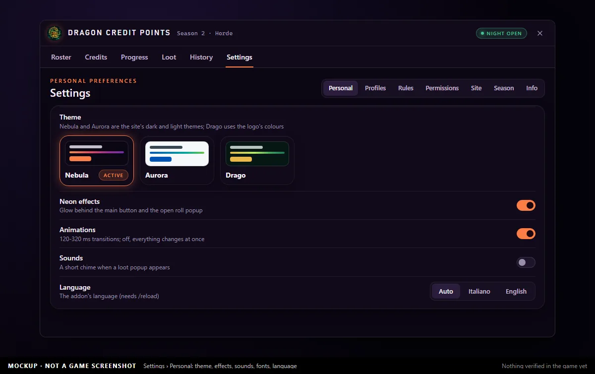
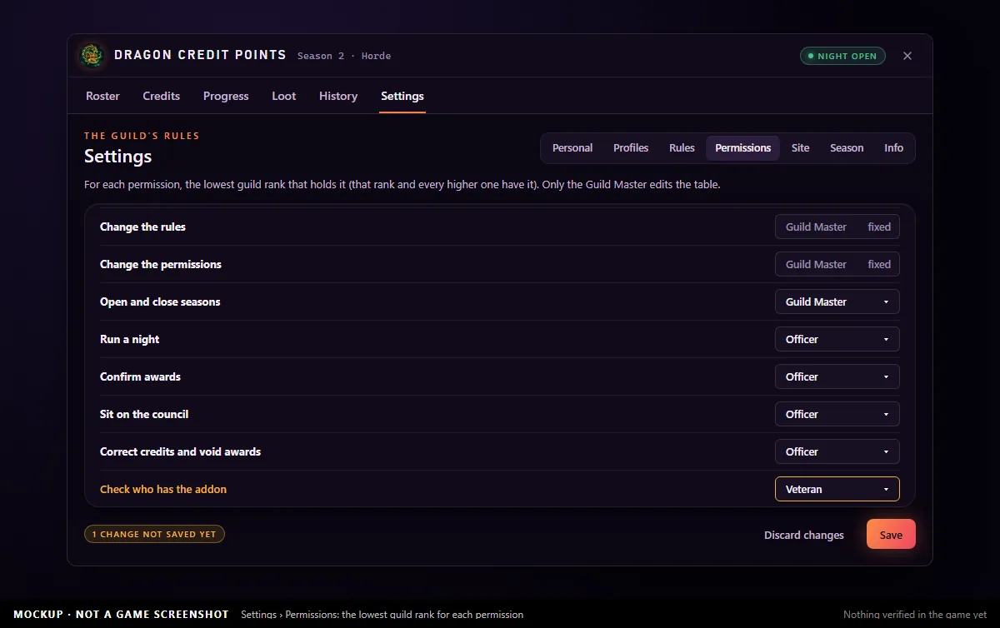

# Settings

> **Built, not yet seen in the game.** The tab works in the offline tests with a simulated client; how it looks in the real game is still to be confirmed. [Italiano](Settings-it)

The **Settings** tab has seven sub-tabs: **Personal**, **Profiles**, **Rules**, **Permissions**, **Site**, **Season** and **Info** (see [[About|About]]). Everybody sees all of them. **Only the Guild Master** (the player with the first guild rank, rank index 0) can change the guild's **rules** and **permissions**: for everybody else the controls are off, the **Save** button is not there and a note says so. Your **personal** preferences are yours and anybody can change them.

The addon also has a small entry in the game's own settings window (**Options › AddOns › Finland Dragon Credit Points**): the neon effects, animations and sounds switches and a button that opens this tab.

## Personal

*Mockup, not an in-game screenshot.*

Only for you: nothing here is shared with the guild.

| Setting | What it does |
|---|---|
| **Theme** | Nebula, Aurora or Drago, applied at once (`/fdcp theme`). |
| **Fonts** | The addon's own fonts, or the game's. |
| **Neon effects** | Glows and shadows on or off (`/fdcp effects`). |
| **Animations** | The 120–320 ms transitions on or off (`/fdcp animations`). |
| **Sounds** | A short chime when a loot popup appears. |
| **Language** | `auto` (the game's) or another language; it needs `/reload`. |
| **Language of messages for everyone** | The language of what the addon writes in `/raid`. |
| **Loot popup › Reset position** | Puts the popup back at the centre, at its starting width. |

## Profiles

Your **profiles** keep your own settings (theme, fonts, effects, animations, sounds, languages, roll countdown); the guild's rules are not in them. You can have several, for example one for raiding and one for a quiet evening.

| Button | What it does |
|---|---|
| **Use** | Switches to the profile picked in the list (the look is redrawn at once). |
| **New** | Creates a profile with the name you typed (1 to 32 characters) and switches to it. |
| **Copy here** | Copies the picked profile's settings over the one in use, after a confirmation. |
| **Delete** | Deletes the picked profile, after a confirmation; the one in use cannot be deleted. |
| **Reset** | Puts the profile in use back to the defaults, after a confirmation. |

**Share a profile.** *Write my profile* puts the profile in use in the box as one line starting with `!FDCP:PRF:`; click the box, press Ctrl+A and Ctrl+C and paste it on Discord. To use somebody else's, paste the line in the box and press **Import**: a dialog lists what would change (*Theme: nebula > aurora*) and nothing is written until you confirm. A string with a wrong value, from a newer version of the addon or that is not a profile is refused with a message, and a chat window that wrapped the line does no harm.

**Presets of the rules.** Four ready-made rule sets: *Patto* (the guild's regulation), *Roll only*, *Pure loot council* and *Simple EPGP*; the one equal to the rules in force is marked *in force*. Pick one to see how many rules it would change. Only the **Guild Master** can apply it: a dialog lists the first changes, and the preset is written like any other change of the rules (one ledger event that keeps the preset's name, visible in **History › Audit**; with a season open it also keeps your confirmation). The guild's own values, the council's names and the site key, are not touched. You can still edit any rule afterwards on the **Rules** tab. The whole rules can also travel as a string, see [[Backup and Seasons|Backup-and-Seasons]].

## Rules

A list of pages on the left, the fields of the page on a card:

- **Night and session**: whether an officer must open the night, who confirms an award (the master looter, automatic after a pause, or the council), the automatic steps, the seconds of a roll round.
- **Priority**: who goes first (fewest credits, fewest credits per night, highest roll), the tie-breaks, the rerolls in a row, whether the addon is required, whether the off-spec answer is allowed, what happens to an item nobody wants or a BoE.
- **Costs**: the cost of each category and quality, in a grid (*Council* in the legendary column means the council sets the cost; type the word to put it back).
- **Multipliers**: the cost factor of each response, of the raid size and of the difficulty.
- **Members and credits**: main characters only, how late joiners start (fewest credits of the pool in the guild's preset, average, median, zero, fixed), the rounding, the credits a season starts with, and the **absence penalty** (credits added for a missed night, 1 in the preset, 0 turns it off) with the switch that writes it at the close without an officer's confirmation (off in the preset).
- **Loot council**: whether its members must be in the raid, the vote, the flags for wasteful requests, who sees the upgrade badges, and the list of council names (empty: whoever has the rank).
- **Legendaries and bench**: how a legendary is awarded, the cost of a chain piece, and what the bench earns.
- **Messages in /raid**: the wording of the notice for players without the addon and of the item and result lines (placeholders `{names}`, `{link}`, `{addon}`).
- **Upgrade badge**: whether the popup shows the upgrade badge, and whether an item the player cannot use comes with Pass preselected. The badge itself follows a fixed rule ([[Upgrade Hints|Upgrade-Hints]]); the season's item-level band it uses is set in **Season** ([[Seasons|Seasons]]).

The label of a main-spec response and its rule (M7-2b) and the personal stat weights and wishlist are gone: the popup has three buttons and the addon computes the upgrade badge. Rules written before keep working: the retired settings are ignored.

Everyone sees the values. The Guild Master edits them: a label turns amber while its value differs from the rules in force, and the line at the bottom counts the changes not saved yet. A number that is not valid is marked at once and never reaches the draft. **Save** checks the whole configuration (if something is not valid it opens the page and names the field), then writes **one** change to the guild's ledger; **Discard changes** brings the form back to the rules in force.

**With a season open** Save first asks for your explicit confirmation: a dialog lists the changes, and the change is kept in the ledger with your name and the confirmation, so the officers can see it in **History › Audit** (*Settings*). Nothing is written until you click **Confirm and save**.

A change is a signed event of the ledger, not a setting of your game: another player cannot make one by any means. The addon refuses it when you ask, and the rest of the guild's addons refuse it if it ever arrives from someone who was not the Guild Master when it was written.

## Permissions

*Mockup, not an in-game screenshot.*

The table of **who may do what**, by guild rank: for each permission, the **lowest rank** that holds it (that rank and every higher one have it). The ranks are the guild's own, by position, so renaming a rank changes nothing. *Change the rules* and *Change the permissions* are fixed at the Guild Master. Like the rules, only the Guild Master edits the table, and a change with a season open asks for the same confirmation.

If the guild **reorders, adds or removes ranks**, the Guild Master sees a notice at the top of the tab (and in chat, at every login until it is closed) with the permissions that now point to a rank that does not exist; click **I have checked the table** once it is right.

## Site

The guild's key on the community site (empty: your faction), used by the files of [[Site Export|Site-Export]]. It is a rule like the others: everybody sees it, the Guild Master edits it.

## Season

The season's page ([[Seasons|Seasons]]).
